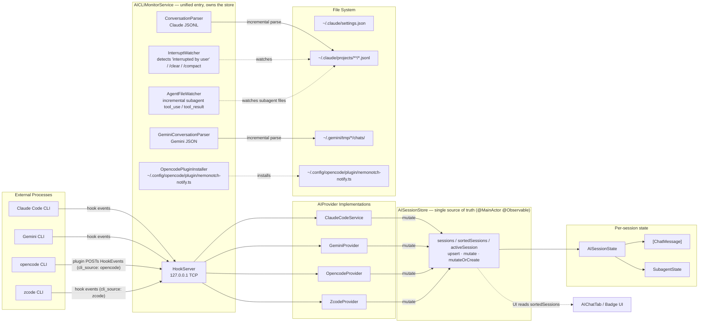
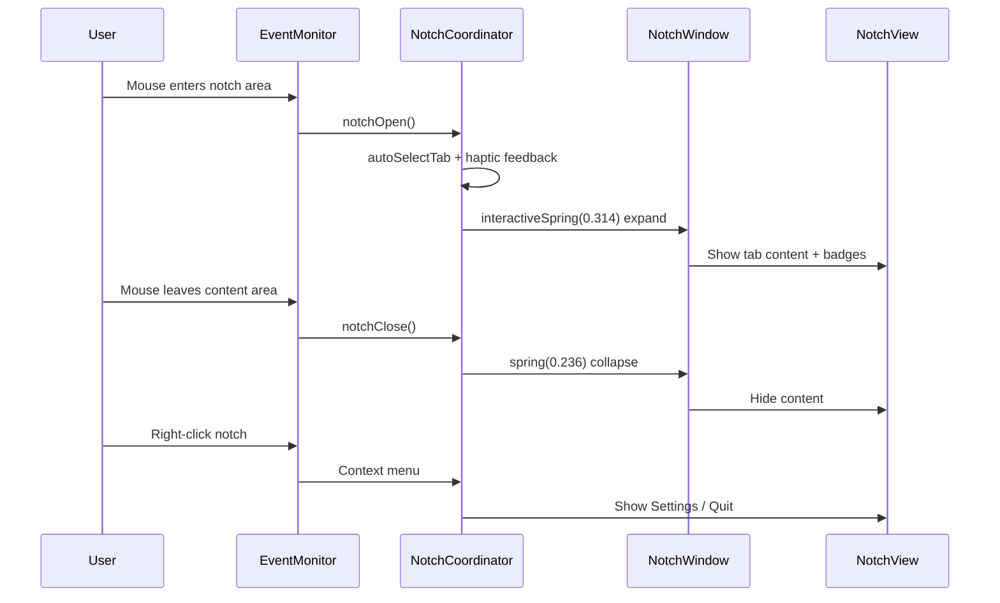

# NemoNotch — AGENTS.md

## Project Overview

NemoNotch is a macOS notch utility that provides an interactive floating panel in the MacBook notch area, integrating media controls, calendar events, AI CLI monitoring (Claude Code / Gemini CLI / opencode / zcode), multi-agent monitoring (OpenClaw / Hermes-agent), and an app launcher.

### Tech Stack

- Swift 6 + SwiftUI, macOS only, depends on CocoaLumberjack, KeyboardShortcuts, mediaremote-adapter (perl-bridge media control)
- Key frameworks: AppKit (NSWindow), MediaPlayer, EventKit, IOKit

### Project Structure

```
NemoNotch/
├── NemoNotchApp.swift           # Entry point, MenuBarExtra, global hotkeys, service assembly
├── Models/                      # Data models (Tab, AppSettings, AIProvider, PlaybackState, MultiAgentMonitor, etc.)
├── Notch/                       # Notch UI core (window, animation, event monitoring, TabBar, HUD)
├── Tabs/                        # Tab content views (AIChatTab renders AI sessions AND OpenClaw/Hermes agents in one merged list)
├── Services/                    # Background services (media, calendar, AI CLI, launcher, HermesService, etc.)
├── Settings/                    # Settings UI
├── PermissionFlow/              # Drag-to-authorize guide for System Settings privacy panes
└── Helpers/                     # Utilities (MarkdownRenderer, ClaudeCrabIcon, ToolStyles)
```

## Architecture

### Overview

```mermaid
graph TB
    subgraph Entry["App Entry"]
        App["NemoNotchApp<br/>@main"]
        AD["AppDelegate<br/>Lifecycle only"]
        DEPD["AppDependencies<br/>Composition root (build, notchContent)"]
    end

    subgraph Services["Service Layer — all @Observable"]
        MS["MediaService<br/>MediaRemote (notifications) + NowPlayingCLI (read) + MediaRemoteCommander (control)"]
        AIM["AICLIMonitorService<br/>Unified AI entry + owns AISessionStore"]
        AISS["AISessionStore<br/>Central AI session truth source (@Observable)"]
        CCS["ClaudeCodeService<br/>AIProvider impl<br/>HookServer + ConversationParser"]
        GP["GeminiProvider<br/>AIProvider impl<br/>GeminiConversationParser"]
        REG["AgentMonitorRegistry<br/>Unifies agent monitors"]
        OCS["OpenClawService<br/>WebSocket client (MultiAgentMonitor)"]
        HES["HermesService<br/>HTTP API client (MultiAgentMonitor)"]
        CS["CalendarService<br/>EventKit"]
        LS["LauncherService<br/>App search & launch"]
        NS["NotificationService<br/>Dock Accessibility API"]
        WS["WeatherService<br/>Open-Meteo primary + wttr.in fallback"]
        UQS["UsageQuotaService<br/>Claude + Codex + Gemini usage quota"]
        HUD["HUDService<br/>Volume/Brightness/Battery + charging notch capsule"]
        KAS["KeepAwakeService<br/>pmset -a disablesleep via osascript admin auth<br/>owns LidMonitor (clamshell → display off)"]
        SYS["SystemService<br/>CPU/memory/disk sampling (SystemTab)"]
        TS["TaskStore<br/>Persistent TODO list (~/.NemoNotch/tasks.json)"]
        PHS["PomodoroHistoryStore<br/>Append-only history (~/.NemoNotch/pomodoro-history.json)"]
        PTS["PomodoroTimerService<br/>State machine + tick + end-alert pipeline"]
        NPM["NotificationPermissionMonitor<br/>UNUserNotificationCenter probe"]
        HK["Hotkeys.swift<br/>KeyboardShortcuts registration (AppDelegate.setupHotkeys)"]
        CFS["CompletionFlashService<br/>Observes AISessionStore + AgentMonitorRegistry<br/>throttle/merge → drives flash + toast"]
        BTS["BluetoothService<br/>IOBluetooth audio connect/disconnect → notch capsule"]
        CDM["CalendarDueMonitor<br/>10s tick → due calendar events → unified flash"]
        CGL["CrashGuard<br/>fatal-signal self-restart (loop-guarded)"]
    end

    subgraph NotchUI["Notch UI Layer"]
        NC["NotchCoordinator<br/>Open/close state & animation"]
        NW["NotchWindow<br/>NSPanel .statusBar+8"]
        NV["NotchView<br/>SwiftUI main view"]
        EM["EventMonitor<br/>Mouse event listener"]
        CB["CompactBadge<br/>Collapsed icons"]
        TB["TabBarView<br/>Tab navigation"]
        HO["HUDOverlayView<br/>Volume/Brightness overlay"]
    end

    subgraph Tabs["Tabs"]
        OT["OverviewTab<br/>Media + Calendar + Weather"]
        AT["AIChatTab<br/>AI sessions + OpenClaw/Hermes agents, one merged list"]
        LT["LauncherTab"]
        PT["PomodoroTab<br/>Idle stats + TODO list + active pie"]
        ST["SystemTab"]
    end

    subgraph Settings["Settings"]
        AS["AppSettings<br/>UserDefaults persistence"]
        SW["SettingsWindow"]
        SV["SettingsView"]
    end

    App --> AD
    AD -->|"creates & owns"| Services
    AD -->|"creates"| NC
    AIM --> CCS
    AIM --> GP
    AIM -->|"owns"| AISS
    CCS -.->|"mutate"| AISS
    GP -.->|"mutate"| AISS
    REG -->|"registers"| OCS
    REG -->|"registers"| HES
    NC --> NW --> NV
    NV --> Tabs
    NV --> CB
    NV --> TB
    NV --> HO
    EM -->|"mouse events"| NC
    HK -->|"hotkeys"| NC
    AS --> SV

    Services -.->|"@Environment injection"| NV
    AS -.->|"@Environment injection"| NV
```



Core data flow: Service → @Observable property changes → SwiftUI auto-redraw → Tab content updates.

### AI Service Architecture



**AISessionStore — central session truth source:** All AI providers (Claude Code, Gemini, opencode, zcode, future DeepSeek/OpenAI) write into one `@MainActor @Observable` store (`NemoNotch/Services/AISessionStore.swift`) owned by `AICLIMonitorService`. Providers translate hook events + file-parse results into `upsert` / `mutate` / `mutateOrCreate` calls on the store; **UI reads `sortedSessions` directly and never touches a provider's internal state**. The store keeps a cached `sortedSessions` (descending by `lastEventTime`, rebuilt on every mutation) and exposes `activeSession` via a priority comparator (`waitingForApproval > processing/compacting > waitingForInput > idle > ended`, ties broken by recency). `sessions(for:)` filters by `AISource` for per-provider surfaces (e.g. a badge that only cares about Claude). Adding a provider means writing to this store — no UI or consumer changes.

**Context-window resolution:** `ModelContextWindow` (`NemoNotch/Models/ModelContextWindow.swift`) maps a model id → context-window size (tokens) for the `contextPercent` / `contextLimitDisplay` labels on `AISessionState`. `limit(for:)` is sync and called from SwiftUI computed props, so resolution is layered with no caller changes: (1) curated hardcoded `limits` table — the source of truth, never overridden, keeps the app correct offline / on a cold launch; (2) an OpenRouter-fetched overlay (`GET https://openrouter.ai/api/v1/models`, **no auth**, public catalog) keyed by normalized bare id (strip `vendor/` prefix, lowercase) — fills gaps for models the table doesn't list yet, so a new GLM/Gemini release shows a real value without a code change; (2.5, **before** the overlay) the Claude table `claudeLimits` — Claude Code's window per family-version (agent-hud-open's catalog: opus-5/4-6+ and sonnet-5/4-6 → 1M; opus-4-5 and older, sonnet-4-5/4, haiku → 200K), matched as a prefix of the bare id with dots read as dashes so dated (`-20250929`) and dot-versioned ids resolve; an unlisted Claude id is 200K, a `[1m]` suffix is 1M. Claude Code runs a model with 200K or 1M and its transcript never says which, so `limit(for:observed:)` (what `AISessionState.contextLimit` uses) upgrades a Claude session to 1M once its latest call was seen holding more than the listed window. OpenRouter's Claude windows are the API's, not Claude Code's — hence before the overlay; (3) `defaultValue`. **What counts as context:** the latest MAIN model call's prompt — Claude `input + cache_read + cache_creation`, skipping `isSidechain` lines and Claude Code's `<synthetic>` notes (both used to move the context and, for `<synthetic>`, replace `session.model` and so the window); Gemini `input` alone (its promptTokenCount already includes `cached` — adding them double-counted every cache hit). The overlay lives in a `Mutex<[String:Int]>` (`import Synchronization`), warmed by `ModelContextWindow.warm()` at launch (skipped under `UITestMode`): loads the disk cache (`~/.NemoNotch/model-context-cache.json`, TTL 3 days) instantly if fresh, else fires a background `refresh()`. Fetch failures are logged and swallowed — the curated table still resolves everything. `parse(data:)` is a pure function (tested without network). The **curated table wins over the overlay on conflict** (the catalog never silently overrides a deliberate value).

**Agent monitoring — registry pattern:** `OpenClawService` and `HermesService` both conform to `MultiAgentMonitor` and are collected by `AgentMonitorRegistry` (`NemoNotch/Services/AgentMonitorRegistry.swift`). The registry exposes unified reads — `installedMonitors`, `anyActiveAgent`, `hasAnyActiveAgent`, `activeAgents` (non-idle across all monitors, sorted by recency) — which the AI tab's merged list and the badge layer consume. There is **no separate agents tab**: `AIChatTab` merges online monitors' agents (active and idle alike, `AgentRowView` rows with per-source style, tap-to-expand message log) with AI sessions in one recency-sorted `consoleItems` list, shows `OpenClawApprovalBanner` at its top when an approval is pending, counts agents into the header summary ("OpenClaw 1 · 2 working"), and renders Hermes/OpenClaw setup cards in its empty state via `AgentMonitorRenderDecision` ("no nag" rule preserved). Hermes additionally has its own `HermesConversationParser` + `HermesHookInstaller`, mirroring Claude's parser/installer split. Adding an agent monitor is one `registry.register(...)` call.

**Usage quota:** `UsageQuotaService` exposes `quotas: [QuotaProvider: ProviderUsageQuota]` and fetches **Claude Code** (Keychain `Claude Code-credentials` / `~/.claude/.credentials.json` → `GET /api/oauth/usage`) and **Codex** (`~/.codex/auth.json` / Keychain `Codex Auth` → `GET chatgpt.com/backend-api/wham/usage` with `ChatGPT-Account-Id`) concurrently. The Codex section appears only when a Codex credential is detected (`hasCodexCredential`). Windows are normalized (session→weekly) and rendered as a card in `AIChatTab`. **Credential reads are file-first** (`~/.claude/.credentials.json` / `~/.codex/auth.json`). **Claude additionally keeps a local read-cache** (`~/.NemoNotch/claude-cred.json`, `0600`, **accessToken + expiresAt only — never the refreshToken**) written on every successful credential read (`writeClaudeCache`); `readClaudeCredential` checks it **before** the CLI file and Keychain, so the common refresh path skips the Keychain entirely and survives sleep without re-validating the ad-hoc signature's ACL trust (that trust lapses across sleep — see below — and used to force a re-authorize every wake). The cache is used only until its token expires (then re-resolved from CLI file / Keychain), and dropped on a usage-API 401 (`invalidateClaudeCache`) since a server rejection means the cached token is stale despite the clock check. When a credential lives only in the Keychain, the AI tab must never auto-prompt: the no-UI flags do **not** suppress the cross-app ACL dialog for a GUI app's `kSecReturnData` read (only attribute reads are silent). So the automatic path uses an **attributes-only probe** (`kSecReturnAttributes`) to detect presence without prompting → `CredentialStatus.needsAuthorization` renders an **Authorize** button (+ a one-line reason) in both the full card and the compact meters, matching the `PermissionCard` "never auto-prompt" pattern. `authorize(_:)` does the one interactive `kSecReturnData` read (off the main actor) that surfaces the dialog and **persists the grant keyed by the running code's cdhash** (`quota.keychainGrantedIdentity.<provider>` in UserDefaults, via `SecCodeCopySigningInformation`); a later launch does a silent gated data read **only if the cdhash still matches**. Because ad-hoc signing changes the cdhash each rebuild, a stale grant reads as not-granted → the entry path shows the button (no auto-prompt) instead of a prompting data read; a stable signature makes it truly one-time. The gated data read itself is wrapped in `SecKeychainSetUserInteractionAllowed(false)` (legacy-keychain process-wide toggle, `dlsym`-resolved, `Boolean`→`DarwinBoolean`) so that even when the cdhash gate passes but the ACL doesn't durably trust the app (user clicked "Allow" once, not "Always Allow", or a restrictive item ACL), the read **fails with `errSecInteractionNotAllowed` instead of popping the consent dialog** → button shown. Without this, the 5-min auto-refresh timer surfaces the Keychain prompt with no user click. **Forgetting the grant is gated on `errSecItemNotFound`** (item genuinely gone): a transient `errSecInteractionNotAllowed` (ACL trust lapsed across sleep on an ad-hoc build) now **keeps** the grant so a later refresh retries the silent read instead of permanently reverting to the button — combined with the local read-cache above, this is why the app no longer demands re-authorize after every sleep. The durable fix remains a stable code signature (ad-hoc cdhash can't anchor "Always Allow" across a cold re-validation). See macOS cookbook §14.3 step 4. `LifecycleAware`, 60s refresh throttle, 5-minute timer, robust `resets_at` parse, and reset-backfill from the previous fetch (ideas borrowed from `CodexBar`). **Gemini** quota (free-tier personal Google account, gated by `geminiEnabled` + `hasGeminiCredential`) uses a three-call Cloud Code flow: refresh the OAuth token (`POST oauth2.googleapis.com/token`; the client_id/secret are extracted at runtime from the installed gemini-cli's bundled JS by `GeminiOAuthClientLocator` — locate binary → resolve symlink → read `oauth2.js` / scan `bundle/*.js` — never hardcoded, so a Google key rotation can't break us; `GeminiOAuthClientLocator.resolve()` runs off the main actor since it may spawn a subprocess) → resolve the project (`:loadCodeAssist`, with a `cloudresourcemanager` fallback) → `:retrieveUserQuota`. The refreshed token is written back to `~/.gemini/oauth_creds.json` (atomic) to stay in sync with the CLI. Credentials live in that plain file — **no Keychain**, so Gemini never uses the `needsAuthorization`/Authorize path; `settings.json`'s `security.auth.selectedType` gates out api-key/vertex-ai auth. Per-model buckets collapse to the lowest remaining fraction and render as `QuotaWindow.gemini(label:)` rows (`utilization = (1 - remainingFraction) * 100`, ordered most-constrained first).

**opencode integration — plugin-based hook delivery:** [opencode](https://opencode.ai) is the third `AIProvider`, implemented by `OpencodeProvider` (`NemoNotch/Services/OpencodeProvider.swift`). Because opencode exposes a TypeScript plugin API rather than a shell-hook mechanism, NemoNotch ships its own plugin at `~/.config/opencode/plugin/nemonotch-notify.ts`, written and installed by `OpencodePluginInstaller` (`NemoNotch/Services/OpencodePluginInstaller.swift`). The plugin subscribes to opencode lifecycle hooks (`chat.message`, `tool.execute.before/after`, `permission.ask`) and the event bus (`session.idle`, `session.error`, `session.compacted`), then POSTs normalized `HookEvent` payloads — including `cli_source: "opencode"` and a `model` field — to the existing `HookServer` TCP listener (127.0.0.1 loopback). `AICLIMonitorService.routeEvent` gained an `"opencode"` case that forwards events to `OpencodeProvider`, which translates them into `upsert` / `mutate` calls on `AISessionStore` exactly as Claude and Gemini do — so badges, completion flash, toast, and the AI tab status card all light up with no further changes. **Scope: notify + live status + bar-side permission answers** (2026-10-16 — previously notify-only); still no conversation/token parsing (messages aren't forwarded) and no usage quota. The approval chain: on `permission.ask` the plugin (v3) opens a **second held POST** to the socket while returning from the hook handler immediately — opencode's own TUI dialog stays up and remains the first-class decider, first of [TUI, bar] wins. `HookServer.handlePermissionRequest` holds that connection (existing Claude machinery, keyed `session:permission-id`); an answer from the notch card / edge bar card / bubble travels back as the HTTP response body, and the plugin applies it **inside opencode through opencode's own client API** (`client.postSessionIdPermissionsPermissionId`), sending only `once`/`reject` — never a persistent rule. Timeout semantics split by `cliSource` (`HookServer.timeoutPayload`, unit-tested): Claude still fail-closes with a deny after 120s (an unanswered hook blocks the CLI forever), the opencode bridge answers with NO decision (ack) after 600s — a deny here would reject the user's tool out from under them while their TUI dialog is still up. `permission.replied`/`session.idle` abort the bridge client-side; PostToolUse and Stop clear stale holds server-side (`clearPendingPermissions`). Falls back gracefully: a plugin input without a client (unknown opencode version) skips the apply step and the TUI stays the decider. `AppSettings.opencodeEnabled` (default `true`) gates the provider; an "Install opencode hooks" menu button and a recovery card in the AI tab mirror the Claude/Gemini install flow. The Settings → AI 与 Agent page (`AIAgentsSettingsPage`, `NemoNotch/Settings/Pages/`) renders every provider as a per-provider **card** (`ProviderCard` shell + `HookCard` wrapper, shared in `NemoNotch/Settings/SettingsComponents.swift` with the `ProviderTint` brand tokens) — Claude / Gemini / opencode / zcode / Hermes / OpenClaw, each with its own brand logo in a tinted chip and install/reinstall/uninstall (OpenClaw: connect/disconnect/remove) — so opencode now has full reinstall + uninstall there, not just the menu-bar install. The card tints are window-appearance-adaptive (the Settings window follows system light/dark, unlike the dark-only `NotchTheme`). opencode's brand mark renders via `OpencodeLogoIcon` (`NemoNotch/Helpers/OpencodeLogoIcon.swift`), a tintable vector of the opencode.ai favicon, used in the badge and AI-tab source-icon slots (cf. `ClaudeCrabIcon`). **Source authority:** a foreign opencode plugin (e.g. `oh-my-openagent`) can race ahead and POST an *untagged* (`cli_source` absent) Claude-shaped event for the same `ses_…` session, which would otherwise mint a `.claude` phantom that the later opencode-tagged event can't relabel. Two defenses: `AISessionStore.mutateOrCreate` makes the caller's `cli_source` authoritative (`session.source` is now `var`, reassigned on every mutate — the explicit per-event source wins over a stale one); and `routeEvent` attributes an unknown-source event whose `sessionId` has the opencode `ses_` prefix to opencode before the Claude fallback. Without these the opencode session shows Claude's crab icon.

**zcode integration — reused hook pipeline, no plugin:** zcode (ZCode.app's GLM-based, Claude-Code-compatible agent CLI) is the fourth `AIProvider`, implemented by `ZcodeProvider` (`NemoNotch/Services/ZcodeProvider.swift`). Unlike opencode it needs no plugin: its hooks are Claude-shaped and flow through the existing `hook-sender.sh` → `HookServer` → provider pipeline unchanged, with `HookEvent` decoding its payload as-is. Its config lives at `~/.zcode/cli/config.json`, which nests hook entries under `hooks.events.<Event>` with a sibling `hooks.enabled = true` flag rather than Claude/Gemini's flat `hooks.<Event>`; `HookInstaller` handles the shape difference with a `.zcode` `HookTarget` whose `usesNestedEventsContainer` flag routes install/uninstall/detection through pure `readEvents`/`writeEvents`-wrapped `applyInstall`/`applyUninstall`/`detectInstalled` transforms shared with Claude and Gemini. zcode sessions get **token backfill from the CLI's local sqlite**: hook payloads carry no usage, so `ZcodeProvider.scheduleUsageBackfill` (per-session 3s throttle, read off-main in `ZcodeUsageReader.readSessionUsage`) reads the session's `model_usage` rows and mutates the store with model / `lastContextTokens` / input/output/cache totals — GLM's `input_tokens` already includes cache reads (`computed_total = input + output`), so context = latest request's `input + cache_creation` (plus `cache_read` when it exceeds input). zcode session ids are `sess_`-prefixed (distinct from opencode's `ses_`), so `hook-sender.sh` checks `$ZCODE_SESSION_ID` (and a `zcode`-matching parent-process fallback) before the Claude branch to tag `cli_source: "zcode"`, and `AICLIMonitorService.routeEvent` attributes an untagged event whose session id starts with `sess_` to zcode ahead of the opencode/Claude fallbacks. `ZcodeProvider` maps zcode's **actual** hook set (SessionStart→idle; UserPromptSubmit/PreToolUse/PostToolUse/PostToolUseFailure→processing; Stop→waitingForInput). zcode emits **neither `Notification` nor `SessionEnd`** (it has only `SessionStart`, with `startup`/`resume`/`clear`/`compact` matchers) — so `HookInstaller.zcode.hookEvents` registers only the real events and ended sessions are reaped by the stale-session timeout (mirroring `OpencodeProvider`'s cleanup), not a removal event. zcode *does* emit `PermissionRequest` (and `PreToolUse` can return allow/ask/deny), but notch-side approval is intentionally out of scope (its CLI exposes no opencode-style API to apply an answer), so that event is not registered — unlike opencode, whose plugin bridge makes bar-side answers real (see above). **Scope: notify + live status only** — no conversation/token parsing and no notch-side approval (`respondToPermission` is a no-op; zcode's own TUI owns the approval decision). zcode's usage area shows a **real quota card** (5h + 7d token windows, % meter + reset countdown) from the same BigModel API ZCode's own usage page uses (`GET https://open.bigmodel.cn/api/monitor/usage/quota/limit`, `Authorization: Bearer <jwt>`), parsed by `ZcodeQuotaParser` into `QuotaProvider.zcode` tiers (`TOKENS_LIMIT` unit3/number5→`.fiveHour`, unit6→`.sevenDay`; `TIME_LIMIT` is a prompt count, not rendered). The token comes from decrypting `~/.zcode/v2/credentials.json` (`oauth:bigmodel:access_token`) via `ZcodeCredentials`: zcode encrypts that file as `enc:v1:<b64url(iv)>.<b64url(tag)>.<b64url(ct)>`, AES-256-GCM with key = SHA256(secret), secret = env `ZCODE_CREDENTIAL_SECRET` or the deterministic fallback `zcode-credential-fallback:darwin:{homedir}:{username}` — **no Keychain**, so NemoNotch decrypts it exactly like the CLI (this corrects the earlier "no remote quota API" note). When the quota fetch is unavailable the section falls back to **local usage stats** via `ZcodeUsageReader` (`NemoNotch/Services/ZcodeUsageReader.swift`): read-only (`SQLITE_OPEN_READONLY` + 2s busy timeout, off the main actor in `UsageQuotaService.fetchZcodeUsageIfPresent`) aggregate queries over the CLI's own sqlite `~/.zcode/cli/db/db.sqlite` `model_usage` table — today's and trailing-7-day `SUM(computed_total_tokens)` + request count, day boundary in local time. Exposed as `UsageQuotaService.zcodeUsage: ZcodeUsageStats?` (NOT in the `quotas` dict / `QuotaProvider` enum — no credential, no percentage, no reset), failed reads keep the previous value, gated by `zcodeEnabled`; rendered as a non-meter section in `UsageQuotaCardView` and a `Z 今日 Ntok` chip in the compact view. `AppSettings.zcodeEnabled` (default `true`) gates the provider; hooks auto-install on launch only when `~/.zcode/cli/config.json` already exists, and an "Install zcode hooks" menu button plus a card on the Settings → AI Agents page (alongside Claude / Gemini / opencode / Hermes / OpenClaw) mirror the other providers' install/reinstall/uninstall flow. zcode's brand mark renders via `ZcodeLogoIcon` (`NemoNotch/Helpers/ZcodeLogoIcon.swift`) in the badge and AI-tab source-icon slots.

### Edge Bar (AI status bar — docked left/right or floating; evlat-style, replaced the FAB on 2026-10-17)

**Three forms, one bar (2026-10-19).** Docked to a screen's LEFT edge (the original, described below), docked to its RIGHT edge (the same bar mirrored: `EdgeBarSide`, `BezelShape(edge: .trailing)`; every x in `EdgeBarMetrics` is measured from the ANCHORED side, so the views flip alignments/offsets by `side` and `barPoint` mirrors the hit coordinates — text still reads left to right, labels hug their rings), or FLOATING anywhere as a horizontal capsule (`EdgeBarFloatingBody`): the closed bar laid on its side — 54pt tall, head at the anchored end exactly where an open panel's head is (`capsuleTop`), rings in a row, "+N" at the far end. A capsule rests only where it lies wholly inside the panel it opens (`capsuleRestRange`, containment-tested) — resting flush against the top or bottom, part of it fell outside the panel and a cursor there folded and reopened it ~3×/s. Hovering a capsule opens the SAME panel content the docked bar shows (`EdgeBarBodyItems`) in a rounded panel morphing from the capsule (`EdgeBarFloatingShape`: one rounded rect at two settings); the head stays put, the rings give way to the list; near the canvas bottom the opened panel rises just enough to fit (`barTop` computed from `restTop`). A capsule's panel is never narrower than the capsule (`measuredOpenWidth`) — else the cursor on the capsule's far end would be outside the panel it opened and fold it at once. A floating capsule anchors on its LEFT end while the opened list + card (`EdgeBarMetrics.reach`) fit to its right, else on its right end (mirrored like a right-docked bar). **Drag:** a docked bar slides along its edge until pulled `tearOff` (48pt) off it; a capsule — or a bar pulled off — follows the cursor anywhere, across screens (`carry`); released within `EdgeBarPlacement.snapDistance` (24pt) of a screen's left/right visible edge it docks there, else it floats where it is (`EdgeBarPlacement.dropped`, pure, tested). A docked bar slides on vertical travel only and tears off only when pulled AWAY from its edge (a head click with a wobble stays a click); an open capsule is carried only by its capsule band (a press on its rows never moves it) and is held where pressed, never jumping. The anchored end is fixed for the whole carry (a head swapping ends mid-drag reads as a glitch); mid-carry the capsule is clamped by its CURRENT length (`EdgeBarPlacement.clampedAnchor`) so it reaches either edge to dock — clamped by the longest capsule, a bar with fewer than four sessions stopped 30–135pt short of the far edge and never docked there. On release and on every re-dock the side is re-fitted (`EdgeBarPlacement.refitted`: kept while its opened list + card still fit, else the side with room, else the roomier one with the anchor pulled in) — so a resolution change or a moved Dock never leaves the card off-screen, and a head never swaps ends while it needn't. The fit is DERIVED: `chosenPlacement` holds what the user chose (persisted, rewritten only by a drag), `placement` is it fitted to the screen it is on now — a fallback screen's fit (the chosen one unplugged) never overwrites the choice. The placement (form, side, screen by `NSScreen.displayUUID`, top share, anchor share) persists as JSON under `edgeBarPlacement`; the left-only bar's `edgeBarTopFraction` migrates; a placement whose screen is gone falls back to the built-in screen; UI-test runs neither read nor write it (they show `.standard`, so screenshots don't depend on this machine's user). **Everything a drag changes lands in the same frame as the window move** (screen-recorded at ~53 fps, 2026-10-20): the drag runs its state changes in a no-animation transaction (`EdgeBarController.instant`) — `disablesAnimations` is the load-bearing part: it also suppresses the views' `.animation(_:value:)` and the card's transition-attached fade, which `animation: nil` alone leaves running — and the form swaps with `.transition(.identity)` both ways. (SwiftUI removes a view with the transition it had when it was INSERTED; switching the transition any time after insertion does nothing.) Before, an animated change kept old content on screen for its duration at the window's NEW origin — tearing off an OPEN bar (the usual case: hovering to grab it opens it) carried the opened panel and its card along, stale, for ~4 frames, then faded the card over the capsule; docking showed one blank frame and a 0.16s fade-in.

The original and default form is a **vertical bar docked to the built-in screen's LEFT edge** (`NemoNotch/Notch/EdgeBar/`, replacing the old FAB capsule entirely — the capsule's interaction regressions are recorded in git history). Anatomy and interaction replicate evlat's bar: a head (app icon, 34pt) at the top, one ring per engaged session below it (20pt, source mark inside a phase-colored ring), closed length hugging its contents, opening on hover into a names list with a summary line and a detail card beside it.

**Shape.** `BezelShape(edge: .leading)` — the same path the notch shell draws (`.top`), transposed; one source of truth for both silhouettes (`NemoNotch/Notch/BezelShape.swift`, unit-tested incl. the transpose). The flare is an INVERSE curve at both ends (control point on the EDGE corner), so the body reads as growing out of the bezel. It fills its rect (flares included), so animating the frame animates the body; the body's content is clipped to the same shape, so nothing draws past the outline mid-animation (the notch shell's single-clip rule). Stroke the `outline` variant (closed=false), fill `self` — the edge segment is only in the fill.

**Geometry** (`EdgeBarMetrics`, evlat-measured, unit-tested): corner 18, flare 20, bodyMargin 14, closed width 54, head 34, ring 20 + spacing 10 (row pitch 30), ringTopGap 18, 4 closed slots (the 4th gives way to "+N" past four sessions), open list 7.5 rows (wheel-scrolls past that), card 320 + gap 8. Every measure along the edge is from the bar's top; the bar hangs in the envelope at `barTop` (head where a full 4-slot bar centred on the screen would start, so the head never moves as sessions come and go). The open width is **measured** from the rows' text (`EdgeBarModel.openWidth`, NSFont), capped.

**Interaction — one hosting view, resolved by geometry (2026-10-19 rework).** SwiftUI hover/tap don't reliably fire in a non-activating panel of a never-active app, and the first version's per-element NSView overlays (`BarInteractView`) were fragile (overlay hit areas, hover exit when crossing onto the card, row flicker). Now `EdgeBarHostingView` (the window's content view) owns exactly two `.activeAlways` tracking areas — the drawn body (its TARGET size, so the strip an opening reveals is already inside) and the card (+ the gap) — reported as ONE inside/outside, with exits verified against the cursor before they are believed (rebuilt areas under a still cursor emit enter+exit pairs) and rechecked every 0.25s. Clicks/scrolls arrive with their point; `EdgeBarController` resolves rows (`EdgeBarMetrics.slot`), the head (chat bubble) and the card's buttons (frames reported by the view via `onGeometryChange`) from geometry, so hover and click can never disagree. Timing lives in two scheduler-injected, unit-tested state machines (`EdgeBarIntent.swift`): `EdgeBarHoverIntent` (0.08s open delay, 0.25s close tolerance, one pending decision, generation-guarded) and `EdgeBarRowSwitch` (0.15s dwell for the first card, 0.12s to move it — crossing rows on the way to the card moves nothing). Opening moves no ring: a name is an OVERLAY on its ring, sliding 10pt out from under it and fading (names in 0.18s after 0.07s, out 0.1s) while a clip grows with the body (smooth 0.24s). The card is placed by a `Layout` (real position, not `.offset`), always-mounted container, asymmetric transition (fade + 0.96 scale + 8pt travel in 0.26s, out 0.14s); a row's ground highlights at once on hover and fully once its card is up. Buttons show a 0.12s press before acting. Rings carry the source's mark; Claude's crab is a vector `Shape` (`EdgeBarCrab`), not the `Canvas` `ClaudeCrabIcon` — in the FIRST ring, drawn above the working ring's arc NSView, the Canvas came out with its legs cut off at a fixed window height (measured on the live bar 2026-10-20: 0–1 leg rows vs 5 in the other rings; never reproduced in a standalone window), and the icon runs a 0.15s timer per instance. opencode's and zcode's marks (`OpencodeLogoIcon` / `ZcodeLogoIcon`) sit in the same slot and were Canvases too; they now draw their own shapes (`OpencodeLogoShape` / `ZcodeLogoShape`) everywhere they appear. Rings: working = faint track + a Core-Animation arc (`EdgeBarSpinningArc`, the render server pays), waiting = amber + one wave per 3s beat (the beat timer runs only while a drawn ring waits), review = one swell+glow on arrival, idle grey. Go-to-session jumps via `AppActivator`: terminals that publish a tab link (iTerm2/Warp/Metalterm/Bateri/Claude desktop — read from the CLI's inherited environment at event time, `TabLink`) reveal the exact tab, otherwise pid-precise activation with bundle-id fallback. Dragging the body moves the bar (see Three forms above: slide along the edge, pull off to float, drop near an edge to dock); a press that never travels is a click (the head's chat bubble).

**Three load-bearing pitfalls, each paid for:**
1. `.allowsHitTesting` does NOT gate events delivered to NSViewRepresentable views — AppKit dispatches mouseDown to the deepest platform view. Any NSView overlay inside a hidden-by-opacity layer must set `NSView.isHidden` (that DOES exit hit-testing and tracking areas), or it silently eats the panel's clicks (the expanded panel's buttons all died this way once).
2. `.offset` moves rendering only — a card positioned by offset keeps its hit area at the layout position, invisibly covering whatever is there (the hover card's invisible hit area swallowed every chip tap until placement moved to layout + padding).
3. `repeatForever` on elements whose layout position changes renders ghost frames at stale origins (the FAB ring bug). The bar uses beats, not SwiftUI loops: one-shot keyframe gestures and static color. The one continuous motion — the working ring's arc — is a `CABasicAnimation` on a sublayer inside its own NSView (`EdgeBarSpinningArcView`, `hitTest` → nil), so it moves with its view's layout instead of ghosting, and costs SwiftUI nothing.

**Palette** (evlat's): working white, waiting amber (1.0, 0.72, 0.18), review green, idle grey; body opaque black, names white, secondary #808080. Rows come from the pure `EdgeBarModel.content(of:)` (unit-tested): engaged sessions only, attention-ordered (approval > running > input, ties by recency), summary line "N sessions · W waiting · R running".

**Context (2026-10-20).** Each open row's status line ends with the session's context share ("running · 3 min · 16%"), and the card carries a context line under the status — label, meter, `161K / 1M · 16%`, amber at ≥ 80%, the model under it. Pure `EdgeBarContext` (on `EdgeBarRow.context`, nil until a call is parsed — opencode reports no tokens), unit-tested; the open width measures the status line at its widest ("· 100%").

**Usage block (2026-10-19).** While open, under the summary (or under the head with no session), evlat's usage block: a hairline, then per provider with a readable quota (`status == .valid`, tiers non-empty — the AI tab's card owns the not-logged-in / Authorize states) a spaced-capitals heading over its windows: label · meter · percent · reset countdown, amber at ≥ 80%. Pure `EdgeBarUsage.lines(from: UsageQuotaService.quotas)` (unit-tested); the open length and width make room for it (`EdgeBarMetrics.openLength(rows:usageLines:)`, measured `EdgeBarUsage.minWidth`). No timer on the bar: one silent refresh at launch, then every opening calls `refresh(force: false)` (the service's 60s throttle applies); the controller observes `quotas`, so a reading that lands while open grows the block in place.

**The notch steps aside.** While the bar is on, every screen's notch drops its AI-session badges, AI glow and AI-tab auto-select (see Badge Priority below).

**Window.** `EdgeBarWindow` — borderless non-activating panel, `.statusBar` level, canJoinAllSpaces + stationary, a fixed envelope spanning the placement screen's visible height — at the docked edge, or around a capsule's anchored end (`envelope(on:)`, `floatingCanvasWidth` adds a gutter behind the anchored end for the shadow) — never resized at interaction time (a drag moves it; hovering never does). `EdgeBarHostingView.hitTest` passes everything outside the body/card rects through. Re-docked (async) on screen-parameter changes, wake and unlock. Toggle: Settings → AI 与 Agent, `aiStatusFabEnabled` (key retained).

### Waiting Reminder (2026-10-16)

A session parked in waiting-for-approval is a call for help the user may not be watching, so `WaitingReminderMonitor` (`NemoNotch/Services/WaitingReminderMonitor.swift`) fires one system notification per session after a configurable wait and **retracts it when the approval is answered** (evlat's waiting reminder, retract-on-answer included). The time-in-phase datum it needs is stamped centrally: `AISessionStore.mutate` / `mutateOrCreate` set `AISessionState.phaseChangedAt` whenever a mutation moves the phase — one write site, every reader gets it free. The decision is the pure `WaitingReminder.plan` (unit-tested): candidates past the threshold get reminded once (`reminded` set), sessions that stop waiting get their notification retracted, and disabling/unauthorized retracts everything so a switched-off reminder leaves no stale toasts. The monitor re-evaluates on a 30s tick, not just on store observation — the threshold CROSSES without any store change, so observation alone can never fire it. `waitingForInput` deliberately never reminds: a parked prompt is a finished turn, not a plea. Settings: 提醒与动效 → 审批等待提醒 (`AppSettings.waitingReminderEnabled`, default **off** — reminders nag by design so they are strictly opt-in; `waitingReminderMinutes` default 5, picker 1/2/5/10/20, threshold clamped ≥ 1 minute), with a live hint when notifications aren't authorized. Never requests permission; only posts when already authorized. UI-test mode skips the monitor.

### Chat Bubble (2026-10-16, v1)

A non-activating panel (Spotlight pattern: borderless `ChatBubblePanel` with `canBecomeKey = true` while NemoNotch stays inactive) that runs **your own `claude` CLI** one turn at a time — evlat's chat balloon. `ChatTurnRunner` (`NemoNotch/Services/ChatTurnRunner.swift`) spawns one `claude -p --input-format stream-json --output-format stream-json --verbose --include-partial-messages` process per turn (first turn `--session-id <fixed uuid>`, later turns `--resume`; Stop = SIGINT; GUI-spawned processes lack the login-shell PATH, so the runner probes the known install locations — `~/.bun/bin/claude` first). stdout lines decode through the pure `ChatStreamEvent.decode` (unit-tested; **unknown lines are ignored** — a new CLI field must not kill the reader). The bubble session is a **first-class store session**: the spawned CLI fires the user's installed hooks, so it lands in `AISessionStore` like any Claude run — the notch sees it, `recordHost` resolves (the host walk tops out at NemoNotch itself, harmless), permission prompts flow through the held-connection machinery, and the bubble's Allow/Deny card calls `respondToPermission` like every other surface — no second permission mechanism. A session id without transcript backfill still shows history: `--resume` replays `SessionStart` and the existing JSONL parser re-reads from offset 0. The session id persists in UserDefaults across relaunches. v1 limits, deliberate: Claude backend only (zcode's CLI has no stream-json contract — the seam for a second backend is `ChatTurnRunner`), no history UI / file drop / mode picker. Entry: a click on the edge bar's head (the app icon).

### Lock Screen AI Panel

While the Mac is locked, a display-only dark card lists the AI sessions still doing something — `LockScreenAIPanelController` + `LockScreenAIPanelView`, window in `NemoNotch/Notch/LockScreenAIPanelWindow.swift`. What counts as "running" is the pure predicate `LockScreenAIPanelModel.shouldShow`: enabled + locked + at least one session with `phase.isActive` (processing / compacting / waitingForApproval — `waitingForInput` and idle don't). Items are built by `makeItems` (approval rows first, then longest-running, capped at 5 with a "+N" footer), also unit-tested. The controller uses a `withObservationTracking` loop (the edge bar's idiom) over `store.sortedSessions` + `appSettings.lockScreenAIPanelEnabled` + `LockScreenMonitor.isLocked`; hide = `contentView = nil` + `orderOut` so nothing ticks unlocked.

**Getting a window above the lock screen.** Two mechanisms must combine (the recipe Atoll validated): the window sits at `CGShieldingWindowLevel()`, **and** `SkyLightOperator.shared.delegateWindow` (MIT SPM package **SkyLightWindow**) moves it into a private SkyLight space pinned at the notification-center-at-screen-lock level — the only zone where third-party content survives above the loginwindow shield. No wallpaper swap, no paid dev account. Atoll's hard-won rules are load-bearing: **delegate exactly once** per window (`hasDelegated` flag); **never release a delegated window** — keep it alive and only order out, or the next ordering cycle can crash the WindowServer connection; and re-present from the 500ms mid-lock self-check because system transitions can drop the panel while the session is still locked. The card is **bottom-aligned with its bottom edge pinned `LockScreenAIPanelWindow.bottomInset` (230pt) above the screen's bottom edge** — just clear of the lock-screen password field — and grows upward as session rows appear; it renders on the built-in display first.

**Lock detection** (`NemoNotch/Services/LockScreenMonitor.swift`) is three-layer because macOS notifications alone are unreliable: `com.apple.screenIsLocked/Unlocked` distributed notifications (primary), `NSWorkspace.sessionDidBecomeActive` as an early unlock signal, and a 500ms `CGSessionCopyCurrentDictionary` → `CGSSessionScreenIsLocked` poll **while locked** that also catches unlock ahead of a late notification. All three feed one idempotent `setLocked`. Note for Swift 6: `Notification` isn't Sendable — extract the value inside the distributed-notification block *before* hopping to the MainActor Task.

The panel is **display-only** (`ignoresMouseEvents = true`) — the lock screen belongs to the system and approvals happen in the CLI's own TUI. Toggle: top of the Settings → AI 与 Agent page, `AppSettings.lockScreenAIPanelEnabled` (default `true`). UI-test mode never creates the controller (nothing may cover the shielded layer in screenshot runs).

### Notch Event Flow



**Open/close choreography (`NotchMotion`, 2026-10-19):** one critically damped curve each way (`.smooth`, open 0.314s / close 0.24s), read by BOTH the coordinator's `withAnimation` and the view's shell `.animation` — they used to differ (interactiveSpring vs a bounce-0.1 spring, plus the content mount in its own transaction a beat later). Content follows the shell in: asymmetric transition, inserted 0.06s late from 0.95× (anchored top) + 8pt up + fade over 0.26s — not the old 0.2× → 1× zoom of the whole panel — and leaves first with a 0.1s fade, so the shell closes over nothing (the edge bar's recipe). `makeKeyAndOrderFront` / `NSApp.activate` stay in the same runloop turn as the state change: an animation's clock starts at its transaction's commit, so work before the commit only delays the start, while deferring it a turn lands it mid-curve.

**Hotkey-aware dismiss:** When the notch is opened via global hotkey, it does NOT close on mouse-move-outside until either (a) the mouse enters the content area at least once, (b) 3 seconds elapse with no mouse entry (`NotchConstants.hotkeyAutoCloseDelay`), or (c) the user presses ESC / hotkey / clicks outside. Mouse-hover open path is unchanged. State machine lives in `HotkeyDismissState`.

**Hover guards:** The mouse open path in `NotchCoordinator` opens the notch **the instant the cursor enters the closed-notch hitbox** — no dwell, no pre-open peek (a fast swipe across the notch opens it too; accepted by design — zero-latency hover was the explicit requirement). Two protections remain: a **close grace** (`hoverCloseGrace`, 100ms — leaving the opened content collapses only if the cursor is still outside after the grace; re-entry cancels), and a **reopen suppression** (`hoverReopenSuppression`, 0.35s after any close, during which hover — but not a click — cannot reopen; prevents an ESC/click-outside close from bouncing straight back open when the cursor is still parked on the notch). The former hover-open dwell (`hoverOpenDelay` 0.3s + expiry re-verify) and the collapsed shape's springy "peek" growth were removed together — with no dwell window there is nothing for a peek to foreshadow.

**Permission UI pattern:** Calendar, Location, and Notification permissions are NOT auto-requested on launch. Instead the relevant Tab/Settings section renders a `PermissionCard` with a "Grant" button. Bluetooth follows the same principle with a different shape (2026-10-17): the Bluetooth TCC prompt fires the moment the process touches IOBluetooth, so `BluetoothService.bind()` makes the 蓝牙动效 settings toggle the ONLY start source — `bluetoothToastEnabled` now defaults to **off**, and a reinstall (new ad-hoc signature = TCC treats the app as a stranger) no longer prompts at launch. Prompt at toggle-on is the user-triggered moment; once denied, `BluetoothService.isDenied` (silent `CBCentralManager.authorization` read — a class property that never initializes the coordinator or prompts) renders a footnote in the 事件提醒 page telling the user to grant in System Settings and re-toggle. AX uses the same card but only links to System Settings (no programmatic request API). Card lives at `NemoNotch/Helpers/PermissionCard.swift`. Notification permission ships in the Pomodoro settings page (`PomodoroSettingsView`), backed by `NotificationPermissionMonitor`.

**Drag-to-authorize guide (AX and other list-style privacy panes):** panes like Accessibility have no request API — the user has to drop the app into System Settings' list themselves. The AX `PermissionCard` CTA calls `PermissionFlowController.shared.start(pane: .accessibility)` (`NemoNotch/PermissionFlow/`), which deep-links System Settings to the pane and parks a borderless `.nonactivatingPanel` at `.floating` level (`PermissionDragPanel`) just below its window (falling back to a side/bottom slot when there's no room). The panel holds the app icon as an AppKit drag source (`DraggableAppIconView`, `Bundle.main.bundleURL` as a `.fileURL` — the drop in System Settings is still what writes TCC; nothing is bypassed). `PermissionPane` lists the **8 panes that accept a drop** (Accessibility, Full Disk Access, Input Monitoring, Screen Recording, App Management, Developer Tools, Bluetooth, Media & Apple Music); prompt-on-first-use services (camera, mic, calendar, …) have no list and must not show the guide. Two load-bearing details: (1) **follow the Settings window via `CGWindowListCopyWindowInfo`, not AX** (`SystemSettingsWindowTracker`) — reading another app's window frame through AX itself requires the Accessibility grant we're trying to obtain (deadlock), while the window-server query needs no TCC (verified on 26.6 without Screen Recording); match by **PID resolved from bundle id `com.apple.systempreferences`**, never `kCGWindowOwnerName` (localized — "系统设置" on a Chinese system); CG→AppKit y is `mainScreenHeight - cgY - cgHeight`. (2) Success detection exists only where a silent preflight does — `AXIsProcessTrusted()` (plain, **not** `…WithOptions` + prompt) and `CGPreflightScreenCaptureAccess()`; on success the panel shows "granted" for `successLinger` (1.6 s) and retires. Other panes (`isGranted == nil`) stay up until System Settings closes, ESC / ×, or the 3-minute `timeout`. Position follows by polling (no AX observer available). The Settings window polls `NotificationService.refreshAXTrust()` every 1.5 s so the card clears itself — the Dock poll timer that also refreshes the flag only runs while apps are monitored. Non-sandboxed only (an App Store sandbox would forbid the overlay). Details + manual test checklist: `docs/permission-drag-guide.md`.

**Pomodoro hotkeys:** `openPomodoro` opens the Pomodoro tab; `openQuickStart` toggles the centered draggable `QuickStartWindow` (`NemoNotch/Notch/QuickStartWindow.swift` / `QuickStartWindowController.swift`). Neither has a default binding — users must set them in Settings → Pomodoro.

### Badge Priority (when notch is collapsed)

```
ai approval > notification > pomodoro running > agents active > ai working > media playing > calendar upcoming
```

**The edge bar owns AI sessions (2026-10-19).** While the edge bar is on (`aiStatusFabEnabled`), no notch repeats its sessions — on EVERY screen, wherever the bar is placed: no `ai approval` / `ai working` badges (`BadgeItem.sessionItems(_:edgeBarShown:isEnabled:)`, pure, unit-tested in `BadgeSessionItemsTests`), hence no AI part in the expanded glow (it follows only agents), and opening the notch no longer auto-selects the AI tab for a working session. All screens behave alike by the user's choice — a per-screen version (hide only on the bar's screen, so an external display kept its AI cue) shipped briefly and was reverted as "one component, two behaviors". OpenClaw/Hermes agents are not on the bar, so their badges, glow and auto-select stay; the approval "Pop" sound and the AI tab stay too. Switch the bar off and the notch shows AI sessions as before.

**Single-row stacked layout:** The collapsed notch never grows a second row. `activeBadgeItems` (priority-sorted) is folded by `BadgeGrouping.group` (`NemoNotch/Notch/Badge/BadgeGrouping.swift`) into `BadgeGroup`s keyed by **icon identity** (AI by source, agents by emoji, media/notification/pomodoro/calendar each their own key); each group's highest-priority member is its `representative` and `count` is its size. `BadgeGrouping.cluster(_:cap:)` caps the visible groups at `NotchConstants.badgeGroupCap` (4), folding extras into a `+K` chip (`BadgeCluster.overflow`). `CompactBadgesView` renders a **mirror fan**: left = overlapping logos (highest priority frontmost, hugging the notch), right = corresponding statuses (highest priority hugging the notch); a group of more than one (same-app instances) shows **only its count**, centered in the slot, in place of the status indicator. A single group of one is pixel-identical to the old single-item look. Tapping anywhere opens the highest-priority group's tab. `BadgeRowView` and the collapsed-notch vertical growth (`extraHeight`) were removed. The collapsed notch instead grows **horizontally** to contain the fan: `NotchView.closedBadgeExtraWidth` sizes the black shape from the visible fan extent (`badgeSpread + index·badgeStackStep`/`badgeStatusStep` per group, plus `badgeEdgeMargin`) rather than a fixed pad, so the shape widens as more groups appear (a single group still yields the historical +72pt). The width is read from `badgeCluster` (the debounced `displayedBadgeItems`), so it animates in sync with the fan.

**Empty-collapse debounce:** The compact badges' visibility is driven by `BadgeViewModel.applyBadgeUpdate(newTypes:)` (called from `NotchView`'s `onChange(of: activeBadgeItems)`). It animates `displayedBadgeItems` which feeds into `BadgeViewModel.badgeCluster` — these must stay in sync to ensure a smooth visual transition. Non-empty updates coalesce on a 16ms tick; an update that drops to **empty** is delayed by `NotchConstants.badgeEmptyGrace` (600ms) and cancelled if a non-empty set arrives within the window. This absorbs momentary idle dips — e.g. an agent (OpenClaw) briefly returning to `.idle` between tool calls drops out of `AgentMonitorRegistry.activeAgents` (which filters `.idle`), which would otherwise empty `activeBadgeItems` for a tick and replay the visual transition. Genuine completion (empty for >600ms) still collapses normally. The delays run through an injected `DelayScheduler` (`NemoNotch/Helpers/DelayScheduler.swift`, shared with the edge bar's intents) with a generation guard, so `BadgeDebounceTests` fire the pending update by hand — they used to sleep real time and failed whenever the test host stalled.

### Activity Glow (when notch is expanded)

The expanded notch body renders a soft blurred glow ring hugging its inner edge whenever there is AI/agent activity — the center (content) stays clean. It is purely visual (`.allowsHitTesting` unaffected; never alters layout). Decision is the pure function `BadgeItem.glow(for: activeBadgeItems) -> NotchGlow`: `.attention` if any session awaits approval, else `.running` if AI is working or an agent is active, else `.none`. Both active states render in the app's theme accent (`NotchTheme.accent`, orange) — the enum stays split so the two can be re-differentiated later without touching the decision logic. `BadgeViewModel.glowState` exposes it; `NotchView` passes it to `NotchBackgroundView`, whose `NotchGlowRing` strokes the same `BezelShape` the shell is clipped by, blurs it, and lets the shell's `.clipShape` remove the outward spread so only an inner-edge ring remains (the shell hosts the panel content and chin bar inside that same single clip — boring.notch-style, so content rendering outside the silhouette is structurally impossible; the HUD, the transient capsules and the collapsed badge row stay siblings outside it); a further vertical `LinearGradient` `.mask` fades it so only the **lower-half** edge glows (vanishing by the middle). `.screen` blended, only when `status != .closed`. Tunables: `NotchConstants.glowRingOpacity` / `glowRingWidth` / `glowRingBlur` / `glowRingCoverage`. While the edge bar is on, AI sessions contribute no badge and therefore no glow (see Badge Priority).

### Completion Flash (when AI/agent finishes)

When an AI session transitions working→idle or an agent transitions active→idle, NemoNotch plays a one-shot **full-screen accent-orange edge glow** on every connected display, plus a **toast capsule centered in the lower portion of the screen** (`completionToastBottomFraction`, ~15 % up from the bottom edge; the capsule leads with the **source app's logo** (Claude Code crab / Gemini / opencode / zcode / agent / Pomodoro — so you can tell which app finished) and hugs its text via horizontal padding, `completionToastMaxWidth` only bounds/truncates very long names) listing the finished project/agent name(s). The **Pomodoro end alert also raises this same unified toast** (via the toast-only entry described below) — the toast is the shared completion surface across both subsystems.

**`CompletionFlashService`** (`NemoNotch/Services/CompletionFlashService.swift`) is the decoupled `@MainActor @Observable` driver. It observes `AISessionStore.sortedSessions` and `AgentMonitorRegistry.installedMonitors` via `withObservationTracking`, feeding the current snapshot into the pure `CompletionDetector` on each change to identify working→idle / active→idle edges. On a detected completion it either fires the flash (exposes `flashLevel` 0...1, animated through a continuous double-pulse curve `0 → 1 → completionFlashDipLevel → 1 → 0` via `completionFlashRise` / `completionFlashDip` / `completionFlashFall`; the view scales `completionGlowOpacity` by it) or, if a flash is already within the `completionFlashThrottle` cooldown (~2 s), merges the new items into the visible toast via `CompletionFlashNames.merge` (dedup by name + count chip) without replaying the glow. Each completed unit is a `CompletionItem` (`name` + `CompletionSource` — `.ai(AISource)` / `.agent` / `.pomodoro`) produced by `CompletionDetector.step`, so the toast can render the source app's logo. The service exposes `toastItems` and `toastVisible` for the toast view, which dwells for `completionToastDuration` (5 s) before fading — its own value, independent of the volume/brightness HUD's shorter `hudDismissDelay`.

**Per-screen overlay windows** are managed by `CompletionFlashWindowController` (`NemoNotch/Notch/CompletionFlashWindow.swift`). It creates one borderless transparent `CompletionFlashWindow` per `NSScreen`, covering the full screen frame, and rebuilds on `NSApplication.didChangeScreenParametersNotification`.
Each window hosts a `CompletionFlashView` — a `.blendMode(.screen)` accent frame (a `Rectangle().strokeBorder` rim wrapping all four sides: a crisp solid outer line plus a blurred halo fading inward), with `allowsHitTesting(false)`. See [§5.10] in the cookbook for the full window recipe.

**具文窗口陷阱(2026-10-14):闪光窗口必须「闪光时重建」,不能复用长期 orderOut 的旧窗。** 86c87dd 的省电优化(窗口闲置时 orderOut、闪光才首次 orderFrontRegardless)在外接屏上孵化出一个静默 bug:创建后一直隐藏、晚些才首次入屏的全屏 borderless 窗口,在**非主屏**上可能永远拿不到渲染表面 —— AppKit `isVisible=true`、CGWindowList `onscreen=true`、frame 分毫不差,但 WindowServer 里没有图像(`screencapture -l<id>` 报 `could not create image`,屏幕像素里零光晕);主屏同路径不受影响;`--uitest --flash`(创建即入屏)两块屏都正常。排查手法可直接复用:`screencapture -l` 直截窗口本体二分「窗口无表面」vs「被遮挡」。因此 `applyOverlayVisibility` 的显示分支在 **overlay 从消隐转可见时** 重建所有屏幕的窗口
(新建+立即入屏 = 实测能渲染的路径;cooldown 内合并进存活 toast 的闪光不经过此翻转,无需重建),
闲置仍 orderOut,省电目标不变。**换出旧窗绝不能用 `close()`**:close 的释放语义
(isReleasedWhenClosed)曾在 Swift 并发 job 的 autorelease pool 里过度释放旧窗 → pool 排干时
再 release → SIGSEGV(2026-10-14 两次实锤,栈 = releaseUntil ← runJobInEstablishedExecutorContext)。
纪律 = `isReleasedWhenClosed = false` + 先建新窗、orderOut 旧窗、字典换引用由引用计数析构,
且窗口操作不留在观察 Task 里(挪进普通 main-queue block,避开并发 job 的 autorelease 池)。

**Toast** (`NemoNotch/Notch/CompletionToastView.swift`) is rendered **inside `CompletionFlashView`** (the full-screen overlay), not the notch window — so it can sit at bottom-center, out of the ~800×430 notch panel's reach. It's positioned via a `GeometryReader`/`.position` at `y = height * (1 - completionToastBottomFraction)`, horizontally centered, sized by `.fixedSize(horizontal:)` so the capsule hugs its content instead of stretching to the offered full-screen width, and fades/slides in on `service.toastVisible`. Glow and toast both show on **every display** (2026-10-20, the user's call: with the toast on the built-in screen only, a completion went unread while working on an external one). The toast dwells for `completionToastDuration` (5 s) before fading.

**Toast-only entry (Pomodoro):** `CompletionFlashService.showCompletionToast(names:)` is a public method that shows/merges the toast **without** firing the glow (Pomodoro's visual channel is the notch ring pulse, not the flash). It deliberately leaves the flash cooldown untouched, so a Pomodoro toast can never swallow a subsequent AI/agent flash. `PomodoroTimerService` holds an optional `CompletionFlashService` (injected in `NemoNotchApp`; optional so tests skip the overlay stack) and calls it from `triggerEndAlerts` alongside the unchanged sound / system notification / pulse.

**External full-flash entry (calendar):** `CompletionFlashService.showCompletionFlash(items: [CompletionItem])` fires the **full glow + toast** from non-AI triggers through the same `handle(items:)` throttle/merge pipeline (inside the 2 s cooldown, items merge into the visible toast instead of re-flashing). The `.calendar` `CompletionSource` case carries the SF "calendar" logo in the toast's `sourceIcon` switch (exhaustive, so the compiler forces new cases in). **`CalendarDueMonitor`** (`NemoNotch/Services/CalendarDueMonitor.swift`) ticks every `calendarDueTickInterval` (10 s) and fires events inside `startDate - lead ≤ now ≤ startDate + calendarDueLateGrace` (2 min — events long past their start, e.g. from before launch, never fire; all-day events excluded; simultaneous events batch into one flash). Dedup keys on `CalendarDueDetector.dedupKey` (startDate + title), **not** `CalendarEvent.id` — the model mints a fresh UUID per init, and `fetchEvents()` rebuilds every value on `.EKEventStoreChanged`. Day rollover calls `CalendarService.refresh()` (public wrapper around `fetchEvents`, which otherwise only runs on that notification). Settings: `calendarDueFlashEnabled`, `calendarDueLeadMinutes` (picker 0/5/10/15, default 0 = at start) in the "事件提醒" section of the 提醒与动效 page (`AlertsSettingsPage`); the gate is per-fire so the toggle takes effect without restart.

**Notch capsule (Dynamic-Island-style transient expansion):** Bluetooth audio connect/disconnect and power-adapter connect/disconnect show as an **in-place expansion of the collapsed notch itself**, not the full flash. The shared view is `NotchCapsuleView` (`NemoNotch/Notch/NotchCapsuleView.swift`) — a same-material shape (the shared `BezelShape` with the collapsed shell's radii — top flare 6 / bottom 8; the frame carries the flare overhang on top of the body width) whose width springs from the physical notch width to a **measured** content width (`.fixedSize` + `.onGeometryChange`, the FAB/`closedContentSize` pattern) via the notch's own open spring (0.314/bounce 0.1), content fading in slightly delayed; unmount is a plain opacity ease-out; dwell is `notchCapsuleDwell` (2.8 s). `NotchView` mounts it in its ZStack at zIndex 3 **only while `effectiveStatus == .closed`**, the charging capsule taking precedence over the bluetooth one (mutual exclusion — same spot, no double shadow); when the notch opens mid-dwell, or an event lands while open, the matching `hideCapsule()` / `hideChargingCapsule()` runs so the expanding panel never fights the capsule. The widened black area is hover/click-inert — `NotchCoordinator` hitboxes read only the physical `deviceNotchRect`.

**Bluetooth capsule:** `BluetoothService` (`NemoNotch/Services/BluetoothService.swift`) owns `capsuleEvent: BluetoothDeviceEvent?` (fresh UUID per event so a rapid connect→disconnect reads as a new capsule; `text` builds the localized "已连接/已断开" label). Classic Bluetooth via the public IOBluetooth framework (AirPods/BT headphones qualify; BLE-only peripherals are not covered — that would need CoreBluetooth). Connect via the class method `IOBluetoothDevice.register(forConnectNotifications:selector:)` (Swift renamed it from the ObjC `registerForConnectNotifications:`), disconnect per-device via `register(forDisconnectNotification:selector:)`; both selectors take two args `(IOBluetoothUserNotification, IOBluetoothDevice)`. **启动路径绝不能同步碰 IOBluetooth(2026-10-14)**:`IOBluetoothDevice.register(forConnectNotifications:)` 与 `pairedDevices()` 都会同步初始化 CoreBluetooth 协调器,bluetoothd 状态不佳时该初始化在信号量上**无限等待** —— 同步跑在主线程会把整个 app 卡死在 `applicationDidFinishLaunching`(刘海不出现、HookServer 饿死、所有 `Task { @MainActor }` 排不上队,表象是"app 打不开且没有任何日志报错")。`start()` 因此把注册+枚举挪到一条带常驻 runloop 的专用线程,后台只收集 Sendable 的地址串,回主线程 `finishStartup` 按址重查 `IOBluetoothDevice(addressString:)` 再挂断开监听(不可跨线程携带非 Sendable 的设备对象 —— 与回调隔离同一条纪律)。

The `@objc` callbacks are **`nonisolated` + main-actor hop** — the "IOBluetooth delivers on the registering runloop" assumption was falsified on macOS 27.0.1 (build 861, 2026-10-12): connection events routed through the CoreBluetooth coordinator (BLE-reconnectable devices such as AirPods) arrive on IOBluetooth's internal `com.apple.bluetooth.iobluetooth.coordinatorQueue`, where a `@MainActor`-isolated callback tripped Swift 6's `dispatch_assert_queue` isolation assert → SIGTRAP ~1s after every launch while an AirPods reconnect coincided (presented as "app won't open"). Pattern: extract Sendable fields (`nameOrAddress` / `addressString` / `classOfDevice` — framework getters, safe off-main) on the callback thread, `Task { @MainActor in … }`, and re-resolve the non-Sendable `IOBluetoothDevice` on the main actor via `IOBluetoothDevice(addressString:)` (Swift import of the header's `+deviceWithAddressString:`) when the disconnect watcher needs the object; capturing the device itself across the hop is a Swift 6 compile error. Audio filtering is the pure, tested `BluetoothAudioClassifier`: **major device class == 0x04 only** — the audio service-class bit (0x100) is also advertised by laptops/phones (they have speakers/mics) and would misclassify a paired Mac/iPhone; keyboards/mice are major 0x05 and reconnect at every sleep/wake, so they must never match. **macOS 26 TCC pitfall:** touching IOBluetooth without `NSBluetoothAlwaysUsageDescription` **crashes the app at launch** ("attempted to access privacy-sensitive data without a usage description") — the key is set as `INFOPLIST_KEY_NSBluetoothAlwaysUsageDescription` in pbxproj (both configs, per the GENERATE_INFOPLIST_FILE rule). With the key present, the first IOBluetooth touch raises the process-modal Bluetooth permission prompt — which **hangs the unit-test host before the test runner connects**, so `AppDependencies.build()` skips `bluetooth.bind()` entirely under `UITestMode.isTestHost` (XCTest env-var + class detection). Monitoring exists ONLY while `bluetoothToastEnabled` ("事件提醒" settings section, default off) is on: `bind()` re-arms a `withObservationTracking` loop (WaitingReminderMonitor idiom) that starts on toggle-on and `stop()`s on toggle-off — `stop()` unregisters every token, `CFRunLoopStop`s the dedicated monitor thread's runloop (captured on that thread; `RunLoop.current` is thread-local), and in-flight callbacks / a late `finishStartup` are guarded by `started` so a stop can't be undone by a raced callback.

**Charging capsule:** `HUDService` (`NemoNotch/Services/HUDService.swift`, now `init(settings:)`) owns `chargingCapsule: ChargingCapsuleEvent?` because its IOPS runloop subscription (`IOPSNotificationCreateRunLoopSource`) already delivers the power edges. The edge keys on **Power Source State == "AC Power"** (`kIOPSPowerSourceStateKey` / `kIOPSACPowerValue`) — **not** `kIOPSIsChargingKey`, which macOS drops when the battery is full while still plugged in (using it would flash a false "disconnected" at 100 %); there is no public external-connected bool (`kIOPSExternalConnectedKey` is private, absent from the SDK header — verified the hard way). Connected+charging shows a green `bolt.fill` (`NotchTheme.chargingGreen`) + "正在充电 · N%"; connected but full shows the same glyph with "已接通电源"; disconnect shows `battery.100` in accent + "已断开电源" — the capsule uses the **exact** percent while the below-notch pill keeps its 10 % rounding. While `chargingCapsuleEnabled` is on, power/charging edges **no longer pop the below-notch battery pill** (that would double-prompt); turning it off restores the old pill-on-charging-change behavior, and the 10 %-milestone pill is unchanged. The first IOPS reading only seeds the baseline (`lastExternalConnected` starts nil, mirroring BluetoothService's "already connected at launch isn't news") — this also fixed a pre-existing bug where every cold launch popped the battery pill once because `lastChargingState` was nil. No TCC / Info.plist surface: IOKit power-source reads are ungated (HUDService and SystemService already used them bare). Gated by `chargingCapsuleEnabled` (same "事件提醒" section).

**Setting:** `AppSettings.completionFlashEnabled` (default `true`) gates the service — no flash or toast fires when disabled (including the Pomodoro toast). Toggle lives in the 提醒与动效 page (`AlertsSettingsPage`). **Settings window layout (2026-10-15 Atoll-aligned rework):** standard `NavigationSplitView(columnVisibility:)` (`.balanced`) — the window keeps its standard (unified, one-row) title bar, and both columns float on one whole-window glass (`glassEffect(.regular.interactive(), in: .rect(cornerRadius: 18))` behind the split view, `ignoresSafeArea` — Atoll's anatomy). The sidebar column (`navigationSplitViewColumnWidth(min: 200, ideal: 210, max: 240)`) is an Atoll-style **search bar at its top** (`SettingsSidebarSearchBar`: magnifyingglass + plain TextField + clear button in a rounded field, in `SettingsComponents.swift`) above the sectioned `List` (`SettingsNavGroup`: 通用 / AI 与效率 / 系统集成, 关于 ungrouped at the tail; rows render `SidebarIconView` — a 26×26 gradient rounded square with a white SF Symbol). The detail column hosts the page switch directly (`scrollContentBackground(.hidden)` so pages sit on the glass). Pages 通用 / 提醒与动效 / AI 与 Agent / 应用列表 / 通知 / 快捷键 / 番茄钟 / 防休眠 / 关于 (`SettingsPage` enum, selection persisted via `@AppStorage`), one file each under `NemoNotch/Settings/Pages/` (`SettingsView.swift` is the shell only; `SettingsComponents.swift` holds the shared tokens/cards). Form-page toggles all use `.toggleStyle(.switch)`; `PermissionCard` is dual-style: `.dark` (NotchTheme colors, notch panel — the default) and `.adaptive` (system semantic colors, Settings window). **Do not hand-roll window chrome here again.** The earlier hand-rolled `HStack` + custom `NSVisualEffectView` floor + hand-installed `NSToolbar` + transparent titlebar went through three iterations of visible seams (toolbar band vs glass card material overlap) and collapse reflows (content top padding jumping to clear the traffic lights) before being deleted wholesale; with a whole-window glass behind it, NavigationSplitView's "floating glass sidebar" (the reason it was originally rejected) reads exactly like Atoll. **The window is a plain `Window` scene (id `settings`, opened via `SettingsWindow.open(with: openWindow)` from the menu bar menu and the notch's context menu/gear — `openWindow` + `NSApp.activate`, since an accessory app doesn't come forward by opening a window; `.defaultLaunchBehavior(.suppressed)` so it never opens at launch — NOT `.restorationBehavior(.disabled)`, which also drops the frame autosave (measured: a resized window reopened at the default size); ⌘, re-added via `CommandGroup(replacing: .appSettings)`; full screen disabled), NOT SwiftUI's `Settings` scene (2026-10-19).** The `Settings` scene forces a preference-style toolbar (the sidebar toggle alone on a second row under the title, floating as a round button over the sidebar, search bar pushed down a row, empty band over the detail column — scene-level `.windowToolbarStyle` is ignored there) and a non-resizable window, and **re-imposes both on every toolbar change**: each sidebar collapse made the window un-resizable again (verified with AX size writes), and the old `SettingsWindowChrome` AppKit patch (insert `.resizable` at open + 450 ms) only covered the first toolbar attach — a KVO re-patch worked but fought SwiftUI on every frame of the collapse animation. With a `Window` scene the one-row toolbar and resizing are native; `SettingsWindowChrome` is deleted. **The sidebar toggle is our own `ToolbarItem(placement: .navigation)` on the detail column** (`SettingsView.sidebarToggle`; the built-in one is removed with `.toolbar(removing: .sidebarToggle)` — which only takes effect on the sidebar column's view, not on the split view): the built-in toggle is moved into the sidebar's toolbar section at the START of the expand animation, while that section is still growing from zero width behind the traffic lights, so for ~130 ms AppKit pushes it into the toolbar's »「更多工具栏项」overflow menu — a » flashes on the right on every expand (AX frame-by-frame, every time). The detail section stays wide throughout, so ours never overflows. `.toolbarBackgroundVisibility(.hidden, for: .windowToolbar)` keeps the toolbar from laying a lighter band over the detail column's glass. **Default size & resizability:** probe-matrix on macOS 26 (measured on the former `Settings` scene) — the scene **ignores the content root's `idealWidth`/`idealHeight`**, and **scene-level `.defaultSize(width: 680, height: 540)`** (on the settings `Window` scene in `NemoNotchApp`) is the knob; content keeps `frame(minWidth: 620, minHeight: 440)` as drag bounds, and a saved autosave frame restores over the default — intended; NSWindow writes the scene-imposed frame into the autosave key the moment the window is created, so any "has the user saved a frame?" check must not run after that. **Settings search (2026-10-15):** `SettingsSearchModel` (shared `@Observable`, `query`; reset in `SettingsView.onAppear` so a reopened window starts empty) ← bound to the sidebar search bar; `SettingsSearchIndex` holds per-page searchable entries (localization keys + locale-independent literals like provider names) and the **pure** `matchingPages(_:stringsByPage:)` (case/diacritic/width-insensitive `folding`, whitespace-trimmed; empty query → `nil` meaning "show normal groups", no hit → `[]` shown as 无匹配结果) — unit-tested in `NemoNotchTests/SettingsSearchTests.swift`. Strings resolve **honoring the in-app language** (explicit lproj bundle): `String(localized:)` follows the *system* locale while `Text` honors `.environment(\.locale)`, so key resolution must not use the default bundle when the user switched language in-app. While a query is active the sidebar's grouped sections collapse into a single 搜索结果 section listing matching pages; Enter (`TextField.onSubmit`) selects the first match. The old 8-tab `TabView` needed a 700pt width just to fit the tab labels; the sidebar removed that constraint.

**Tunables** in `NotchConstants`: `completionFlashThrottle`, `completionFlashRise`, `completionFlashDip`, `completionFlashFall`, `completionFlashDipLevel`, `completionToastDuration`, `completionToastBottomFraction`, `completionToastHeight` / `completionToastMaxWidth` / `completionToastHPadding` / `completionToastIconSize` / `completionToastFontSize` / `completionToastCountFontSize`, `completionGlowWidth`, `completionGlowBlur`, `completionGlowEdgeWidth`, `completionGlowOpacity`.

### Keep Awake with the Lid Closed

`KeepAwakeService` (`NemoNotch/Services/KeepAwakeService.swift`) keeps the Mac awake with the lid shut. Two facts drive the whole design:

**1. Lid-close sleep ignores every IOPMAssertion.** It runs through the kernel's clamshell sleep path, so `IOPMAssertionCreateWithName` / `caffeinate` (which is all `kIOPMAssertionTypePreventUserIdleSystemSleep` buys you) does nothing for it. The only lever is `IOPMrootDomain`'s `SleepDisabled` flag — i.e. `pmset -a disablesleep` — and that needs root.

**2. `SleepDisabled` is a global setting that survives a restart.** If the app doesn't restore it, the user's Mac never sleeps again with no visible cause. The safety net is not optional.

**Privilege route: `osascript ... with administrator privileges`, NOT SMAppService.** The textbook approach is a LaunchDaemon registered via `SMAppService.daemon(plistName:)` + XPC (one approval, then permanently silent). It was **measured and rejected** — it requires a stable Apple-issued signature, and NemoNotch's Release DMGs are ad-hoc signed (`build.sh` passes `CODE_SIGNING_ALLOWED=NO` then `codesign --sign -`). Same bundle, same `/Applications` path, same already-approved bundle id, only the signature differs:

| | ad-hoc (`--sign -`) | Apple Development |
|---|---|---|
| `register()` | OK | OK |
| `status` | `.enabled` | `.enabled` |
| launchd launches the helper | **no** | yes (`uid=0`) |
| XPC connection | times out | `pong uid=0 euid=0` |

**The trap: under ad-hoc, `register()` returns success and `status` reports `.enabled` — both lie.** Nothing reveals the failure until you send an XPC message and it times out. Any future attempt at this route must gate availability on an actual XPC round-trip, never on `status`. Two related findings from the same probe: the user's approval binds to the **app's bundle id, not its cdhash** (so re-signing / rebuilding does *not* require re-approval — unlike the Keychain grant in `UsageQuotaService`, which is cdhash-keyed), and **changing the helper requires `unregister()` → `register()`**, otherwise launchd keeps the stale record and the helper never starts.

The cost of the chosen route is one authorization dialog per toggle. `PMSet` (`NemoNotch/Services/PMSet.swift`) wraps it; the command string is fully hardcoded (absolute `/usr/bin/pmset`, no interpolated input). User cancellation is detected by **AppleScript error number `-128`, not the message text**, since that text is localized.

**Ownership marker + reconciliation.** `~/.NemoNotch/keep-awake.enabled` records "we turned this on". Written *before* the `pmset` call, so a crash in between still leaves a trace the next launch can recognize. `KeepAwakeReconciliation` is the pure decision function over (system flag, marker) and is where the subtle case lives: **`pmset -g` returning `nil` means "couldn't read", not "off"** — dropping the marker on `nil` would permanently forget that a live `SleepDisabled=1` was ours, so the marker is dropped only on a definite `false`. `isOwned` gates quit-time restore, so a `SleepDisabled` the user set with `sudo pmset` is reported honestly but never touched. Startup deliberately does **not** auto-restore a leftover (that would mean an authorization dialog on every launch) — it shows the real state in the menu bar and Settings instead.

**External-edit detection (adopted from MacMiniMode, 2026-10).** Remote-desktop / cleaner tools rewrite power settings and clobber `SleepDisabled` along the way (MacMiniMode measured machines hit every 10 minutes). NemoNotch detects this on two channels but deliberately does **not** auto-restore — restoring means an osascript auth dialog, which can't pop unattended; the honest scope is detect → self-correct the UI → record `防休眠设置被外部程序改动` to `KeepAwakeEventLog`. Channels: (1) the `com.apple.system.powermanagement.prefschange` Darwin notification, and (2) a 10s reconciliation poll. Two hard-won details from MacMiniMode carried over: the notification fires **before the new value reaches the kernel**, so rechecks run at 0/0.2/1/2.5s (single-shot reads miss the change); and both channels are **suppressed while `isBusy`** — our own `osascript` write triggers the same notification, so without that gate every one of our toggles would be mislogged as an external edit. Receiving uses `CFNotificationCenterAddObserver` on the Darwin center with the observer pointer as callback context (the `LidMonitor` refcon pattern) — not `notify_register_dispatch`, whose C callback can't carry a non-Sendable `self`. Making the poll affordable required swapping the truth-source read: `PMSet.readSleepDisabledLive()` reads the `SleepDisabled` flag straight off `IORegistryEntryCreateCFProperty(IOPMrootDomain)` (µs, no subprocess), with `pmset -g` kept as fallback only when the root domain can't be reached. Side effect of periodic `refresh()`: `turnDisplayOffIfNeeded` is now **rising-edge only** (`isEnabled && !wasEnabled`) — every-tick would re-fire `displaysleepnow` at a closed lid each poll.

**Second-layer assertion.** While enabled, `holdIdleSleepAssertion` holds an unprivileged `PreventSystemSleep` `IOPMAssertionCreateWithName` ("NemoNotch Keep Awake"). Normally redundant (`disablesleep` already disables the whole sleep path); it covers exactly the tamper window above — between another tool clearing `SleepDisabled` and our detection, idle sleep stays prevented. It never covers clamshell sleep (no assertion does) and deliberately **follows the system truth (`isEnabled`), not user intent** — no hidden state contradicting the "system is the truth source" invariant; once the external edit is detected the assertion is released honestly and the user decides. Assertions are reclaimed by the system when the process exits (even SIGKILL), so the quit path needs no extra handling; gated off under `UITestMode.isTestHost` so the test host doesn't pin the machine awake for a test run.

**Sleep-now on disable with lid closed.** Clearing `disablesleep` does **not** make an already-closed-lid machine sleep on its own — it keeps running hot in the bag. After a successful off-toggle (and on the quit-restore path), `sleepNowIfLidClosedAfterDisabling` issues the no-root `pmset sleepnow` when the pure `KeepAwakeSleepNowDecision` says so: `systemSleepDisabled == false && lidClosed == true && clamshellCausesSleep == true`, any `nil` input → don't sleep (never sleep a machine you can't positively verify). `AppleClamshellCausesSleep` is the kernel's own judgment of "would closing the lid sleep this machine" (`LidMonitor.clamshellCausesSleep()`), which is already false in the external-display clamshell workstation mode — stricter and more authoritative than our hand-rolled `CGGetActiveDisplayList` check. The toggle path re-checks after a 2s settle (the re-toggle-regret window); the quit path checks immediately — a delayed Task would not outlive the terminating app.

**Quit path.** `AppDelegate.applicationShouldTerminate` returns `.terminateLater`, restores, then replies — and always lets the quit through, since blocking it is worse. If restore fails or the user cancels, an `NSAlert` names the leftover state and offers to copy `sudo pmset -a disablesleep 0`; the marker is kept so the next launch still recognizes it.

**`LidMonitor`** (`NemoNotch/Services/LidMonitor.swift`) subscribes to `kIOPMMessageClamshellStateChange` on `IOPMrootDomain` and calls `pmset displaysleepnow` when the lid closes — with sleep disabled the panel stays lit behind a closed lid, burning battery and heat. That constant is **not exported to Swift** (it's the C macro `iokit_family_msg(sub_iokit_powermanagement, 0x100)`), so it's recomputed by hand: `err_system(0x38) | err_sub(13) | 0x100 == 0xE0034100` (verified against the header's bit layout). Current lid state comes from the `AppleClamshellState` CFBoolean on the same node — note `ioreg -c IOPMrootDomain` does *not* list that property even though `IORegistryEntryCreateCFProperty` reads it fine, so don't use the CLI to conclude it's missing. Skipped when an external display is attached (`CGDisplayIsBuiltin`) — that's the clamshell setup the user wants. `pmset displaysleepnow` needs no root, which is why this policy lives entirely on the unprivileged side. `deinit` is `isolated deinit` (Swift 6.2) because the IOKit handles are `@MainActor`-isolated non-Sendable values a nonisolated `deinit` cannot touch.

**Event log — `~/.NemoNotch/keep-awake.log`.** Lid events are also appended to a dedicated file by `KeepAwakeEventLog` (`NemoNotch/Services/KeepAwakeEventLog.swift`), **in addition to** the normal `LogService.info` lines. The reason is retention: the main log is a `DDFileLogger` with `maximumNumberOfLogFiles = 7` and `DDFileLogger`'s **default 1MB per-file cap**, so rolling is size-driven, not the configured daily frequency — measured on this repo's own machine, active use burns 3–4 files in a single day, giving an effective window under two days. Closing the lid is a low-frequency event you want to audit weeks later, so it would be gone. The dedicated file doesn't roll (a few lines a day, tens of KB a year), carries the same local-time `yyyy/MM/dd HH:mm:ss:SSS` stamp as the main log so the two can be lined up, and self-trims to 512KB if it ever exceeds 1MB (a driver/dock fault could storm clamshell messages) — keeping whole lines, never a half line at the head.

**Log level matters here.** Release builds set `dynamicLogLevel = .info`, so anything at `.debug` never reaches the file. Every lid event, skip reason, marker write/remove, and toggle outcome is therefore `.info`. Crucially the log records **why nothing happened** (`keep-awake is off` / `auto display-off disabled in settings` / `an external display is attached`) — logging only the success path makes "event never arrived" indistinguishable from "event arrived but was filtered", which is exactly the question you'd be asking. `LidMonitor.start()` also logs the computed `clamshellMessage=0x…` constant, so a later "lid close does nothing" can be split into "subscription never came up" vs "message arrived but was skipped". `pmset -g` reads stay `.debug` — that one runs on every `refresh()`, and per this file's own logging rules a high-frequency poll must not log every tick (see the `NotificationService` incident above).

**Settings:** `AppSettings.keepAwakeLidDisplayOff` and `keepAwakeRestoreOnQuit` (both default `true`), on the Settings → Awake page (`KeepAwakeSettingsView`). Menu bar toggle is `KeepAwakeSection`.

## Debug Pitfalls

### Info.plist Configuration

**The project has `GENERATE_INFOPLIST_FILE = YES`**, so keys in the source `NemoNotch/Info.plist` will **not** end up in the build product! All Info.plist keys must be declared as `INFOPLIST_KEY_*` in `NemoNotch.xcodeproj/project.pbxproj` (both Debug and Release configurations).

Correct process for adding new permission descriptions (e.g. `NSAppleEventsUsageDescription`, `NSMicrophoneUsageDescription`):

1. Edit `project.pbxproj`, find all `INFOPLIST_KEY_NSCalendarsFullAccessUsageDescription = ...;` lines, add a new line next to them: `INFOPLIST_KEY_NSAppleEventsUsageDescription = "...";`
2. Verify: `/usr/libexec/PlistBuddy -c "Print :Key" $APP/Contents/Info.plist` must output the value
3. **Missing `NSAppleEventsUsageDescription` causes macOS to silently refuse to show the "automation authorization" dialog**, and the automation settings panel cannot manually add the app — this pitfall is extremely deep. When debugging, first check whether the build product's Info.plist actually has this key.

### Media Info Retrieval

**⚠️ Important**: Now Playing info (title, artist, album, artwork, duration, progress) is **retrieved via `NowPlayingCLI`**; playback state (isPlaying) uses an **optimistic-update + guard** mechanism driven entirely by the CLI (no ScriptingBridge). **There is no `MediaBridge` / ScriptingBridge / Automation permission anymore** — reads come from `NowPlayingCLI`, control from `MediaRemoteCommander`.

- `NowPlayingCLI` launches a perl daemon (`mediaremote-mini.pl` + dylib extracted from `MediaRemoteMini.bin.gz`), polling via stdin/stdout JSON protocol
- `MediaService.updateNowPlaying()` → `nowPlayingCLI.fetchNowPlayingInfo()` → `applyInfo()`
- **All playback control** (play/pause/next/previous/seek, **every player including Music & Spotify**) goes through `MediaRemoteCommander`, a thin wrapper around the `mediaremote-adapter` Swift package's `MediaController`. Since macOS 15.4 Apple gated the private `MediaRemote.framework` control functions (`MRMediaRemoteSendCommand` / `MRMediaRemoteSetElapsedTime`) to Apple-signed processes, so calling them **in-process** (the old `MediaRemote.swift` path) silently no-ops. The adapter spawns the Apple-signed `/usr/bin/perl`, which `dlopen`s the framework and issues the command — same perl-bridge bypass `NowPlayingCLI` already uses for reads. **Control no longer needs Automation/AppleScript.** Empirically verified on Spotify: `set_time` (absolute seek), `toggle_play_pause`, `next_track`, `previous_track` all work — the old "Spotify needs AppleScript for seek" note applied only to the **relative** `SkipBackward/Forward` commands, which Spotify rejects; **absolute `MRMediaRemoteSetElapsedTime` is honored**. See macOS cookbook §7.6.
- `MediaRemote.swift` now only **registers system notifications** to trigger refresh / `setCanBeNowPlayingApplication`; its old `sendCommand` / `skip` / `setElapsedTime` (and the `Command` enum) were removed — in-process control is gated since 15.4
- `MediaBridge`, `MediaAutomationPermissionMonitor`, and the `ScriptingBridge/` Spotify/Music interfaces were **deleted** — control no longer needs AppleScript/Automation, and the authoritative `isPlaying` read they provided is no longer needed (the CLI playback-rate + guard self-heal, see below). The Automation `PermissionCard` and the `NSAppleEventsUsageDescription` Info.plist key are gone too.
- When debugging "info lost" issues, prioritize investigating NowPlayingCLI daemon state / dylib extraction (`~/Library/Application Support/NemoNotch/MediaRemoteMini.dylib`) / perl script, rather than modifying MediaRemote.swift
- **Artwork accent color**: `MediaService.artworkAccent` holds the album art's dominant color, extracted by `ArtworkColor` (`NemoNotch/Helpers/ArtworkColor.swift` — HSB hue-bucket weighted voting on a 40×40 downsample, saturation/brightness boost + perceived-brightness floor; grayscale → `nil`). Recomputed off the main actor whenever the artwork bytes change. The Overview media card tints its halo glow, progress scrubber, and play button with it (falling back to `NotchTheme.accent`).

**Play/Pause state reconcile flow**:

1. User taps play/pause → `togglePlayPause()` sets optimistic `isPlaying` + `reconcileExpectedIsPlaying` guard, then sends the command via `MediaRemoteCommander`
2. After ~0.5s, `reconcilePlayState()` just triggers a fresh `updateNowPlaying()` (CLI fetch) — and the player's own `com.spotify.client.PlaybackStateChanged` / `com.apple.Music.playerInfo` distributed notifications also trigger refreshes for fast convergence
3. `applyInfo()` respects the guard: while a stale CLI poll disagrees, the guard preserves the optimistic value; once the CLI's reported playback rate agrees (or the 3s hard expiry passes), the guard self-clears and the CLI value wins — so the button never lags, flickers, or sticks

**Media seek (skip forward/back 15s)**:

- **All players** (Music, Spotify, browsers, Podcasts, …): `MediaService.seek(toAbsolute:)` computes the absolute target and calls `MediaRemoteCommander.setTime(seconds:)` → `set_time` over the perl bridge (`MRMediaRemoteSetElapsedTime`). This is honored even by Spotify (verified). No AppleScript / Automation needed.
- `MediaService.supportsSeeking` is now simply `playbackState.duration > 0` (any finite timeline is seekable), not a per-player capability gate.
- The old in-process `MediaRemote.skip(interval:)` / `setElapsedTime` and the AppleScript `MediaBridge.setPlayerPosition` paths were removed (along with all of `MediaBridge`) — the former is gated since 15.4, the latter is no longer needed now that absolute seek works through the bridge for Spotify too.

### Collapsed-State View Tree

**`opacity(0)` does not unmount a SwiftUI view — the whole subtree stays alive and keeps doing work.**

`NotchView.contentPanel` used to be mounted unconditionally and merely hidden with `.opacity(effectiveStatus == .opened ? 1 : 0)` + `.scaleEffect(...)`. With the notch collapsed the entire tab tree therefore stayed in the view graph, so `OverviewTab`'s media card kept reacting to `mediaService.playbackPosition` — updated every 0.5s by `MediaService.progressTimer`, and each change fires a 0.25s `.animation(.snappy, value:)` (`OverviewTab.swift:311`), so roughly half the wall clock was spent mid-animation. **While any SwiftUI animation is active, ViewGraph re-walks the entire display list every frame**, and there is one `NotchView` per screen, so a two-display setup paid it twice.

Measured (Release, music playing, comparable AI load): ~22% process CPU, 1774µs per main-runloop turn, 215MB RSS, and 4 live `VinylDiscView` instances (2 screens × badge + OverviewTab). `sample` attributed 52% of active main-thread time to `__NSWindowGetDisplayCycleObserverForLayout_block_invoke` → `NSHostingView.layout()` → `DisplayList.ViewUpdater.update` recursion — the same stack as the `cpu_resource` watchdog reports that had been killing the app at "90s cpu over 166s (54% average)". Pausing playback dropped CPU to 0.3%, which is what localized the problem to this path.

This is the **second layer** of the same `cpu_resource` story, and the distinction matters. `fix(media): split playbackPosition out` (87b46bf) pulled `position` out of the `@Observable` `PlaybackState` struct so a progress tick no longer invalidated every view reading *any* field — that fixed the **body re-evaluation** storm in the attribute-graph layer. It does not address this one: even with zero `body` re-eval, an **active animation** makes the *render* layer re-walk the display list every frame for the entire mounted tree. Same trap as `CompletionFlashView`, whose `body` runs at only 0.7–2/s while its full-screen window stays permanently visible — **`body` frequency tells you nothing about render cost**, and reading one for the other is what makes this class of bug take several passes to find.

Fix: `contentMounted` gates the mount; enter/exit is carried by `.transition(.scale(scale: 0.2, anchor: .top).combined(with: .opacity))`, driven by `withAnimation(notchStateAnimation) { contentMounted = ... }`. Same scale/anchor values as the old property animation, so the feel is unchanged, and SwiftUI holds the view until the removal animation completes before releasing the tree. Result: 1242µs per turn (−30%), 175MB RSS, 2 `VinylDiscView` instances; ~10% CPU while music plays.

When adding notch UI, keep in mind:

- Never use `opacity` / `scaleEffect` / `frame(height: 0)` to "hide" an expensive subtree — they hide pixels, not work. Gate the mount instead.
- **When converting a hidden-by-opacity view into a conditionally-mounted one, its enter/exit animation must move to `.transition`.** State-bound `scaleEffect`/`opacity` + `.animation(value:)` animates nothing on insertion — a freshly inserted view has no previous value to interpolate from, so it snaps straight to the final state (this shipped briefly in d396741 and made the panel pop in with no scale-up). `.transition` is the only modifier that describes insertion/removal, and it holds the view until the removal animation finishes — so no hand-rolled deferred unmount is needed.
- An always-mounted `.animation(value:)` bound to a frequently-changing service property costs a full per-frame tree walk no matter how small the animated view is. Frequency of the trigger tells you nothing about its cost; only the tree size does.
- Per-screen views multiply every such cost by the display count.
- **Bind `.animation(value:)` to what actually changes on screen, not to the upstream datum.** The elapsed-time label bound its `numericText` transition to `playbackPosition` (0.5s cadence) while `formatTime` only resolves to whole seconds — so half the 0.25s animations ran with an identical string on screen. Binding the formatted string instead halves the trigger rate with no visual difference.
- Animation driving style is a red herring for CPU: rewriting `VinylDiscView` from a 20fps `@State` loop to a `repeatForever` animation, and `AudioEqualizerView` from animating `frame(height:)` (layout) to `scaleEffect` (transform), each measured **zero** CPU improvement — both kept an animation *active*. Only unmounting helped. (The `scaleEffect` rewrite was reverted: `Capsule` corner radii distort under non-uniform scaling. The `repeatForever` rewrite was later replaced too — next bullet.)
- **`repeatForever` cannot be stopped by assigning a new value, not even inside a `disablesAnimations` transaction.** The animation stays attached to the property and keeps driving it — the vinyl went on spinning after playback paused. It also hides the current interpolated value (the property already equals the target), so stopping can only reset it, which snaps the artwork upright. `TimelineView(.animation(paused:))` fixes both: the driver halts and the last rendered frame holds. Derive the value from `context.date` (`VinylDiscView.angle(at:)`) so there is no state to coordinate and a view rebuild can't lose phase. Caveat: `TimelineView` keys off `paused` alone, **not visibility** — a mounted-but-invisible view keeps ticking every frame, so never pair it with opacity-style hiding.
- **`repeatForever` also ghosts on views whose layout position changes.** The FAB session rings pulsed via `PulseModifier` while chips REORDERED on every phase flip (attention sort); the pulse's interpolated frames kept rendering against the stale layout origin, producing visible ghost rings sliding between slots (captured: five rings for four chips). Rule of thumb: `repeatForever` only on elements whose position is stable (the FAB head dot — always first — is fine), or drop the pulse and let color/glow carry the state.

### 屏幕重配崩溃族(2026-10 根治)

**崩溃签名**(2026-08-19 / 10-12 / 10-13 三份 .ips 完全一致):主线程 SIGSEGV,栈 = `objc_release ← __RELEASE_OBJECTS_IN_THE_ARRAY__ ← NSArrayM dealloc ← autoreleasePoolPop ← AppKit _NSCGSDisplayConfigurationUpdateAndInvokeObservers ← SkyLight 屏幕重配 datagram`,**栈内无任何应用帧** —— AppKit 在屏幕配置变更通知的派发栈里对一个(被我们弄成僵尸的)窗口对象过度释放。触发不限于唤醒:插拔显示器、切显示模式、开合盖都会发这条通知;用户接上外接显示器后频率从 30 天 1 次升到 24h 2 次。

**L1(根因)**:`didChangeScreenParametersNotification` 的观察者绝不能在通知派发栈内同步销毁/重建 NSWindow。`NotchCoordinator.screenParametersChanged` 与 `CompletionFlashWindowController` 均已改为 pending 标志合并 + `DispatchQueue.main.async` 推迟一个 runloop turn(调用栈退净后才执行重建)。新增屏幕相关 observer 时遵守同一条:重建永远 async。附带发现:NotificationCenter 的 block 观察者 `queue: .main` 在主线程 post 时可能同步执行 —— 不要依赖它异步,自己显式推迟。

**L2(兜底)CrashGuard**(`NemoNotch/Services/CrashGuard.swift`,装配于 `applicationDidFinishLaunching` 最前):SIGSEGV/SIGBUS/SIGILL/SIGFPE/SIGABRT/SIGTRAP 的信号 handler。循环保护决策是纯函数 `CrashRestartPolicy`(600s 窗口 ≤3 次自动重启,之后放弃等用户;稳定运行 120s 清零计数,有单测);允许重启时 `posix_spawn` 一个 `/bin/sh` 子进程 —— 它先捕获 `P=$PPID` 再轮询 `kill -0 $P` 等**垂死进程真正退出**(pid 释放;上限 20s)然后 `open -a` 拉起新实例(直接 sleep 会赶在旧实例死透前 open,只是激活垂死实例;**open 带三次重试**,崩溃上下文里偶发静默失败,失败 rc 落审计日志 `action=open-failed`,绝不无声消失);最后 handler 恢复 SIG_DFL 重发信号,系统照常写 .ips 报告。测试宿主/`--uitest` 跳过(测试崩溃不复活);逃生开关 `crashGuardEnabled=false`。状态 `~/.NemoNotch/crash-restart.state`(定长 "count last\n" 原地覆写),审计 `~/.NemoNotch/crash-restart.log`(独立文件不随主日志滚动,KeepAwakeEventLog 思路)。

**App Nap 会推迟稳定清零(实测,无害)**:`scheduleCounterReset` 的 `asyncAfter(120s)` 是 mach-uptime 时钟 —— 用户离开、GUI 会话空闲时被 App Nap 小憩的 app,其 dispatch 定时器会被无限期推迟(同一二进制:用户在场时准时触发,不在场的晚上连漏 3 个实例;闭包体首行即无条件日志,排除静默失败)。循环保护的正确性不依赖它:handler 侧的 600s 窗口读的是 `time(nil)` 挂钟,不受小憩影响,清零只是加速归还重启配额的第二路径。排查"清零没触发"时先问用户当时在不在机器前,别再挖代码。

**async-signal-safe 纪律**(改 CrashGuard 前必读):(1) handler 内禁止任何 String/Array/Foundation 构造 —— 它们 malloc,而崩溃线程可能正持有 malloc 锁,重入即死锁;数字格式化/解析全部手写标量运算。(2) 所有缓冲 install() 时预分配;**Swift static var 懒初始化本身要拿锁分配,handler 读的每个 static —— 包括 `CrashRestartPolicy` 的策略常量,默认参数在每个调用点求值 —— 必须在 `signal()` 注册前显式触碰**。(3) C 函数指针只能由**顶层函数引用**形成:Swift 6 拒绝静态方法引用与"捕获上下文"的闭包字面量,所以文件尾有一个 `crashGuardSignalC` trampoline。(4) `ftruncate`/`sscanf`/`localtime` 都不是 async-signal-safe —— 状态文件靠定长记录避开截断,解析手写,审计只记 epoch 秒。

### Performance Probe

`PerfProbe` (`NemoNotch/Helpers/PerfProbe.swift`) is an opt-in hotspot counter/timer. Disabled by default — the gate is one static `Bool` read — so call sites are safe to leave in hot paths permanently. Enable via `NEMONOTCH_PERF=1` (env) or `defaults write com.nemo.BrightnessApp.NemoNotch perfProbe -bool true`; window length via `NEMONOTCH_PERF_INTERVAL` (default 5s). Each window logs at `.info` (so Release builds are covered too): process CPU from `getrusage`, main-thread vs other-thread split from `thread_info`, hotspots sorted by **total time** (not frequency), raw call frequencies, and a visible-window snapshot with total megapixels participating in compositing.

`MainThreadProbe` feeds every runloop turn into it as `MainRunloop.activeTurn`, which is how "main thread woken ~180×/s at ~1.8ms each" became visible at all — `MainThreadProbe`'s own 50ms single-turn threshold is blind to that pattern (many short turns rather than one long stall), and its `beforeWaiting` stack sampling cannot name the business function because the work has already returned by then.

Two gotchas worth keeping:

- Use `getrusage`, **not** `proc_pid_rusage` — on the current SDK `rusage_info_current`'s struct version disagrees with what the kernel writes back and the call SIGABRTs (verified).
- `pthread_main_thread_np`, `THREAD_BASIC_INFO_COUNT`, `TH_USAGE_SCALE` and `TH_FLAGS_IDLE` are C macros and invisible to Swift; capture the main thread's mach port with `pthread_mach_thread_np(pthread_self())` from `start()` and hardcode the rest.

## Development Conventions

### Behavioral Guidelines

**Tradeoff:** These guidelines bias toward caution over speed. For trivial tasks, use judgment.

**Think Before Coding — Don't assume. Don't hide confusion. Surface tradeoffs.**
- State assumptions explicitly. If uncertain, ask.
- If multiple interpretations exist, present them — don't pick silently.
- If a simpler approach exists, say so. Push back when warranted.
- If something is unclear, stop. Name what's confusing. Ask.

**Simplicity First — Minimum code that solves the problem. Nothing speculative.**
- No features beyond what was asked.
- No abstractions for single-use code.
- No "flexibility" or "configurability" that wasn't requested.
- No error handling for impossible scenarios.
- If you write 200 lines and it could be 50, rewrite it.
- Ask yourself: "Would a senior engineer say this is overcomplicated?" If yes, simplify.

**Surgical Changes — Touch only what you must. Clean up only your own mess.**
- Don't "improve" adjacent code, comments, or formatting.
- Don't refactor things that aren't broken.
- Match existing style, even if you'd do it differently.
- If you notice unrelated dead code, mention it — don't delete it.
- Remove imports/variables/functions that YOUR changes made unused.
- Every changed line should trace directly to the user's request.

**Goal-Driven Execution — Define success criteria. Loop until verified.**
- Transform tasks into verifiable goals with success criteria.
- "Add validation" → "Write tests for invalid inputs, then make them pass"
- "Fix the bug" → "Write a test that reproduces it, then make it pass"
- "Refactor X" → "Ensure tests pass before and after"
- For multi-step tasks, state a brief plan with verification at each step.

Strong success criteria let you loop independently. Weak criteria ("make it work") require constant clarification.

**Evidence Discipline — state the tier; verify against the artifact.** A verification claim must declare where it sits on the five-rung evidence ladder: (1) self-asserted — worthless on its own; (2) points at concrete `file:line`; (3) walks the failure path step by step and shows it can't be reached; (4) **actually ran it** — a script or test touching the real code that fails loudly when wrong; (5) reproduced in the running app. Stopping at rung 2–3 is allowed; **writing up a safety claim as settled when it hasn't reached rung 4 is not** — and a write-up that "sounds right" reads as convincing whether or not it is true, so soundness is not evidence. Verify against the real artifact (run the feature, read the actual value, inspect the diff) — not proxies, mtimes, cached screenshots, or self-report; **when verification fails, suspect the observation method before suspecting the system**; for delegated work (subagent, script, other session), inspect the output artifact, not the delegate's summary. A deterministic script that re-runs the same comparison beats a one-time eyeball — that is what `scripts/lint.sh` / `scripts/test.sh` are for.

**These guidelines are working if:** fewer unnecessary changes in diffs, fewer rewrites due to overcomplication, and clarifying questions come before implementation rather than after mistakes.

### Logging

Use CocoaLumberjack (`LogService`), outputting to both console and file. Log directory: `~/.NemoNotch/logs/`. Retention is **not** the 7 days the daily `rollingFrequency` suggests: `DDFileLogger` also enforces a default **1MB per-file cap**, and with `maximumNumberOfLogFiles = 7` that size limit is what actually drives rolling — measured on a normal working day, 3–4 files are consumed, leaving an effective window under two days. Anything that must stay auditable for weeks needs its own file (see `KeepAwakeEventLog`).

Usage: `LogService.debug/info/warn/error("message", category: "xxx")`

**Log coverage requirements** — When implementing features, logs must be added at every key point:

- **Service init/deinit**: `.info` level, marking lifecycle
- **External interactions**: Network requests, IPC, file I/O, subprocess launch/exit — `.info` (success) or `.error` (failure)
- **State changes**: Key property assignments (playback state, session phase, connection status) — `.debug` with before/after values
- **Error paths**: All `catch`, `nil` fallbacks, permission denials, timeouts — `.warn` or `.error` with context. **Inside a polling loop, log the state *transition*, not every failed tick.** Taken literally this rule produced a real bug: `NotificationService` logged "AX not trusted" on every 2s poll, which grew to **96% of all log volume**, filled a 1MB file every 4 hours and pushed everything useful out of the 7-file retention window. Keep the last-logged state and emit only on change (`logAXStateIfChanged`).
- **Async callback entry**: Timer, NotificationCenter, Delegate callbacks — `.debug` to confirm callback fired

Category naming: use module name, e.g. `"MediaService"`, `"HookServer"`, `"NotchCoordinator"`, for easy filtering.

**Timestamps are local time.** CocoaLumberjack's `DDLogFileFormatterDefault` **hardcodes UTC**, so file logs used to run 8h behind the wall clock and disagree with crash reports, `ps` and Console — trivially misread as "the process stopped hours ago" (it cost real time during the CPU investigation). `LogService` now installs a `DDLogFileFormatterDefault` with `timeZone = .current`. Caveat: the log **file names** are still UTC — they come from `DDLogFileManagerDefault`, which does not go through `logFormatter` — so `…2026-08-10--03-15-30.log` is an 11:15 local-time file.

### Git Workflow

**Never commit directly on main — and never commit in the primary checkout at all.** All development goes through feature worktrees (`git feat`).

- **main**: Stable release branch, only accepts merges from develop, never direct commits
- **develop**: Integration branch — receives `--no-ff` merges via `git feat-done`; **no direct commits** (pre-commit blocks them in the primary worktree)
- **feature/xxx**: Feature branches, created by `git feat xxx` in their own worktree, merged back to develop via `git feat-done xxx`
- **hotfix/xxx**: Hotfix branches, branched from main, merged back to both main and develop

Workflow:

1. New feature: `git feat xxx` → `cd .worktree/xxx` → work and commit inside the worktree
2. Finish: `git feat-done xxx` — runs the unit tests in the worktree first (Swift changes only; `NEMONOTCH_SKIP_TESTS=1` escapes), then auto-stashes the primary checkout's dirty state, merges into develop (`--no-ff`), restores the stash, tears the worktree down
3. The `post-merge` hook then runs `./build.sh` automatically, so the installed app always matches develop
4. Release: tag from main (`vX.Y.Z`)

**Judge ≠ author:** before `git feat-done`, the feature diff gets an independent review — a code-review subagent or another session, never the agent/session that wrote the change. CI green, lint green, and a successful build are **signals, not verdicts**; "safe" is a verdict from someone who didn't write the code.

**Enforced guards (per-clone, run once: `sh .githooks/install.sh`; re-run after pulling any change that touches `.githooks/` — the installed copies live in `.git` and don't self-update):** Source lives in `.githooks/` and is copied into the shared `.git` dir so it stays active across every branch and worktree. The guards make the rules above mechanical:

- `pre-commit` hook: blocks any commit on `main`/`master`; **blocks direct commits in the primary worktree** (every commit happens in a `git feat` worktree — the only exception is concluding a conflict-resolved merge via `git commit` with `MERGE_HEAD` present); runs the **Swift lint gate** on staged `*.swift`; normalizes any staged `*.xcstrings` via `scripts/xcstrings.py format`.
- `pre-merge-commit` hook: blocks merge commits on `main`/`master` (PR-only); on `develop`, only `feature/*` / `hotfix/*` (or `origin/develop` self-sync) may merge.
- `post-merge` hook: when develop receives a merge from `feature/*` / `hotfix/*` in the primary worktree, it runs `./build.sh` (full chain incl. install to `/Applications` + relaunch). Merging develop *into* a feature worktree (sync) does not trigger it. `NEMONOTCH_HOOK_DEBUG=1` dry-runs the command instead of building. Build failure is loud but never rolls the merge back.
- Config: `pull.ff=only` (main never silently diverges), `branch.develop.rebase=true`, `branch.develop.mergeoptions=--no-ff` (feature merges keep a merge commit).
- Bypass any guard in emergencies with `--no-verify`.

**Swift lint gate (eslint-style):** `scripts/lint.sh` = SwiftFormat (formatting, `.swiftformat`) + SwiftLint (analysis, `.swiftlint.yml`). Pre-commit runs it as `--staged --fix`: SwiftFormat auto-fixes staged files and re-stages them (files that also have unstaged changes are checked only, so partial staging never leaks unstaged hunks into the commit); SwiftLint **error**-level violations block the commit while warnings pass. Requires `brew install swiftlint swiftformat` — a missing tool **blocks** instead of silently skipping (no false green). Manual use: `sh scripts/lint.sh [--staged] [--fix]`.

**Doc reconciliation gate (`scripts/doc-audit.sh` + `.github/workflows/doc-audit.yml`):** paired assertions that keep the authoritative docs honest — HookServer transport (code `NWListener` ↔ AGENTS.md diagram/`127.0.0.1 TCP`), `INFOPLIST_KEY_*` Debug+Release parity in the pbxproj, the nested-worktree triple exclusion (`.gitignore` / `.swiftlint.yml` / `.swiftformat`), and the `CLAUDE.md → AGENTS.md` symlink. Born 2026-10-20 from a measured 5-month drift: AGENTS.md still described HookServer's retired unix-socket era (both the architecture diagram and the opencode section) while `27cb231` (2026-05-16) had moved it to 127.0.0.1 TCP, and the CodeQL comment's file counts were equally stale — **"keep the manual in sync" is a rule, not a fact; number/architecture assertions get machine-checked.** Each check is a *paired* assertion: when a fact changes (transport, layout), the code, AGENTS.md, and the assertion itself must change in the same commit — that forced co-travel is the point. Historical narration (fix-cluster retrospectives) must not be phrased as present-tense assertions that would trip the checks.

**Worktree workflow (parallel features):** `git feat <name>` **pulls latest first** — when local develop is purely behind `origin/develop` it fast-forwards the primary checkout's develop (`--ff-only --autostash`, so in-flight dirty files survive; a pull failure aborts the feat) — then creates `feature/<name>` off the refreshed develop in a worktree **nested inside the primary checkout at `.worktree/<name>`** (git-ignored and excluded in `.swiftlint.yml` / `.swiftformat`, so the whole-repo `scripts/lint.sh` never scans or formats the nested copy and `git add -A` can never stage it as an embedded repo; the sibling `../NemoNotch-worktrees/` layout was retired 2026-10-19) (diverged local/remote → warns and stays on local develop, the build/deploy source on this machine; primary checkout not on develop → warns and skips the pull); `git feat-done <name>` merges it back to `develop` (`--no-ff`), auto-stashing/restoring the primary checkout's dirty state around the merge, then tears the worktree down; `git feat-list` shows all worktrees. See `docs/git-worktree-workflow.md`.

### Testing

- Unit tests live in `NemoNotchTests/`, written with **Swift Testing** (`import Testing`, `@Test`, `#expect`). Do not use XCTest for new code.
- Test pure logic — parsers, encoders, state transitions. Skip ScriptingBridge / AX / NSWindow integration tests (they need real macOS permissions and are flaky in CI).
- **Run via `sh scripts/test.sh`** (not raw `xcodebuild`): it carries the ad-hoc signing flags this machine needs, supports `--only <TestClass>` to focus, writes the full output to `build/test.log`, and prints the exit code + log path. **Report test results by quoting this script's exit code and log — never paraphrase "tests pass" from memory.** (The lint gate's sibling entry; see Evidence Discipline above.)
- `git feat-done` **runs the unit tests in the feature worktree before merging** — merging means auto-deploying to `/Applications`, so tests must precede deployment. Features with no `*.swift` / `project.pbxproj` changes skip the gate; `NEMONOTCH_SKIP_TESTS=1` is the emergency escape.
- **Test discernment (the "undefined check", language-agnostic):** every test must call the unit under test with a concrete input and assert a literal output or observable side effect. The razor: *if the unit under test returned default values everywhere, would this test still pass?* If yes, it has no discriminating power and cannot fail for a defect. Not acceptable: asserting only that a call happened, self-referential expectations (`#expect(f(a)) == f(a)`-shaped), pinning a hand-written constant. Exception: cross-table relationship assertions (a key exists in both tables, a child references its parent). The existing pure-fold tests (`CompletionDetector`, `BadgeGrouping`, `FABCapsuleState`, `LockScreenAIPanelModel`) are the model.
- **Bug fixes ship a failing test first**: the regression test lands as its own commit (or the first commit of the feature) while it still fails, with the actual failure output quoted in the commit message (`sh scripts/test.sh --only <Class>` red, then the fix on top) — so a reviewer can replay red→green instead of trusting a claim. Skip only when there is no cheap local test target (test path unclear, expensive, or integration-heavy).
- **Mutation verification (`sh scripts/mutate.sh <file> <orig> <repl> [--only <Class>]`)**: injects a literal mutation into a Swift file and requires the suite to go red — the machine version of the discernment razor. Verdicts: red = the guard has teeth (exit 0); green = **mutation survived, the guard has no teeth** (exit 1); zero tests ran = filter/wiring error, not a catch (exit 2). The mutated file is ALWAYS restored (trap-guarded, even on Ctrl-C; restores the exact pre-mutation bytes, so dirty files are safe). Verify each new guardrail/test this way before trusting it — "every new guard gets mutation-verified before it's believed" (adopted 2026-10-20, mirroring DynamicIsland's rule).
- **No mandatory TDD for new features — settled, don't re-litigate:** blind-reviewed data shows no quality difference at 3–8.5× token cost (Böckeler, *TDD in the Agent Loop*); the failing-test rule above already covers the case where evidence actually matters.

### Localization (String Catalog)

All UI strings live in `NemoNotch/Resources/Localizable.xcstrings` (a JSON String Catalog, en + zh-Hans). The catalog is kept in **Xcode's own String Catalog format** — `"key" : value` (a space on **both** sides of the colon), 2-space indent, `ensure_ascii=False` so CJK stays literal, insertion order preserved (**never sorted**), empty objects expanded to the multi-line `{\n\n<indent>}` form, and **no trailing newline**. This format is what Xcode's editor writes, so editing in the Xcode GUI produces zero churn.

- **Edit freely — in the Xcode GUI editor, via `scripts/xcstrings.py`, or by hand.** A `pre-commit` hook runs `scripts/xcstrings.py format` on any staged `*.xcstrings`, normalizing it byte-for-byte to Xcode's format before commit, so no matter how it was edited the committed diff is minimal. The trap this avoids: a naive `json.dump(indent=2)` uses `": "` and can sort keys, reformatting *every line* — never write the catalog that way; go through `scripts/xcstrings.py` (whose `dump_canonical()` reproduces Xcode's bytes exactly).
  - `scripts/xcstrings.py set [file] KEY --en "…" --zh "…"` — add/update a fully-`translated` key (avoids build-time `state:"new"` re-extraction), then rewrites canonically.
  - `scripts/xcstrings.py format [file]` — normalize in place (no-op if already canonical); `check [file]` — exit non-zero if not canonical.
  - `file` defaults to `NemoNotch/Resources/Localizable.xcstrings`.
- The `%@` / `%1$@` / empty-object entries already in the catalog are Xcode's auto-extracted placeholders — leave them; they are not build noise.

### Coding Conventions

- Planning docs follow the **Superpowers** convention: design specs go in `docs/superpowers/specs/YYYY-MM-DD-<topic>-design.md` (via the brainstorming skill), implementation plans go in `docs/superpowers/plans/YYYY-MM-DD-<feature>.md` (via the writing-plans skill). Once a plan ships, move it to `docs/superpowers/plans/archive/`; the spec stays in `specs/`. Commit plan docs alongside code.
- After adding or modifying features, must update `README.md`, `README_CN.md`, and `AGENTS.md` to reflect changes in feature descriptions, tech stack, architecture, etc.
- All Services use `@Observable` macro, UI updates via SwiftUI reactivity
- AI providers implement the `AIProvider` protocol, managed via `AICLIMonitorService`
- Notch window level is fixed at `.statusBar + 8`, properties: `fullScreenAuxiliary` + `stationary` + `canJoinAllSpaces`
- Prefer checking reference projects for existing implementations before building from scratch

### 代码查询/改动工具：ast-grep 与 ripwire

别把所有查询都默认交给 Grep/Read。按查询类型选工具：

- 纯文本/子串/报错原文搜索 → `rtk grep` / `rg` 够用，别上重工具
- 问符号与调用关系（谁调用 X、改 X 影响什么、这个任务该先读哪些代码）→ **ripwire**
- 按语法结构找代码（文本表达不了的形状，如"所有 `withAnimation { x = y }` 形状的赋值点"）→ **ast-grep**

**ast-grep**（`ast-grep`，别名 `sg`）— AST 结构搜索：匹配语法节点而非文本；元变量 `$ARG` 匹配单个、`$$$REST` 匹配多个节点序列。

```bash
# 简单模式（多行也能匹配）
ast-grep run --pattern 'LogService.debug($A, category: $C)' --lang swift NemoNotch
# 复杂结构（inside/has/not/all 组合）用 scan + YAML 规则；关系规则（inside/has）必须带 stopBy: end
ast-grep scan --inline-rules '<YAML 规则>' NemoNotch
```

- 零匹配 ≠ 代码不存在：pattern 只匹配完整 AST 节点，形状不对就空；先 `--debug-query=pattern` 看代码被解析成什么再修规则
- shell 内联规则里元变量写 `\$VAR` 防止 shell 展开
- 写复杂规则前先经 Skill 工具加载 `ast-grep` 技能（含完整规则语法参考）

**ripwire**（`ripwire <dir> [flags]`）— 代码库结构地图 + 调用图查询（符号按 PageRank 排序），支持 Swift。只回答结构问题（定义/调用/影响面），不回答构建、链接、运行时错误。

- 冷启动或上下文压缩后重建：`ripwire NemoNotch`（排序符号地图）、`--for="<任务>"`（任务透镜：该先读的签名与函数体）；只想看一个函数别 Read 整个文件，用 `--expand=SYM`
- 符号导航：`--callers=SYM` / `--callees=SYM` / `--uses=SYM` / `--impact=SYM`；验证封闭断言 `--verify='calls(A,B)'`（另有 uses/unused/defines/contains/reaches）
- 写新函数/类之前：`--exemplar="<子任务>"` 找仓库同类最佳范例先模仿；`--for` 先查有没有现成实现，别重复造轮子
- 改完收尾（"我觉得做完了"时）：`--quality-delta`（对比 git HEAD，只报本次改动引入的劣化，exit 2 = 有新债务）→ `--edit-check=SYM`（契约没变）→ `--affected`（该跑哪些测试）
- 不确定用哪条命令：`ripwire NemoNotch --help-task="<自然语言任务>"`，工具直接推荐一条（只建议，不执行）
- 按场景的子技能经 Skill 工具加载；不知道进哪个就先加载 `ripwire-router`（moment→skill 映射表）

### Protocol-First Extensible Design

Multi-provider scenarios (AI Provider, Conversation Parser, Multi-Agent Monitor, etc.) use a **protocol + concrete implementation** pattern:

- Define protocols with only **common interfaces** (e.g. `messages`, `tokens`, `findSessionFile`, `agents`, `hasActiveAgents`)
- Each Provider/Parser keeps **independent Result types and parsing logic**, don't force unified data structures
- Provider-specific fields (Claude's `cacheRead`, Gemini's `thoughtTokens`) stay in their implementations, accessed via protocol extensions or concrete types
- Generic consumers use protocol interfaces, specific logic accesses concrete types
- Adding a new Provider (e.g. DeepSeek, OpenAI) or a new Agent Monitor (e.g. HermesService) only requires implementing the protocol, no changes to existing code

## macOS Cookbook

> **The macOS knowledge base lives in its own repo:** `git@github.com:GaoZimeng0425/macos-playbook.git`. `docs/macos` here is a **local symlink** to a sibling checkout (`../macos-playbook`) and is **gitignored** — it won't appear in a fresh clone of NemoNotch. To get it, clone the playbook repo as a sibling directory; the symlink then resolves and all `docs/macos/...` paths below work. Edits to these docs are committed in the playbook repo, not here.

A consolidated reference of every macOS-specific technique used in this codebase lives at `docs/macos/macos-cookbook.md`. Organized by subsystem, anchored to `file:line` in real source. Use it before re-deriving how to do `dlopen`, MediaRemote, Carbon hotkeys, AX, IPC, etc.

For **reusable, cross-project macOS playbooks** (distilled from NemoNotch + Peekaboo + Ironsmith + Raycast, organized by macOS development block — `window/` `media/` `permissions/` `keychain/` `ipc/` `architecture/` etc., plus `ai-codegen/` `native-feel/` `design-system/` domain modules), see the knowledge base at `docs/macos/index.md`. The cookbook above is NemoNotch's precise `file:line` map; the playbooks are the generalized patterns + Pitfalls + checklists that cite it.

**Top-level sections:** 1) How to use · 2) Critical pitfalls · 3) Build & release · 4) Private API loading · 5) Notch & window · 6) Event capture & hotkeys · 7) Media · 8) System sensing · 9) ScriptingBridge & AppleScript · 10) Accessibility & Dock badges · 11) Permissions · 12) IPC & subprocess · 13) Hook installers · 14) Keychain · 15) Swift 6 concurrency · 16) SwiftUI patterns · 17) Architecture · 18) Logging · 19) Reference projects index · 20) UI-test screenshot harness (`--uitest`).

**When to update:** Any commit that adds a new private API call, a new system-framework integration, or a new `@unchecked Sendable` / `nonisolated(unsafe)` boundary must add a matching technique entry in the same commit.

## Reference Projects

All reference projects are located at `/Users/gaozimeng/Learn/macOS/`. Check these first when facing implementation questions.

| Need | Reference Project | What to Reference |
|------|------------------|-------------------|
| Notch window positioning, multi-screen | **NotchDrop** | NSPanel subclass, screen.notchSize detection, per-screen WindowController |
| Notch window management, tri-state machine | **Peninsula** | NSPanel subclass, notch positioning, closed/popping/opened state machine, NotchBackgroundView notch shape rendering |
| Notch animation, auto-collapse | **DynamicNotchKit** | Spring animation .bouncy(duration: 0.4), Timer auto-dismiss, NSScreen extensions (hasNotch/notchSize/notchFrame) |
| Mouse event monitoring | **NotchDrop** | Global NSEvent monitor for mouse approach/leave detection |
| Global hotkeys | **KeyboardShortcuts** | User-customizable bindings via `Hotkeys.swift` name registry; registered in `AppDelegate.setupHotkeys` |
| Now Playing info retrieval | **PlayStatus** / **Tuneful** | MediaPlayer framework, MPNowPlayingInfoCenter polling |
| Media key interception | **PlayStatus** | sendEvent override intercepting NX_KEYTYPE_PLAY etc. |
| CLI now playing info | **nowplaying-cli** | daemon connection → legacy callback → MRNowPlayingController three-tier fallback, dylib path search |
| MediaRemote bridging | **PlayStatus** | dlopen/dlsym dynamic loading of MediaRemote.framework private API |
| Window management | **Loop** | WindowEngine architecture, radial menu, keyboard event handling |
| Spotlight-style search | **DSFQuickActionBar** | NSPanel floating window, async search, keyboard navigation |
| Dock hover preview | **DockDoor** | SCWindow screenshots, window thumbnail cache, AXUIElement window control |
| Menu bar architecture | **eul** | StatusBarManager, Combine reactive, dark/light mode adaptation, host_processor_info CPU sampling, host_statistics64 memory reading |
| Brightness monitoring | **MonitorControl** | DisplayServicesGetBrightness() private API, dlopen dynamic loading |
| AI Hook architecture | **masko-code** | Unix Socket event delivery, HookInstaller writing to ~/.claude/settings.json, hook-sender.sh process tree detection |
| Conversation parsing | **vibe-notch** | Incremental JSONL parsing, ChatMessage structured parsing, PermissionRequest approval flow |
| Status icons | **NotchNook** | Notch-side icon layout style |

## Build & Release

**"build" always means `./build.sh`.** When the user asks to build, run `./build.sh` — never a bare `xcodebuild build`. The script's last step **deploys**: it quits the running app, replaces `/Applications/NemoNotch.app` with the freshly exported bundle, and relaunches it. So the user is always testing the new build immediately, and **you must not copy, move, or install the app yourself** — the script already did it. A plain `xcodebuild build` only writes to DerivedData and leaves `/Applications` untouched, which reads as "my change didn't do anything".

`xcodebuild` stays the right tool for **checking** work (`xcodebuild test`, or a compile-only check); `./build.sh` is what makes a change real on this machine.

Local `xcodebuild` invocations need ad-hoc signing flags on machines without the project's Apple Development certificate (`build.sh` already passes them):

```bash
xcodebuild test -project NemoNotch.xcodeproj -scheme NemoNotch -destination 'platform=macOS' \
  CODE_SIGN_IDENTITY="-" CODE_SIGNING_REQUIRED=NO CODE_SIGN_STYLE=Manual \
  DEVELOPMENT_TEAM="" PROVISIONING_PROFILE_SPECIFIER=""
```

- One-click build: `./build.sh` (arm64, default), `./build.sh --x86` (Intel), or `./build.sh --arm` (explicit) — auto Archive → export .app → generate DMG → **quit, install to `/Applications`, relaunch**. Single-arch only (no universal binary); each build passes `ARCHS` to `xcodebuild`
- Output: `build/NemoNotch-<arch>.dmg` (e.g. `build/NemoNotch-arm64.dmg`, `build/NemoNotch-x86_64.dmg`) — arch-suffixed so `--arm` and `--x86` builds don't overwrite each other
- Supporting files: `ExportOptions.plist` (export config), `build.sh` (build script)
- Currently skips signing (`CODE_SIGN_IDENTITY="-"`), configure signing and notarization for official distribution
- **Version is injected at build time, not stored in pbxproj.** pbxproj's `MARKETING_VERSION` (`1.0`) is only a local Xcode/dev-run placeholder (shown in Settings → About). `build.sh` overrides `MARKETING_VERSION` from the latest global `vX.Y.Z` tag (build number = commit count); the release workflow overrides it from the **pushed tag** (`GITHUB_REF_NAME`, build number = Actions run number). So the About tab and DMG always show the real release version — bumping `release.sh`'s tag is all that's needed.

### Release Process

When the user says "release":

1. Confirm all changes are committed to main
2. Create version tag (format `vX.Y.Z`, e.g. `v0.1.0`)
3. Push tag to origin: `git push origin <tag>`
4. GitHub Actions auto-builds and publishes **two DMGs** (`NemoNotch-arm64.dmg` for Apple Silicon, `NemoNotch-x86_64.dmg` for Intel) to Releases via a `matrix.arch` build (workflow: `.github/workflows/release.yml`)
5. Build status: `https://github.com/GaoZimeng0425/NemoNotch/actions`
