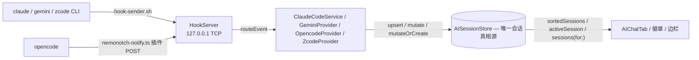

# NemoNotch — AGENTS.md

> 精简版(2026-10-20):只留**操作必需**与**防错提示**(不变量 + 实测坑)。功能如何工作的完整叙事在 git history 与 `docs/experience-playbook.md`。往本文件加内容遵循同一原则:只写坑与不变量,不写功能说明书;历史复盘别写成会撞 `doc-audit` 检查的现在时断言。

## 项目速览

macOS 刘海工具:媒体控制 / 日历 / AI CLI 监控(Claude Code、Gemini、opencode、zcode)/ 多 agent 监控(OpenClaw、Hermes)/ 启动器 / 番茄钟 / 防休眠。Swift 6 + SwiftUI,macOS only;依赖 CocoaLumberjack、KeyboardShortcuts、mediaremote-adapter(perl 桥)。

```
NemoNotch/
├── NemoNotchApp.swift   # 入口;AppDependencies 是组合根
├── Models/              # Tab、AppSettings、PlaybackState、MultiAgentMonitor…
├── Notch/               # 刘海 UI 核心(窗口/动画/EventMonitor;EdgeBar/ 子目录)
├── Tabs/                # AIChatTab = AI 会话 + agent 的合并列表(无独立 agent tab)
├── Services/            # 全部后台服务(@Observable)
├── Settings/            # Pages/ 每页一文件;SettingsComponents.swift 共享件
├── PermissionFlow/      # 拖拽授权引导
└── Helpers/             # PermissionCard、PerfProbe、MarkdownRenderer…
```

核心数据流:Service(`@Observable`)属性变化 → SwiftUI 自动重绘。

## 构建与发布

- **"build" 永远指 `./build.sh`**(arm64 默认 / `--x86`)。脚本最后一步**部署**:退出运行中的 app、替换 `/Applications/NemoNotch.app`、重启。裸 `xcodebuild build` 只写 DerivedData、不碰 /Applications,读作"我的改动没生效"。**不要自己 copy/move/install**——脚本已做。`xcodebuild` 只用于检查(编译 / test)。
- 本机无团队证书时 `xcodebuild` 需 ad-hoc 签名参数(`test.sh` 已带):`CODE_SIGN_IDENTITY="-" CODE_SIGNING_REQUIRED=NO CODE_SIGN_STYLE=Manual DEVELOPMENT_TEAM="" PROVISIONING_PROFILE_SPECIFIER=""`。签名报错会掩盖真实编译错。
- **本地部署自签(fail-closed)**:`build.sh` 用自签身份 `NemoNotch Local Code Signing`(`scripts/make-signing-cert.sh` 创建,登录钥匙串)——ad-hoc 每次重建换 cdhash,TCC/Keychain 授权会全丢。pre-flight 用 **codesign 签探针文件**验证身份,缺失响亮失败、**绝不静默回落 ad-hoc**;逃生 `NEMONOTCH_SIGNING_IDENTITY=-`。**存在性检查不要用 `security find-identity -p codesigning`**——该过滤器隐藏无信任设置的自签证书(实测导致证书双重导入 + codesign ambiguous,要按 `-Z` 哈希清理)。CI 发布 DMG 与 test bundle 刻意保持 ad-hoc(无公证的自签在 Gatekeeper 面前与 ad-hoc 等价)。`doc-audit` 断言身份名同时登记在 build.sh 与本手册——改名要脚本、手册、证书三处一起换。
- **版本号构建时注入,不存 pbxproj**:pbxproj 的 `MARKETING_VERSION`(1.0)只是本地占位,**别改**;`build.sh` 用最新全局 `vX.Y.Z` tag 覆盖,release workflow 用 pushed tag。
- Release:改动全部进 main → 打 annotated tag `vX.Y.Z`(打在 PR 合并提交上)→ `git push origin <tag>` → Actions 出双架构 DMG(`build/NemoNotch-<arch>.dmg`)。main 只经 GitHub PR 收 develop(钩子拦本地 merge)。

## Git 流程与门禁

**绝不在 main 直提,也绝不在主检出直提**;一切开发走 `git feat <name>` 建的 worktree(嵌套在 `.worktree/<name>`,被 `.gitignore`/`.swiftlint.yml`/`.swiftformat` 三重排除——缺一处嵌套副本就被全仓 lint 扫、被 `git add -A` 暂存成嵌入仓库)。

1. `git feat xxx`:先拉最新(本地 develop 纯落后 origin 时 `--ff-only --autostash` 快进;分叉则警告留在本地;主检出不在 develop 则跳过拉取),再从刷新后的 develop 建 worktree。
2. 在 worktree 里干活、提交。
3. `git feat-done xxx`:先跑文档对账门禁(秒级 grep;`NEMONOTCH_SKIP_DOC_AUDIT=1` 逃生)→ 再在 worktree 跑单测(Swift 变更才跑;`NEMONOTCH_SKIP_TESTS=1` 逃生)→ 自动 stash 主检出脏状态 → `--no-ff` 合回 develop → 恢复 stash → 拆 worktree。
4. post-merge 钩子在主检出对 develop 收到 feature/hotfix 合并时自动跑 `./build.sh`(=自动部署);`NEMONOTCH_HOOK_DEBUG=1` 干跑。构建失败响亮但不回滚合并。
5. `git feat-list` 列 worktree;`git feat-gc` 清已合并进 develop 的本地 feature/hotfix 化石分支(只 `-d` 删已合并,未合并的列出不动;worktree 在用的跳过——**刚建未提交的分支与 develop 同指针,会被 `--merged` 列出**,靠这层过滤保住,实测踩过)。细节 `docs/git-worktree-workflow.md`。

**Judge ≠ author**:`feat-done` 前的 feature diff 要独立评审(code-review subagent 或另一会话,绝不是写改动的那个)。CI 绿 / lint 绿 / 构建成功是**信号不是判决**。

**钩子(每 clone 跑一次 `sh .githooks/install.sh`;副本会自检——`git feat`/`feat-done`/`feat-gc`/`pre-commit` 启动时经 `.githooks/freshness.sh` 逐字节对比 `.githooks/` 源与已装副本,不一致自动重装并中止本次让你重跑;`freshness.sh` 自身不复制,检查器永不过期。改源不重装 = 静默跑旧代码、排障盯一份没在执行的源文件——这是它存在的理由。在 worktree 里开发 hooks 自身时 `NEMONOTCH_SKIP_FRESHNESS=1` 跳过):**
- `pre-commit`:拦 main/master 直提;拦主检出直提(唯一例外:带着 `MERGE_HEAD` 收尾冲突合并);对 staged `*.swift` 跑 lint 门禁;对 staged `*.xcstrings` 跑 `scripts/xcstrings.py format` 归一化。
- `pre-merge-commit`:main 上拦一切合并(只走 PR);develop 上只许 `feature/*`、`hotfix/*`(或 origin/develop 自同步)。
- 配置:`pull.ff=only`、`branch.develop.rebase=true`、`branch.develop.mergeoptions=--no-ff`。紧急逃生 `--no-verify`。

**Lint 门禁**:`scripts/lint.sh` = SwiftFormat(格式)+ SwiftLint(分析,只有 error 级拦提交)。pre-commit 以 `--staged --fix` 跑:SwiftFormat 自动修并重新暂存(同时有未暂改动的文件只检查,防部分暂存泄漏);缺工具**拦**而非跳过(无假绿)。手动:`sh scripts/lint.sh [--staged] [--fix]`。

**文档对账门禁(`scripts/doc-audit.sh`)**:成对断言机器对账代码与手册——HookServer 传输(代码 `NWListener` ↔ 本手册 `127.0.0.1 TCP` 标注)、`INFOPLIST_KEY_*` pbxproj 双配置、worktree 三重排除、`CLAUDE.md → AGENTS.md` 符号链接、签名身份名、**手册引用的脚本路径必须存在**(scripts/ 与 .githooks/ 精确路径;根目录裸名须在仓库根 / scripts/ / .githooks/,或是 Swift 源码里出现的运行时产物——`hook-sender.sh` 由 HookInstaller 生成不在仓库)。**在 feat-done 合并前与 CI(push/PR 到 main/develop)各跑一次**——漂移要在部署前抓,不是 push 后等 CI 变红。**事实(传输/布局/数字)变了,代码、手册、断言三者必须同一提交改**——这个强迫同行就是门禁存在的目的;起因是 HookServer 从 unix socket 迁到 TCP 后手册漂了 5 个月才被抓到。

## 测试

- 单测在 `NemoNotchTests/`,用 **Swift Testing**(`import Testing`、`@Test`、`#expect`),新代码不要用 XCTest。
- 只测纯逻辑(parser、编码、状态机);ScriptingBridge/AX/NSWindow 集成测试跳过(要真权限,CI 不稳)。
- **跑测试用 `sh scripts/test.sh`**(不是裸 xcodebuild——它带本机 ad-hoc 签名参数;支持 `--only <Class>`;全量输出写 `build/test.log`)。**报告测试结果必须引脚本的退出码和日志,绝不凭记忆复述"过了"**。
- `feat-done` 合并前在 worktree 跑单测——合并即部署 /Applications,测试必须先于部署。
- **冷启动宿主崩溃有界重试**:仅当「非零退出 + 0 个用例执行 + 日志含崩溃特征(`Early unexpected exit`/`Test runner exited` 等)」同时成立才重试一次(首次日志存 `build/test.log.crash1`)——真失败/编译错误绝不重试,不给真失败擦粉。`NEMONOTCH_TEST_NO_RETRY=1` 关;特征词待抓到真实崩溃日志后校准。
- **判别剃刀(假测试判据)**:每个测试必须以具体输入调被测单元、断言字面输出或可观察副作用。问:*被测代码到处返回默认值,这测试还能过吗?*能过就没有鉴别力。不可接受:只断言"调用发生了"、自指期望(`#expect(f(a)) == f(a)` 形)、钉手写常量。例外:跨表关系断言。范例:`CompletionDetector`、`BadgeGrouping` 等纯 fold 测试。
- **修 bug 先落失败测试**:回归测试单独成 commit(或 feature 首个 commit),提交信息里引用真实失败输出(red→green 可重放)。没有便宜本地测试目标才可跳过。
- **变异验证 `sh scripts/mutate.sh <file> <orig> <repl> [--only <Class>]`**:注入字面变异、要求套件变红。红=守卫有牙(exit 0);绿=**变异存活,守卫没牙**(exit 1);0 个测试跑=过滤/接线错误(exit 2)。文件必然恢复(trap 保护,Ctrl-C 也恢复原字节)。每个新守卫/新测试先这样验证再信。
- 新功能**不强制 TDD**(已定,勿重议):盲审数据显示质量无差、token 成本 3–8.5×;上面的失败测试规则已覆盖证据真正重要的场景。

## 架构不变量(AI / agent)



- **AISessionStore 是唯一会话真相源**(`@MainActor @Observable`,归 AICLIMonitorService 所有):provider 只经 `upsert`/`mutate`/`mutateOrCreate` 写入,**UI 只读 `sortedSessions`,绝不碰 provider 内部状态**。加 provider = 往 store 写,UI 零改动。store 缓存 `sortedSessions`(每次突变重建);`mutate`/`mutateOrCreate` 在 phase 变化时统一写 `phaseChangedAt`(一个写点,所有读者免费)。
- **事件来源归属是坑**:外来 opencode 插件可能抢跑 POST 未标 `cli_source` 的 Claude 形状事件。两道防线:`mutateOrCreate` 让调用方的 `cli_source` 权威(`session.source` 是 var,每次 mutate 重指派);`routeEvent` 把 session id 以 `ses_` 开头的无主事件归 opencode、`sess_` 开头归 zcode,再走 Claude 兜底。没有它们 opencode 会话会顶螃蟹图标。
- **上下文窗口解析顺序**(`ModelContextWindow`,UI 同步调用,勿改成分层破坏):(1) 硬编码表(真相源,永不被覆盖);(2) Claude 家族表(裸 id 前缀匹配,点当横线、剥 Bedrock/Vertex/日期后缀;未列出的 Claude id=200K,`[1m]` 后缀=1M);(2.5,在 overlay 之前);(3) OpenRouter overlay(**无鉴权**公共目录,只填表没有的空白,冲突时表赢);(4) default。overlay 在 `Mutex` 里,启动 `warm()`(UITestMode 跳过),盘缓存 TTL 3 天,fetch 失败吞掉。**Claude 1M 升级粘性**:`limit(for:observed:)` 一旦最新调用超出了表列窗口就升 1M,并按模型记住(`upgradedContextModel`)——provider 必须先写 token 再写 model(didSet 联动),否则 `/compact` 缩回 prompt 后又掉回 200K 误报 75%。**什么算 context**:Claude = 最新主模型调用的 `input + cache_read + cache_creation`,跳过 `isSidechain` 与 `<synthetic>`(它们仍计入 token 总数,只是不换 context/model);Gemini = 只算 `input`(其 promptTokenCount 已含 cached,再加就双计)。
- **多 agent 监控走注册表**:OpenClaw/Hermes 实现 `MultiAgentMonitor`,收进 `AgentMonitorRegistry`;统一读 `installedMonitors`/`activeAgents`。加监控 = 一次 `registry.register(...)`。agent 与 AI 会话在 `AIChatTab` 一个列表合并渲染。
- **Usage quota 的授权陷阱**(见下「Keychain / 权限 / TCC」):凭据**文件优先**(`~/.claude/.credentials.json`/`~/.codex/auth.json`);Claude 另有本地读缓存 `~/.NemoNotch/claude-cred.json`(0600,**只存 accessToken + expiresAt,绝不存 refreshToken**,成功读即写,先于 CLI 文件与 Keychain 检查,401 即弃);自动路径用 attributes-only 探测、绝不自动弹窗;授权按 cdhash 记;**只有 `errSecItemNotFound` 才忘授权**(`errSecInteractionNotAllowed` 保留——ad-hoc 的 ACL 信任跨睡眠失效是暂时态)。Gemini 凭据是明文文件**无 Keychain**,永不走 Authorize 按钮;client_id/secret 运行时从 gemini-cli 自带 JS 里提取(`GeminiOAuthClientLocator`,可能在子进程跑,**绝不硬编码**,Google 轮换密钥不能弄坏我们);刷新的 token 原子写回 `~/.gemini/oauth_creds.json`。zcode quota 靠解密 `~/.zcode/v2/credentials.json`(`enc:v1:` 格式 AES-256-GCM,key=SHA256(secret),secret = 环境变量 `ZCODE_CREDENTIAL_SECRET` 或确定性 fallback),调 BigModel API;不可用时回落本地 sqlite 统计(`SQLITE_OPEN_READONLY`,主线程外)。服务 60s 节流 + 5 分钟定时器,`resets_at` 解析要健壮。
- **opencode**:无 shell hook,靠自带插件 `~/.config/opencode/plugin/nemonotch-notify.ts`(OpencodePluginInstaller 安装)POST HookEvent 到 HookServer。**审批超时语义按 cli_source 分**(已单测):Claude 120s 后 fail-close 拒绝(未答的 hook 会永远阻塞 CLI);opencode 桥 600s 后答"无决定"(此时用户 TUI 对话框还在,拒绝等于替用户拒工具)。代答回答在 opencode 内部经其 client API 应用,只发 `once`/`reject`,**绝不落持久规则**;插件输入没带 client(未知版本)就跳过应用,TUI 仍是决定者。
- **zcode**:无插件——hook 是 Claude 形状,直接走 hook-sender.sh → HookServer;`$ZCODE_SESSION_ID`(及父进程匹配兜底)在 Claude 分支**之前**判,标 `cli_source: "zcode"`。配置在 `~/.zcode/cli/config.json`,hook 嵌在 `hooks.events.<Event>` 且有兄弟 `hooks.enabled` 开关(HookTarget `.zcode` 的 `usesNestedEventsContainer` 处理形状差异)。token 回填读 CLI 自己的 sqlite(`model_usage`,每会话 3s 节流、主线程外):GLM 的 `input_tokens` 已含 cache 读,context = 最新请求的 `input + cache_creation`(cache_read 超过 input 时再加)。zcode **不发 Notification 也不发 SessionEnd**(只有 SessionStart),结束会话靠 stale 超时回收;`PermissionRequest` 刻意不注册(CLI 无代答 API,notch 侧审批不在范围)。
- **聊天气泡**:直跑用户自己的 `claude` CLI(每 turn 一个进程,`--resume` 续)。子进程会触发用户已装的 hook,所以气泡会话是 store 的一等公民(刘海、权限、代答全共用既有机制)。GUI 起的进程没有 login-shell PATH,**runner 要探测已知安装位**( `~/.bun/bin/claude` 优先)。流式解码**未知行必须忽略**(CLI 新字段不能弄死读端)。v1 限 Claude 后端;第二后端的接缝是 `ChatTurnRunner`。
- **等待提醒**(`WaitingReminderMonitor`):审批等待超阈值发一次系统通知、**答了即撤回**。30s tick 必须保留——阈值会在 store 无变化时被跨过,纯观察永远烧不起来。`waitingForInput` 刻意不提醒(那是完成一轮,不是求救)。默认关(提醒天生烦人,严格 opt-in);未授权绝不请求。UITestMode 跳过。
- **锁屏 AI 面板**:窗口在 `CGShieldingWindowLevel()` **且** SkyLightWindow 的 `delegateWindow` 把它挪进锁屏级私有空间——两机制缺一不可。硬规则:**每窗只 delegate 一次**(`hasDelegated`);**绝不 release 已委托的窗口**(保活、只 orderOut,否则下轮排序周期可崩 WindowServer 连接);锁定期间 500ms 自检重呈现(系统过渡会丢面板)。面板 display-only(`ignoresMouseEvents`)——锁屏属于系统,审批在 CLI 自己的 TUI。`shouldShow` 纯函数:waitingForInput/idle 不算"在跑"。锁检测三层(分布式通知 + sessionDidBecomeActive + 锁定中 500ms 轮询)都喂同一个幂等 `setLocked`。**Swift 6:`Notification` 不是 Sendable——分布式通知 block 里先取值再 hop MainActor**。UITestMode 不建 controller(截图运行不许有东西盖屏蔽层)。

## Notch / Edge Bar / 完成闪光:不变量与坑

### Edge Bar

- **边栏拥有 AI 会话**:边栏开启(`aiStatusFabEnabled`)时**每块屏**的刘海都撤 AI 徽章/AI 辉光/AI tab 自动选中(纯函数 `BadgeItem.sessionItems(edgeBarShown:isEnabled:)`,有单测)。全屏一致是拍板行为(按屏隐藏的版本上线过又被撤,"一个组件两种行为")。agent 不在边栏上,徽章/辉光/自动选中保留。
- **选择 vs 拟合**:`chosenPlacement`(用户拍板,持久化 JSON `edgeBarPlacement`,只有拖拽会改写)与 `placement`(按当前屏幕拟合)分离——备用屏的拟合**永不**覆盖选择。放置屏按 `NSScreen.displayUUID` 记;屏没了回落内置屏;UI-test 既不读也不写。释放与每次重停靠都重拟合(`refitted`),分辨率/Dock 变了卡片也不会出屏。
- **拖拽的帧纪律**:拖拽的一切状态变更与窗口移动**同帧**落地——no-animation 事务(`EdgeBarController.instant`),其中 **`disablesAnimations` 是承重件**:它还要压掉视图的 `.animation(_:value:)` 和卡片的 transition 淡入(`animation: nil` 压不掉这些)。形态切换(停靠↔浮囊)两个方向都用 `.transition(.identity)`——**SwiftUI 用视图插入时的 transition 移除它**,插入之后再换 transition 无效。
- **三个买过单的坑**(改 hit-testing / 动效前必读):
  1. `.allowsHitTesting` **不**门禁 NSViewRepresentable 的事件——AppKit 把 mouseDown 派给最深的平台视图。不透明度隐藏层里的 NSView 覆盖件必须设 `NSView.isHidden`(它才真正退出 hit-testing 和 tracking area),否则静默吃掉面板点击。
  2. `.offset` 只挪渲染——卡片的 hit area 还留在布局位,不可见地盖住下面的东西(悬停卡的隐形 hit area 曾吃掉所有 chip 点击)。定位用 Layout(真位置)。
  3. `repeatForever` 在布局位置会变的元素上**出鬼影帧**(插值帧按过期原点渲染,FAB 曾四 chip 渲出五环)。连续动作用节拍(一次性 keyframe)或 Core Animation:`CABasicAnimation` 挂在自家 NSView 的子层(`hitTest → nil`),跟随视图布局且不花 SwiftUI。
- **非激活面板里 SwiftUI hover/tap 不可靠**(never-active app 的 non-activating panel):由 hosting view 的 tracking area 统一收事件、按几何解析行/头/卡片按钮(`EdgeBarController` + 纯 `EdgeBarMetrics`),hover 与 click 永不分裂。tracking area 重建时静止光标下会发出 enter+exit 对——**exit 要对着光标实测才信**;另每 0.25s 复查。
- 图标在环内画 **Shape 不用 Canvas**:Canvas 在固定窗高的第一环里蟹腿被裁(实测 0–1 排腿 vs 其他环 5 排,独立窗口无法复现),且 Canvas 每实例跑 0.15s 定时器。`EdgeBarCrab`/`OpencodeLogoShape`/`ZcodeLogoShape` 是 Shapes。
- 浮囊只能整体落在它打开的面板内休止(`capsuleRestRange` 包含测试)——否则光标落在面板外的部分会以 ~3Hz 折叠重开;拖运中按**当前**长度夹紧锚端(否则不足四会话的条永远够不到远端停靠)。开栏即静默 `refresh(force: false)`(60s 节流照常),控制器观察 `quotas`,开着时读数落地会让用量块原地长。

### 刘海本体

- **开合时序**:`makeKeyAndOrderFront`/`NSApp.activate` 与状态变更**同一 runloop turn**——动画时钟从事务 commit 起算,commit 前的活只推迟起跑,拖一 turn 才做就落进曲线中段。
- 热键开的刘海**不因鼠标移出而关**,直到:(a) 鼠标进过内容区一次;(b) 3 秒无进入;或 (c) ESC/热键/点外部(`HotkeyDismissState`)。
- 悬停路径**零延迟开**(光标一进闭合 hitbox 就开,快速扫过也开——设计如此);保护只剩两个:关合宽限 100ms(离开后复验光标仍在界外才收)、重开抑制 0.35s(任何关闭后 hover 不能重开,click 可以;防 ESC 关后光标还停在刘海上的弹跳)。
- 收起徽章**永不长第二行**:按图标身份分组折叠成镜像扇(左 logo 右状态,组内多于 1 只显计数),可见组上限 4,多的折进 +K。宽度按扇形实测张开量长(读去抖后的 `badgeCluster`,与扇同步动画)。
- **空集去抖 600ms**:agent 在工具调用间隙回 `.idle` 会把 `activeBadgeItems` 掏空一拍;非空更新 16ms 合并、变空延迟 600ms、窗口内来非空即取消。延迟走注入的 `DelayScheduler`(代际守卫),测试手动触发,不睡真时间。
- 胶囊(蓝牙/充电)只在 `effectiveStatus == .closed` 挂载,互斥(同位不叠影);刘海打开即 `hideCapsule()`。

### 完成闪光 / Toast

- `CompletionFlashService` 观察 store + registry(纯 `CompletionDetector` 边沿检测),~2s 节流内合并进在显 toast、不重放辉光。**toast-only 入口(Pomodoro `showCompletionToast`)刻意不动闪光节流**——番茄钟 toast 永远吞不掉紧随其后的 AI/agent 闪光。日历走完整闪光入口 `showCompletionFlash(items:)`。辉光与 toast **每块屏都显示**(用户拍板:只显主屏时在外接屏干活会漏看)。
- **具文窗口陷阱:闲置窗口"闪光时再入屏"在非主屏可能永远拿不到渲染表面**。AppKit `isVisible=true`、CGWindowList `onscreen=true`、frame 分毫不差,但 WindowServer 里没有图像(`screencapture -l<id>` 报错、像素里零光晕);主屏同路径不受影响;创建即入屏则两屏都正常。排查可直接复用:`screencapture -l` 二分"窗口无表面"vs"被遮挡"。修法 = overlay 从消隐转可见时**重建**所有屏的窗口(节流合并不翻转可见性,无需重建);闲置仍 orderOut 省电。
- **换出旧窗绝不能 `close()`**:close 的释放语义在 Swift 并发 job 的 autorelease 池里过度释放 → SIGSEGV(栈 = releaseUntil ← runJobInEstablishedExecutorContext,两次实锤)。纪律:`isReleasedWhenClosed = false` + 先建新窗、orderOut 旧窗、字典换引用靠引用计数析构;窗口操作别留在观察 Task 里(挪进普通 main-queue block)。
- **日历到期去重键 = startDate + title,不是 `CalendarEvent.id`**——模型每次 init 铸新 UUID,`fetchEvents()` 在 `EKEventStoreChanged` 时整体重建值对象。触发窗 = 提前量 ≤ now ≤ 开始后 2 分钟(远过期的从不补火);全天事件排除;同时的批量一次火;跨天滚动调 `CalendarService.refresh()`;开关按次判定(免重启生效)。

### 防休眠(KeepAwake / LidMonitor)

两个事实定全局:**合盖睡眠无视一切 IOPMAssertion**(只有 `pmset -a disablesleep` 这个 root 开关有效);**`SleepDisabled` 全局且重启后仍在**——安全网不是可选的。

- **所有权标记 + 对账**:`~/.NemoNotch/keep-awake.enabled` 记"是我们开的",写在 pmset 调用**之前**(中间崩溃下次也能认领)。纯函数 `KeepAwakeReconciliation` 的微妙点:**`pmset -g` 返回 nil 是"读不到",不是"关"**——只有确定的 false 才弃标记,否则永久忘记一个活着的 SleepDisabled 是我们的。`isOwned` 门禁退出恢复(用户自己 sudo 开的如实上报、绝不动)。启动**刻意不自动恢复**(否则每次启动弹授权框),只在菜单栏/设置里如实显示。
- **SMAppService(LaunchDaemon)路线实测被否**:ad-hoc 签名下 `register()` 成功、`status .enabled`、launchd 不拉起 helper、XPC 超时——**前两个都在撒谎**,只有 XPC 往返揭穿。若重走此路,可用性必须以实际 XPC round-trip 为准,绝不看 status。附带发现:审批绑 **bundle id 不是 cdhash**(重签不需要重批,与 Keychain 授权相反);换 helper 必须 `unregister()` → `register()`。
- **提权走 `osascript … with administrator privileges`**:命令串全硬编码(绝对路径,零插值)。用户取消 = AppleScript **错误号 -128**,不是消息文本(文本是本地化的)。代价是每次切换一个授权框。
- **外部改动检测**:远控/清理工具会重写电源设置顺带清掉 SleepDisabled。检测两通道(`com.apple.systempowermanagement.prefschange` Darwin 通知 + 10s 对账轮询),**刻意不自动恢复**(恢复=无人值守时弹授权框,诚实范围 = 检测→自纠 UI→记 `KeepAwakeEventLog`)。两个硬细节:通知在**新值到达内核之前**就发,复查跑 0/0.2/1/2.5s(单次读会错过);两通道在 `isBusy` 时**都压制**(我们自己的 osascript 写也触发同一通知,不压会把每次自切换误记为外部改动)。
- 轮询要便宜:真源读 `readSleepDisabledLive()` 直读 IOPMrootDomain 的 IORegistry 属性(µs 级、无子进程),`pmset -g` 只是兜底。副作用纪律:`turnDisplayOffIfNeeded` **只升沿触发**(每次 tick 都发 `displaysleepnow` 会在合盖状态下每轮重复熄屏)。
- 第二层 assertion 跟随**系统真相**(`isEnabled`)而非用户意图——不留与"系统是真源"不变量矛盾的隐藏状态;它只补篡改窗口(别的工具清掉 SleepDisabled 到我们检出之间),盖不了合盖(没有 assertion 盖得了);进程退出(哪怕 SIGKILL)系统即回收,退出路径无需额外处理;UITestMode 关。
- **关开关后补睡眠**:清掉 disablesleep 不会让已合盖的机器自己睡(会捂在包里发热)。纯决策 `KeepAwakeSleepNowDecision`:全输入非 nil 才睡(任何 nil 都不睡——无法确证就绝不睡);`AppleClamshellCausesSleep` 是内核对"合盖会不会睡"的权威判断,比手搓 `CGGetActiveDisplayList` 严。切换路径 2s 后复检(反悔窗口);退出路径立即查(延迟 Task 活不过正在终止的 app)。
- 退出:`applicationShouldTerminate` 返 `.terminateLater` → 恢复 → reply,**永远放行退出**(阻塞更糟);恢复失败/用户取消弹 NSAlert 给出遗留状态并提供复制 `sudo pmset -a disablesleep 0`;标记保留待下次认领。
- **LidMonitor**:`kIOPMMessageClamshellStateChange` 不导出给 Swift(C 宏),手算 `0xE0034100`(`err_system(0x38)|err_sub(13)|0x100`,已按头文件位布局核对)。当前盖态读同节点的 `AppleClamshellState` CFBoolean——**`ioreg -c IOPMrootDomain` 列不出该属性但 `IORegistryEntryCreateCFProperty` 读得到**,别用 CLI 下"不存在"的结论。外接屏时跳过(`CGDisplayIsBuiltin`)。`pmset displaysleepnow` 免 root。Darwin 通知收信用 `CFNotificationCenterAddObserver` 带 observer 指针当 context(不是 `notify_register_dispatch`——C 回调带不了非 Sendable self)。`deinit` 是 `isolated deinit`(Swift 6.2,IOKit 句柄是 MainActor 隔离的)。
- 盖事件日志走**独立文件** `~/.NemoNotch/keep-awake.log`(主日志实际保留 <2 天,见日志节),同格式时间戳可对表,512KB 自截断。**Release 的 dynamicLogLevel=.info,盖事件/跳过原因一律 .info**(排"事件没到"vs"到了被滤"必须能区分);`pmset -g` 读留 .debug(高频轮询不许每 tick 都打)。

## 坑总目录

### SwiftUI 渲染与动画(实测:收起态子树让整机 CPU 22%、触发 cpu_resource 看门狗)

- **`opacity(0)` 不卸载视图**——整个子树活着并持续干活,每屏一份还要乘屏数。隐藏昂贵子树绝不许用 opacity/scaleEffect/frame(0),要**门控挂载**。
- **把隐藏改条件挂载时,进出场动画必须挪到 `.transition`**:状态绑定的 scaleEffect/opacity + `.animation(value:)` 对**插入**不生效(新视图没有上一值可插值,直接跳终态,曾整版"无缩放弹出")。`.transition` 是唯一描述插入/移除的机制,且会把视图持有到移除动画完——不需要手搓延迟卸载。
- **只要有一个动画在跑,ViewGraph 每帧重走整棵 display list**——与 `body` 频率无关(body 0.7/s 的全屏窗口照样贵;读一当二是这类 bug 要好几轮才找到的原因)。常挂的 `.animation(value:)` 绑高频服务属性 = 无论动画视图多小都全树逐帧走。
- **`.animation(value:)` 绑屏幕上真的会变的东西,不是上游数据**:耗时标签绑 0.5s 节拍的 position 而文本只按整秒变,一半动画同串空跑;绑格式化后的字符串直接减半。
- **`repeatForever` 停不掉**:赋新值(哪怕在 disablesAnimations 事务里)都不行,动画仍挂在属性上继续驱动;且它隐藏当前插值,只能重置(瞬跳)。用 `TimelineView(.animation(paused:))`——驱动停、末帧保持,值从 `context.date` 推导(无状态可丢相位)。注意 TimelineView 只看 paused **不看可见性**,挂载但不可见照样逐帧 tick——别与 opacity 式隐藏搭配。
- `repeatForever` 在布局位置会变的元素上出鬼影(见 Edge Bar 坑 3)。
- 动画驱动方式对 CPU 是红鲱鱼:20fps 状态循环改 repeatForever、frame(height:) 改 scaleEffect,实测**零**改善(动画都还"在跑"),只有卸载有用。

### 窗口与 AppKit

- **屏幕重配崩溃族(根治,但纪律必须传下去)**:`didChangeScreenParametersNotification` 观察者**绝不能在通知派发栈内同步销毁/重建 NSWindow**(栈内无应用帧的 SIGSEGV,过度释放僵尸窗口;插拔屏/切模式/开合盖都触发)。重建永远 pending 标志合并 + `DispatchQueue.main.async` 推迟一 turn。附带:**NotificationCenter 的 block 观察者 `queue: .main` 在主线程 post 时可能同步执行**——别依赖它异步,自己显式推迟。
- **CrashGuard(兜底)**:致命信号 handler 自动重启(纯 `CrashRestartPolicy`:600s 窗 ≤3 次,120s 稳定清零)。重启子进程先 `P=$PPID` 轮询 `kill -0` 等**垂死进程真死透**(直接 sleep 会在旧例死透前 open,只是激活垂死实例),`open -a` 带三次重试、失败落审计日志绝不无声消失;handler 恢复 SIG_DFL 重发信号照常写 .ips。测试宿主/`--uitest` 跳过。**App Nap 会无限期推迟 120s 清零定时器**(mach uptime;实测同一二进制用户不在场就连漏 3 晚)——无害:600s 窗读挂钟 `time(nil)`。排查"清零没触发"先问用户当时在不在机器前。
- **改 CrashGuard 前必读 async-signal-safe 纪律**:handler 内禁一切 String/Array/Foundation 构造(malloc 重入死锁;数字格式化手写标量);缓冲 install() 时预分配;**handler 读的每个 static(含默认参数每调用点求值的策略常量)必须在 `signal()` 注册前显式触碰**——Swift static 懒初始化自己要拿锁分配;C 函数指针只能由**顶层函数引用**形成(Swift 6 拒绝静态方法引用和捕上下文闭包,文件尾有 trampoline);`ftruncate`/`sscanf`/`localtime` 都不安全(状态文件定长记录、手写解析、只记 epoch 秒)。
- **设置窗口用普通 `Window` scene,不是 `Settings` scene**:`Settings` 强制 preference 风工具栏(侧栏钮挤到标题下第二行)+ 不可调宽,且**每次工具栏变动都重新强加**(侧栏折叠动画每帧和 SwiftUI 打架;AppKit 补丁只盖住第一次)。scene 级 `.defaultSize(width:height:)` 是尺寸旋钮(内容 root 的 idealW/H 被忽略);saved autosave frame 会覆盖默认——有意。侧栏自带开关用自置 `ToolbarItem(placement: .navigation)` + `.toolbar(removing: .sidebarToggle)`(内置钮在展开动画开头被挤进 » 溢出菜单,AX 帧级实测每次闪)。`.defaultLaunchBehavior(.suppressed)` 而非 `.restorationBehavior(.disabled)`(后者连 frame autosave 一起丢)。**别再手搓窗口 chrome**(三轮可见接缝后整删)。
- 刘海窗口层级固定 `.statusBar + 8`,属性 `fullScreenAuxiliary` + `stationary` + `canJoinAllSpaces`。
- Swift 6 分布式通知/回调进 MainActor:`Notification` 不是 Sendable,先取值再 hop(见锁屏节)。

### 媒体

- **macOS 15.4 起 MediaRemote 私有控制函数锁给 Apple 签名进程,进程内调用静默 no-op**。一切控制(播放/暂停/切歌/seek,含 Music 和 Spotify)走 `MediaRemoteCommander` → mediaremote-adapter perl 桥(spawn `/usr/bin/perl` dlopen framework);读取(标题/艺人/封面/进度/isPlaying)走 `NowPlayingCLI` 守护。**没有 ScriptingBridge/Automation 路线了**,别复活它。
- 调"信息丢失":查 NowPlayingCLI 守护状态 / dylib 解包(`~/Library/Application Support/NemoNotch/MediaRemoteMini.dylib`)/ perl 脚本,别去改 MediaRemote.swift(它只管注册系统通知触发刷新)。
- **isPlaying 乐观更新 + guard 自愈**:点播放先设乐观值,CLI 轮询不同意时 guard 保护乐观值,一致(或 3s 硬过期)后 CLI 赢;播放器自己的分布式通知也触发刷新加速收敛。按钮永不滞后/闪烁/卡死。
- **seek 一律绝对定位**:`seek(toAbsolute:)` → `MRMediaRemoteSetElapsedTime`,Spotify 也认(它拒的是相对 SkipBackward/Forward 命令,不是绝对定位)。`supportsSeeking` 就是 `duration > 0`,没有按播放器的能力门。
- 封面主色(`ArtworkColor`)在主线程外算,只在封面字节变化时重算。

### 蓝牙 / IOKit(实测坑密度最高的区)

- **启动路径绝不能同步碰 IOBluetooth**:`IOBluetoothDevice.register(forConnectNotifications:)` 与 `pairedDevices()` 会同步初始化 CoreBluetooth 协调器,bluetoothd 状态不佳时在信号量上**无限等待**——主线程同步跑 = 整个 app 卡死在 `applicationDidFinishLaunching`(刘海不出现、HookServer 饿死、零报错日志,表象"app 打不开")。注册+枚举挪到带常驻 runloop 的专用线程,只回传 Sendable 地址串,主线程 `IOBluetoothDevice(addressString:)` 重查再挂监听(非 Sendable 设备对象不许跨线程带)。
- **`@objc` 回调必须 `nonisolated` + 拆 Sendable 字段 + `Task { @MainActor }` hop**:IOBluetooth 的回调可能从 CoreBluetooth 协调队列(`com.apple.bluetooth.iobluetooth.coordinatorQueue`)交付(macOS 27 实测,BLE 可重连设备如 AirPods 的连接事件),`@MainActor` 隔离的 `@objc` → `dispatch_assert_queue` 断言 → SIGTRAP("app 打不开"的另一种表象)。回调线程上只调框架 getter 取 name/address/classOfDevice(线程安全),设备对象回主线程重解析。
- **没 `NSBluetoothAlwaysUsageDescription` 碰 IOBluetooth 直接崩**("attempted to access privacy-sensitive data without a usage description");key 以 `INFOPLIST_KEY_NSBluetoothAlwaysUsageDescription` 进 pbxproj(双配置)。有 key 后首次触碰弹进程级蓝牙 TCC,**会挂死单测宿主**(测试 runner 还没连上)→ `UITestMode.isTestHost` 下 `build()` 整个跳过 `bluetooth.bind()`。
- **惰性启动**:`bluetoothToastEnabled`(默认关)是**唯一**启动源——设置里的开关就是用户触发的那一瞬,TCC 弹窗只出现在用户动作处。被拒后用静默 `CBCentralManager.authorization` 读(类属性,不初始化协调器、不弹)渲染提示,绝无自动重试。
- 音频分类纯函数 `BluetoothAudioClassifier`:**只认 major device class == 0x04**。0x100 音频服务位连笔记本/手机都广播(它们有扬声器和麦),会误分类配对的 Mac/iPhone;键盘鼠标是 0x05 且每次睡眠唤醒都重连,绝不能匹配。
- **充电胶囊边缘检测用 Power Source State == "AC Power"**(`kIOPSPowerSourceStateKey`),**不是** `kIOPSIsChargingKey`——满电插着电源时 macOS 不再报 charging,用它会在 100% 时闪一个假"已断开"。没有公开的 external-connected bool(`kIOPSExternalConnectedKey` 私有,SDK 头里没有,别再找)。IOPS 读数不过 TCC。首次读数只种基线(`lastExternalConnected` 初始 nil——启动时已插着不是新闻;顺带修了每次冷启动弹一次电池药丸的老 bug)。

### Keychain / 权限 / TCC

- **GUI app 的 `kSecReturnData` 读永远弹跨 app ACL 对话**(no-UI 标志压不住,只有 attributes 读是静默的)→ 凡 Keychain 凭据:**绝不自动弹窗**。存在性探测用 attributes-only(`kSecReturnAttributes`);要授权就渲染 Authorize 按钮(PermissionCard"绝不自动请求"同款);`authorize` 做唯一一次交互读(主线程外),**授权按当前代码 cdhash 记**(`SecCodeCopySigningInformation`,存 UserDefaults);下次启动只在 cdhash 仍匹配时做静默门控读。门控读包 `SecKeychainSetUserInteractionAllowed(false)`(dlsym 解析,`Boolean`→`DarwinBoolean`)——cdhash 过了但 ACL 没持久信任("允许一次"而非"始终允许")时,读**以 `errSecInteractionNotAllowed` 失败而不是弹窗**;没有这层,5 分钟自动刷新定时器会在无人点击时把弹窗顶出来。**忘授权只由 `errSecItemNotFound` 触发**(条目真没了)——瞬时的 `InteractionNotAllowed`(ad-hoc 的 ACL 信任跨睡眠失效)**保留**授权,下次刷新重试静默读。自签部署(2026-10-20 起)让 ACL 跨冷校验保持,残余最坏 = 每次重建后按钮重现一次、点击无对话框即过。
- 权限弹窗只在用户动作那一刻出现(用户明示原则):日历/定位/通知一律 PermissionCard + Grant 按钮,不自动请求;AX 只给系统设置链接(无程序化请求 API);被拒用静默探测渲染提示,绝不自动重试。
- **拖拽授权引导**(列表式隐私面板,`PermissionFlow/`):跟随系统设置窗口用 `CGWindowListCopyWindowInfo`,**不是 AX**——用 AX 读别 app 窗口 frame 自己就需要正在申请的可访问性授权(死锁);窗口服务查询不过 TCC。按 **PID**(从 bundle id `com.apple.systempreferences` 解析)匹配,**绝不用 `kCGWindowOwnerName`**(本地化——中文系统是"系统设置")。CG→AppKit y 翻转:`mainScreenHeight - cgY - cgHeight`。**成功检测只存在于有静默预检的能力**:`AXIsProcessTrusted()`(裸调,不带 Options+prompt)和 `CGPreflightScreenCaptureAccess()`;其余 pane 挂到设置窗关/ESC/3 分钟超时。只有 8 个**有列表可拖**的 pane 显示引导(Accessibility/Full Disk Access/Input Monitoring/Screen Recording/App Management/Developer Tools/Bluetooth/Media & Apple Music);prompt-on-first-use 的能力(摄像头/麦克风/日历…)没有列表,不许显示引导。细节 `docs/permission-drag-guide.md`。

### 日志

- 用 CocoaLumberjack(`LogService`),`~/.NemoNotch/logs/`。**保留不是配置的 7 天**:`DDFileLogger` 默认还有 **1MB 单文件上限**,`maximumNumberOfLogFiles = 7` 下真正驱动滚动的是大小——正常工作日 3–4 个文件,**有效窗口不到两天**。要审计数周的(盖事件、崩溃重启审计)放独立文件(`KeepAwakeEventLog` 思路)。
- 关键点必须打:服务 init/deinit(.info)、外部交互(.info/.error)、状态变化(.debug 带前后值)、错误路径(.warn/.error)。**轮询循环里记状态迁移,不记每次失败 tick**——照字面执行出过真 bug:`NotificationService` 每 2s 打一次 "AX not trusted",长到**占全部日志 96%**,4 小时填满一个 1MB 文件把有用的全挤出保留窗。记 last-logged 状态、变了才发。
- **时间戳是本地时间**:CocoaLumberjack 的 `DDLogFileFormatterDefault` **硬编码 UTC**——不覆盖的话文件日志比挂钟慢 8h,与崩溃报告/ps/Console 对不上(真踩过,误读成"进程几小时前就停了")。`LogService` 已装 `timeZone = .current`。注意日志**文件名**仍是 UTC(来自 `DDLogFileManagerDefault`,不走 logFormatter)。
- category 用模块名(`"MediaService"`、`"HookServer"`)。

### 本地化(String Catalog)

- 全部 UI 字符串在 `NemoNotch/Resources/Localizable.xcstrings`(en + zh-Hans)。**保持 Xcode 自己的目录格式**:`"key" : value`(冒号**两侧**空格)、2 空格缩进、`ensure_ascii=False`、保持插入序(**绝不排序**)、空对象展开多行、无尾换行——Xcode GUI 编辑才零 churn。
- **绝不用裸 `json.dump(indent=2)` 写目录**(`": "` + 可能排序 = 每行都重排)。要走 `scripts/xcstrings.py`(`format` 原地归一 / `check` 非规范即非零);pre-commit 对 staged `*.xcstrings` 自动归一,怎么编辑的都无所谓。
- 目录里已有的 `%@`/`%1$@`/空对象条目是 Xcode 自动提取的占位——留着,不是构建噪音。
- **`String(localized:)` 跟系统 locale,`Text` 跟 `.environment(\.locale)`**——app 内切换语言后,key 解析必须用显式 lproj bundle,不能用默认 bundle。

### 工具与探针

- 按查询类型选工具:纯文本/子串 → `rtk grep`/`rg`;符号与调用关系(谁调 X/改 X 影响啥)→ **ripwire**;语法结构形状(文本表达不了的)→ **ast-grep**。别把一切默认交给 Grep/Read。
- **ast-grep 零匹配 ≠ 代码不存在**(pattern 只匹配完整 AST 节点,形状不对就空;先 `--debug-query=pattern` 看解析结果再修规则);关系规则(inside/has)必须带 `stopBy: end`;shell 内联规则元变量写 `\$VAR` 防展开;复杂规则先经 Skill 工具加载 `ast-grep` 技能。
- **ripwire** 只答结构问题(定义/调用/影响面),不答构建/链接/运行时错误。冷启动或压缩后 `ripwire NemoNotch` 重建;`--for="<任务>"` 找该先读的代码;`--expand=SYM` 看单函数别 Read 整文件;写新函数前 `--exemplar` 找同类范例、`--for` 先查现成实现;收尾 `--quality-delta` → `--edit-check` → `--affected`;不确定命令用 `--help-task`。
- **PerfProbe**(`NEMONOTCH_PERF=1` 开):用 `getrusage`,**不是 `proc_pid_rusage`**——当前 SDK 的 `rusage_info_current` 结构版本与内核写回的不一致,调用直接 SIGABRT(实测)。`pthread_main_thread_np`/`THREAD_BASIC_INFO_COUNT`/`TH_USAGE_SCALE`/`TH_FLAGS_IDLE` 是 C 宏,Swift 看不见——主线程 mach port 在 `start()` 里 `pthread_mach_thread_np(pthread_self())` 捕,其余硬编码。

## 开发约定

- **证据纪律(五级梯子)**:验证声明必须自报梯级——(1) 自述( worthless);(2) 指到 `file:line`;(3) 走失败路径证不可达;(4) **真跑过**(碰真代码的脚本/测试,错时响亮失败);(5) 在运行中的 app 复现。停在 2–3 级可以,**把安全结论当已定而没到 4 级不行**——"听起来对"的行文不管真假都有说服力,自洽不是证据。对真工件验证(跑功能/读真值/看 diff),不用代理(mtime/缓存截图/自述);**验证失败先怀疑观测方法再怀疑系统**;委派工作(subagent/脚本/别的会话)查输出工件,不查 delegate 的总结。`scripts/lint.sh`/`scripts/test.sh` 就是为此存在——可重跑的确定性脚本胜过一次性目测。
- 行为基线:假设要说出口;多解释并列出而非默默选一个;最小改动(不顺手"改进"邻近代码/格式;只清自己制造的垃圾);每行改动可追溯到请求;任务转成可验证目标再循环。
- 功能增改后同步更新 `README.md`、`README_CN.md`、`AGENTS.md`(功能描述/技术栈/架构)。
- 设计文档:spec 在 `docs/superpowers/specs/YYYY-MM-DD-<topic>-design.md`,plan 在 `docs/superpowers/plans/`,ship 后 plan 挪 `archive/`;plan 文档随代码一起提交。
- 多 provider 场景协议优先:协议只放公共接口;各 provider 保留自己的 Result 类型与解析逻辑,**别强推统一数据结构**;加 provider 只实现协议,零改既有代码。
- 动手前先查参考项目有没有现成实现(见下)。

## 参考项目与外部手册

- 兄弟目录(本机 `/Users/aa00930/Documents/Learn/macos/`):**evlat**(边栏交互/审批代答/tab 级跳转的参照)、**ping-island**(notch 内审批渲染)、NotchDrop / DynamicNotchKit / Peninsula / Loop / Atoll 等(窗口/动画/设置 UI 参照)。路径随机器变,以 `ls ../` 为准。
- **macOS cookbook 在独立仓库**:`git@github.com:GaoZimeng0425/macos-playbook.git`;本仓库的 `docs/macos` 是指向兄弟检出 `../macos-playbook` 的**本地符号链接且被 gitignore**——fresh clone 里没有,要手动 clone playbook 到兄弟目录才解析。dlopen/MediaRemote/Carbon 热键/AX/IPC/Keychain 等先查 cookbook 再自己推。**更新规则**:任何新增私有 API 调用、系统集成或 `@unchecked Sendable`/`nonisolated(unsafe)` 边界的提交,同一提交里在 cookbook 加对应条目。
- 本仓库经验总结:`docs/experience-playbook.md`(七章 + 可迁移清单);worktree 流程细节:`docs/git-worktree-workflow.md`;拖拽授权:`docs/permission-drag-guide.md`。
