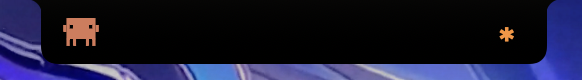
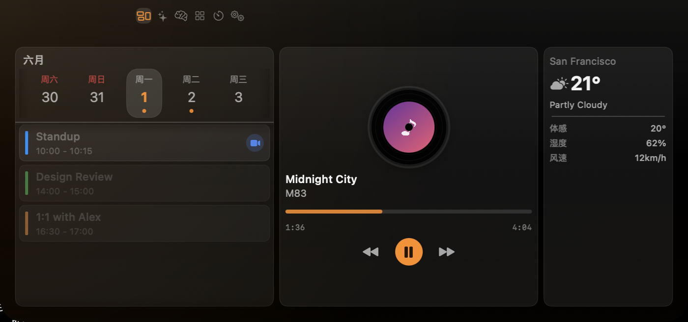
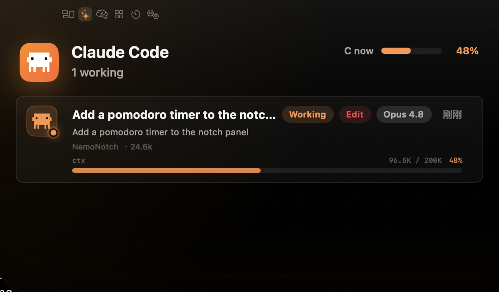
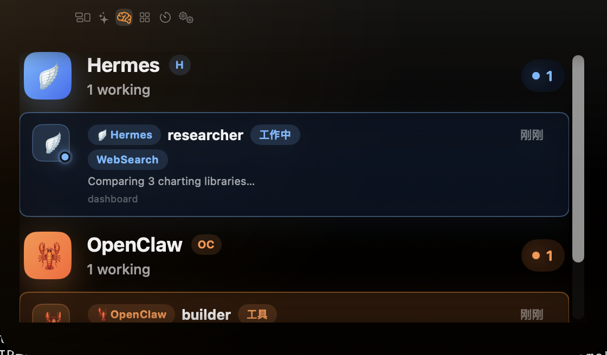
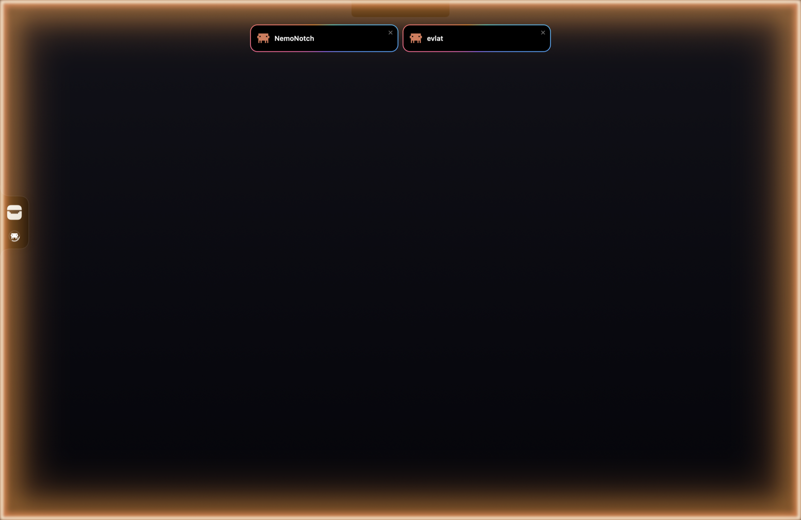

# NemoNotch

An interactive floating panel for the MacBook notch area, turning the notch into a multi-purpose information hub.

<p align="center">
  
</p>

<p align="center"><em>Real-time AI session &amp; agent status.</em></p>

<p align="center">
  
</p>

<p align="center">
  
  
</p>

<p align="center">
  <a href="README_CN.md">中文文档</a>
</p>

## Features

### Functional Tabs

| Tab | Description |
|-----|-------------|
| **Overview** | Three glanceable panels in one tab — **Media**: real-time playback controls (play/pause/next/previous/seek), album artwork, progress bar — works with any player that reports Now Playing (Apple Music, Spotify, browsers, Podcasts, NetEase Music, …) via a Perl bridge to the system media controls; **Calendar**: 15-day date picker, daily event list, color-coded calendars, clickable meeting URLs; **Weather**: current temperature / feels-like, high/low, humidity & wind, scrollable 7-day forecast, day/night condition icons (Open-Meteo, falls back to wttr.in) |
| **AI Chat** | Unified Claude Code, Gemini CLI, opencode & zcode monitoring — session list, subagent tracking, model display; conversation details, permission approval & context usage bar for Claude Code & Gemini CLI. Each CLI has its own toggle in Settings: off = uninstall its hook, stop discovery polling, and silently clear its sessions — no cards, no badges, nothing |
| **Agents** | Multi-agent status monitoring for OpenClaw (WebSocket) and Hermes-agent (HTTP API), real-time agent state tracking |

### Highlights

- **Notch Floating Panel** — Hovers over the notch area, auto-detects notch size
- **Multi-AI Provider** — Unified interface for Claude Code, Gemini CLI, opencode, and zcode with hook event listening and session tracking; permission interception for Claude Code and Gemini CLI. opencode integrates via a NemoNotch-written plugin (`~/.config/opencode/plugin/nemonotch-notify.ts`) that POSTs lifecycle events to NemoNotch's hook server — badge, completion flash, toast, and AI tab status card all work automatically, and permission prompts can be answered from the notch or the status capsule (the plugin applies the answer inside opencode through its own API; its own TUI dialog stays up and whichever answers first wins). zcode (GLM-based, Claude-Code-compatible) reuses Claude's hook pipeline directly (no plugin needed) — notify + live status only, no conversation/token parsing or notch-side approval (its own TUI owns approvals)
- **AI usage quota** — shows your Claude Code, Codex, and Gemini usage quotas (utilization % + reset countdown) as a card in the AI tab. Claude usage comes from the snapshot the claude-hud statusline renderer writes (`~/.claude/usage-snapshot.json`, refreshed while a Claude session renders its statusline — no credential is read); Codex and Gemini are read from their CLIs' OAuth credentials. The Codex and Gemini sections appear automatically when those CLIs are signed in. zcode usage comes from the same BigModel quota API ZCode's own usage page uses (5-hour + weekly token windows with % and reset countdown), authenticated via the CLI's credential chain (coding-plan API key decrypted from the `enc:v2:os` store, its key read silently from the login Keychain, never prompting); API errors surface as an explicit "login required" state instead of vanishing, and when no credential is reachable it falls back to local usage stats (today / last 7 days) from the CLI's sqlite database.
- **AI Status Capsule** — a draggable floating capsule (top-right of the main screen by default) stays visible while any AI session is running or waiting on you. The collapsed strip shows **one indicator per session** — the CLI's logo inside a ring colored by phase: red = waiting for a permission choice, yellow = running (the app icon at the head is the drag handle and tap-to-expand anchor; when everything goes quiet it shows a hollow green "done" until the capsule fades). Hovering a chip opens a preview card (project, phase, current tool) — for a session waiting on a permission the card carries **Allow / Deny buttons**, so you never have to leave your current app. Tapping a chip opens the panel onto that session; the hover card's **Jump** button goes straight to the terminal — terminals that publish a tab link (iTerm2, Warp, Metalterm, Bateri, Claude desktop) reveal the **exact tab**, otherwise NemoNotch activates the hosting app (pid-precise, bundle-id fallback). Click the head to expand into a session list + detail panel (model, tokens, context progress, current tool), with a usage/quota footer showing each provider's shortest window as a percentage meter + reset countdown. Sessions under tmux/ssh or from plugin-based emitters without a resolved host expand the panel onto that session instead of jumping.
- **Chat Bubble** — a small floating bubble (chat button in the capsule's expanded panel) that runs **your own `claude` CLI** one turn at a time: streaming replies rendered as markdown, a Stop button, and permission requests answerable right inside the bubble. The session is a first-class AI session — it shows in the notch and the capsule like any other, keeps full context via `--resume`, and survives relaunches. Claude Code backend; more backends as their CLIs grow streaming support.
- **Waiting Reminder** — opt-in system notification when a session has been sitting on a permission prompt for too long (default 5 minutes, configurable 1–20), automatically retracted the moment the approval is answered. Sessions waiting for your *input* never remind — a parked prompt is a finished turn, not a plea. Settings → 提醒与动效.
- **Lock Screen AI Panel** — while your Mac is locked, a compact dark card under the lock-screen clock lists the AI sessions still running (Claude Code / Gemini / opencode / zcode): project name, live status (running / compacting / awaiting approval), elapsed time and context %. Approval-needing sessions sort first and are tinted. Purely a glance display — it never takes clicks. Toggleable in Settings.
- **Global Shortcuts** — Toggle panel: configure your own in Settings → Hotkeys (no default). Tab switches default to `⌥⌘1` (Overview) and `⌥⌘2` (AI). All bindings are user-customizable, powered by [KeyboardShortcuts](https://github.com/sindresorhus/KeyboardShortcuts)
- **Smart Auto-Switch** — Automatically selects the active tab (AI working, music playing, etc.; while the AI status bar is on, a working AI session no longer pulls the notch to the AI tab)
- **AI Status Bar** — One ring per running AI session, docked to the screen's left or right edge, or floating anywhere as a horizontal capsule: drag it off the edge to float it, drop it near an edge to dock it. Hover to see every session with its status and context share, usage quota (hover a provider for its windows' resets and pace) and a detail card (context window used, model, approve/deny, jump to the session's terminal). The moment a session starts waiting on a permission, the bar opens on its own with that session's card already up — Allow/Deny one click away, no delay — and folds itself away once every approval is answered (the first pointer entry hands the bar back to the cursor). A session parked at your prompt never forces the bar open; its card rises only on an already-open bar. A multi-choice ask (AskUserQuestion) is answered right on the card: one single-select question goes with a press on its option; multi-select and multi-question asks tick their picks and Send (a draft sends only when every question is answered). The answer rides the permission response as `updatedInput.answers` — Claude Code only. Optional usage alerts (Settings → 提醒与动效, off by default): when a provider's quota window passes your threshold (50–100%, default 80%) the bar opens with an alert card that stays until you press Got it — and the window's recovery is announced the same way.
- **Activity Glow** — When AI/agents are busy (working, or waiting for approval), the expanded notch shows a soft blurred glow in the app's theme orange along its lower inner edge, fading out by the middle (content stays clean). While the AI status bar is on, the notch leaves AI sessions to the bar — no AI badges or AI glow on any screen (agents still show; the AI tab still lists every session)
- **Reminders, color-coded by what they need from you** — Only moments that need you fire a toast under the notch plus a full-screen edge glow, and the color says why: **green** = a turn finished (come back), **amber** = a question or plan is parked on your decision (AskUserQuestion / plan review), **blue** = a permission awaits your click, **red** = something broke (agent error, API/usage limit, or the CLI died mid-turn — no more fake "done" cards). The card's rotating ring and the glow speak the same tone color; amber/blue cards stay until you answer (they retract the moment the CLI is unblocked), and a late "hit a limit" red card swaps out the just-shown green one. Same row rules as before: one card per session, up to 4 side by side with overflow waiting behind, 5-minute expiry (hover pauses), AI cards titled with the prompt you typed, click to jump back to the session's app. Calendar / notification / external cards keep their multi-color ring. Three independent switches in Settings → Alerts (green / needs-you / failures).
- **Notification Toasts** — New Notification Center messages from the apps you pick (default Mail, Slack, WeChat) show up as cards in the same toast row — one card per app: a single message shows sender and text, several show the count, the senders and the latest message. Clicking a card opens the app (launching it if needed) and closes the card; a closed, clicked or expired card's messages never come back, even while they still sit in Notification Center. Messages already there when NemoNotch starts are not replayed. NemoNotch reads Notification Center's database read-only (there is no public API for other apps' notifications), so it needs Full Disk Access; Notification Center itself is never modified. Off by default — turn it on under Settings → Notifications.
- **External Toast API** — Any app or script on this Mac (any language, GUI or CLI) can pop a card into the same toast row under the notch with a single HTTP POST (`POST /v1/toast`): your app name, title, body, an icon (SF Symbol, AI tool logo or an installed app's icon), and an optional click-to-jump bundle id. Pushes with the same `key` refresh the same card (timer restarts); pushes without a key each get their own card. NemoNotch does no translation of your data — the request body is the whole card face, a missing field clears it. Authenticated by the shared local token (see [External Toast API](#external-toast-api) below). On by default, toggleable in Settings → Alerts. A one-click-copy agent onboarding guide (endpoint discovery, full contract, acceptance checklist — paste it to any agent and it can generate the integration script) lives right under that toggle.
- **Event Alerts** — Bluetooth audio devices (headphones/speakers) connecting or disconnecting expand the collapsed notch itself, Dynamic-Island-style: a headphones glyph + device name springs open from the notch and folds back a few seconds later. Connecting or disconnecting the power adapter does the same with a green bolt + exact charge percent. Calendar events reaching their start time (lead time configurable: at start / 5 / 10 / 15 minutes ahead) raise the full-screen flash + toast with a calendar icon; the card shows the time and place, and when the event carries a meeting or other link it shows it too — clicking the card opens that link. All-day events are excluded; all alerts are toggleable in Settings.

  <p align="center">
    
  </p>
- **Idle Keep Awake & sleep-assertion panel** — a second, dialog-free toggle holds a plain `PreventUserIdleSystemSleep` assertion while NemoNotch runs: the Mac won't idle-sleep, the display may still turn off, and closing the lid still sleeps (that's the toggle below's job). The assertion dies with the process on quit and is re-created from the persisted setting on the next launch — state survives restarts with nothing to restore and zero authorization dialogs. Below it, a "Who's preventing sleep" panel lists other apps currently holding sleep assertions (process, duration, minutes left, plus `for X` attribution when a daemon like `coreaudiod` holds one on behalf of a recording app; system daemons `powerd`/`WindowServer`/`runningboardd`/`bluetoothd` and NemoNotch's own assertions are filtered), and one clamshell line reports whether `SleepDisabled` is on and whether NemoNotch owns it — read entirely through the public `IOPMCopyAssertionsByProcess` API
- **Keep Awake (Lid Closed)** — One-click menu bar toggle that keeps the Mac awake with the lid shut (for unattended builds, downloads, long jobs). Lid-close sleep is handled inside the kernel and **ignores the `caffeinate` family of sleep-prevention APIs**; the only lever is the global power setting `pmset -a disablesleep`, so each toggle needs one administrator authorization. While active, closing the lid turns the display off (otherwise the screen stays lit behind the closed lid, draining battery and building up heat — skipped when an external display is attached, which is the clamshell setup you probably want), and an unprivileged `PreventSystemSleep` assertion is held as a second layer covering the window in which another tool clears `SleepDisabled` (remote-desktop / cleaner apps do that) before NemoNotch notices — it guards idle sleep only, never lid-close sleep. Because that setting is global and survives a restart, NemoNotch keeps an on-disk marker to remember it was the one that turned it on: it restores normal sleep on quit, honestly reports a leftover state on the next launch after a force-quit, and never touches a `SleepDisabled` you enabled yourself with `sudo pmset`. State is read straight from the IOPMrootDomain registry flag (no `pmset -g` subprocess), so a 10s reconciliation poll plus the `com.apple.system.powermanagement.prefschange` notification can watch for external edits — when another program changes the flag, the UI self-corrects and the change is recorded to the event log. Turning keep-awake off (or restoring on quit) with the lid already closed issues a no-root `pmset sleepnow`, gated on the kernel's `AppleClamshellCausesSleep` judgment, so a closed-lid MacBook goes to sleep instead of running hot in a bag while a clamshell workstation (external display) is never put to sleep. Tunable under Settings → Keep Awake. Lid open/close, toggle, and external-edit events are recorded to `~/.NemoNotch/keep-awake.log` (separate from the main rolling log, so it stays auditable weeks later)
- **Crash self-recovery** — a signal-level crash guard restarts NemoNotch within seconds if it ever dies from a fatal signal (SIGSEGV / SIGBUS / SIGABRT / …), and re-raises the signal afterwards so macOS still writes its standard crash report. Loop protection: at most 3 automatic restarts per 10-minute window (after that it stays down until you relaunch — never a restart hammer), and the counter resets once the app has run stably for 2 minutes. Each decision is recorded in `~/.NemoNotch/crash-restart.log`. Force-quit (SIGKILL, uncatchable) never triggers a restart. Kill switch: `defaults write com.nemo.BrightnessApp.NemoNotch crashGuardEnabled -bool false`
- **Menu Bar Entry** — Fixed pixel-art notch icon (state is visible on the notch panel above the menubar); menu shows Now Playing controls (previous / play-pause / next) when media is active
- **HUD Overlay** — Volume, brightness, and battery level indicators with segmented bars
- **i18n** — Supports English and Simplified Chinese, switchable in Settings
- **Explicit permission requests.** NemoNotch does not auto-request permissions on launch. Each feature surfaces a "Grant Access" button (Calendar in the Overview tab, Location in the Weather card) — click to invoke the system dialog. For permissions that have no system dialog (Accessibility and other list-style privacy panes), the button opens the right System Settings pane and parks a small floating guide beside it: drag the NemoNotch icon from the guide into the list, flip the switch, and the guide confirms and disappears on its own (the grant itself still happens in System Settings — nothing is bypassed). Media control needs no permission at all — it goes through the Perl bridge.
- **ESC closes the notch.** Press ESC any time the notch is opened.

## External Toast API

Any app on this Mac — any language, GUI or script — can show a toast card under the notch over HTTP. This is the first step of NemoNotch's plugin story: the wire schema is a public, versioned contract.

- **Endpoint**: `POST http://127.0.0.1:<port>/v1/toast`
- **Auth**: `X-NemoNotch-Token` header carrying the contents of `~/.NemoNotch/hook-token` (0600, generated on first launch). Wrong or missing token → `401` and no card.
- **Port discovery**: read `~/.NemoNotch/hook-port` — one line with the actual port (it self-heals across port fallbacks). File missing → default `45831`.

Request body:

```json
{
  "schema": 1,
  "app": "MyDownloader",
  "key": "download-42",
  "title": "Download finished",
  "body": "nemo-1.2.3.dmg · 84 MB",
  "icon": "sf:arrow.down.circle",
  "jumpBundleId": "com.me.mydownloader",
  "jumpURL": "mydownloader://downloads/42",
  "tone": "done",
  "expiresAt": 1794470400
}
```

| Field | Type | Required | Notes |
|---|---|---|---|
| `schema` | Int | ✓ | Contract version, `1` for now; anything else → `400` |
| `app` | String | ✓ | Display name, 1–48 chars |
| `key` | String? | | Present = keyed card (same key refreshes the same card, timer restarts); absent = one-shot card, every push is its own. 1–128 chars; an empty string is treated as absent. Neither `app` nor `key` may contain `::` |
| `title` | String | ✓ | 1–120 chars (not needed with `action: "close"`) |
| `body` | String? | | ≤ 280 chars |
| `icon` | String? | | Three forms: `sf:<SF Symbol name>` (system symbol) / `ai:claude`, `ai:opencode`, `ai:gemini`, `ai:zcode` (NemoNotch's own AI tool logos) / `app:<bundle id>` (that installed app's icon); an unrecognised form, unknown symbol or missing app falls back to the generic card icon, no error. Image files are not supported |
| `jumpBundleId` | String? | | Clicking the card activates that app; absent = the click just closes the card. ≤ 255 chars |
| `jumpURL` | String? | | Clicking the card opens this URL (deep link or web page) — it wins over `jumpBundleId`, which stays the fallback when the URL cannot be opened. Absolute URL with a scheme, never `file:`; ≤ 2048 chars; trimmed, and an empty or whitespace-only string is treated as absent; otherwise passed through verbatim (percent-encode it yourself) |
| `tone` | String? | | Ring color class: `done` (green, come look) / `decide` (amber, come decide) / `approve` (blue, come allow) / `error` (red, come rescue); absent = rainbow ring; anything else → `400`. Color only — never changes the card's text |
| `herdrTerminal` | String? | | A [Herdr](#herdr-mod) agent address (`t7`, `vps/t7`): clicking focuses that agent in Herdr. Wins over `jumpURL` (the URL is ignored); falls back to opening Herdr. `[machine/]address`, address 1–32 alphanumerics, must not start with `-` → else `400` |
| `action` | String? | | `show` (default) or `close`. `close` removes the card with the same `app` + `key` (shown or queued), **requires `key`**, needs no `title`; an unknown card still answers `200` |
| `expiresAt` | Number or String | | When the card leaves: Unix seconds (fractions allowed) — it disappears then, hovering doesn't extend it; or `"infinity"` — never on its own, only via `close` / click / × (**requires `key`**). Absent = about 5 minutes. A past timestamp, or one more than 30 days ahead → `400` |

Contract rules: unknown fields are ignored (forward compatible); a keyed re-push is the **whole card face** — omitting `body` clears it, there is no per-field merge; cards live as long as the internal ones (about 5 minutes) unless `expiresAt` says otherwise. Responses: `200 {"status":"ok"}` / `400 {"status":"error","reason":…}` / `401`.

```bash
PORT=$(cat ~/.NemoNotch/hook-port)   # file missing → 45831
TOKEN=$(cat ~/.NemoNotch/hook-token)
curl -X POST "127.0.0.1:$PORT/v1/toast" \
  -H "X-NemoNotch-Token: $TOKEN" -H "Content-Type: application/json" \
  -d '{"schema":1,"app":"MyDownloader","key":"download-42","title":"Download finished","body":"84 MB","icon":"sf:arrow.down.circle"}'
```

### Herdr mod

Herdr users can get a NemoNotch card whenever an agent in Herdr finishes while you weren't looking (green, leaves after ~5 minutes) or waits on you (blue, stays until handled). Clicking a card focuses that agent in Herdr; looking at it or answering it in Herdr removes the card. In Herdr itself the only addition is a small `● NemoNotch` in the sidebar's Spaces row (the dot is lit while NemoNotch is reachable).

```bash
# Herdr must be open
sh scripts/install-herdr-mod.sh              # install / refresh (safe to re-run)
sh scripts/install-herdr-mod.sh --uninstall
```

The mod's source is `integrations/herdr-mod/`; it uses only the External Toast API above (`tone`, `herdrTerminal`, `action`, `expiresAt`). If you also run NemoNotch's own Claude Code hooks inside Herdr you'll get two cards per turn — uninstall the hooks you don't want.

## Tech Stack

- **Swift 6** + **SwiftUI**, native macOS app
- **AppKit** — Custom NSWindow, click-through, multi-screen positioning
- **MediaPlayer / MediaRemote** — Media playback control
- **EventKit** — Calendar event access
- **IOKit** — Power sources (battery / charging detection) and sleep assertions
- **CocoaLumberjack** — Logging (`~/.NemoNotch/logs/`, 7 files capped at 1MB each — under active use that is well under a week, often under two days)
- **KeyboardShortcuts** — User-customizable global hotkeys (replaces Carbon `RegisterEventHotKey`)
- **WebSocket / Unix Socket** — AI CLI Hooks & OpenClaw communication
- **HTTP API** — Hermes-agent monitoring via localhost:8787

## Project Structure

```
NemoNotch/
├── NemoNotchApp.swift           # Entry point, MenuBarExtra, global hotkeys
├── Models/                      # Data models (Tab, AppSettings, AIProvider, PlaybackState, etc.)
├── Notch/                       # Notch UI core (window, animation, event handling, TabBar, HUD)
├── Tabs/                        # Tab content views (AIChatTab for unified AI sessions)
├── Services/                    # Background services (media, calendar, AI CLI monitor, etc.)
├── Settings/                    # Preferences UI
└── Helpers/                     # Utilities (MarkdownRenderer, ClaudeCrabIcon, ToolStyles)
```

## Build

1. Open `NemoNotch.xcodeproj` in Xcode
2. Select the `NemoNotch` target
3. Build & Run (requires macOS 14+)

> **Developer setup:** committing requires the lint gate tools — `brew install swiftlint swiftformat`, then `sh .githooks/install.sh` (worktree workflow + hooks; `git feat-done` runs the unit tests before merging into `develop` and auto-builds/installs via `./build.sh`). See `docs/git-worktree-workflow.md`.

> **Note:** If macOS blocks the app on first launch, run the following command to remove the quarantine attribute:
>
> ```bash
> sudo xattr -d com.apple.quarantine /Applications/NemoNotch.app
> ```

## Acknowledgements

NemoNotch draws inspiration from the following open-source projects:

### Notch Window & Interaction

- [**NotchDrop**](https://github.com/Lakr233/NotchDrop) — Notch window positioning, multi-screen support, click-through
- [**DynamicNotchKit**](https://github.com/MrKai77/DynamicNotchKit) — Spring animations, auto-dismiss, content switching
- [**Peninsula**](https://github.com/celve/Peninsula) — Multi-view state management in the notch area

### Media & Playback

- [**mediaremote-adapter**](https://github.com/ejbills/mediaremote-adapter) — Perl bridge for media control on macOS 15.4+ (bypasses the private-API signature gate)

### Window Management & Shortcuts

- [**Loop**](https://github.com/MrKai77/Loop) — Global hotkey registration, window operations

### Display & System Monitoring

- [**MonitorControl**](https://github.com/MonitorControl/MonitorControl) — Display brightness reading via DisplayServices API

### System Tools

- [**eul**](https://github.com/gao-sun/eul) — Menu bar architecture, Combine reactive patterns

### UI Components

- [**Luminare**](https://github.com/MrKai77/Luminare) — SwiftUI component library & design language

### AI & Desktop Integration

- [**Vibe Notch**](https://github.com/farouqaldori/vibe-notch) — Claude Code notch notifications, session monitoring, permission approval UI
- [**masko-code**](https://github.com/RousselPaul/masko-code) — Claude Code status monitoring & desktop overlay concept

### UI & Design

- [**Notch Pilot**](https://notchpilot.app/) — Visual reference for the notch panel's layout, tab structure, and console-style header treatment

## License

MIT
