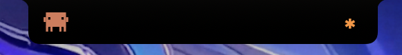
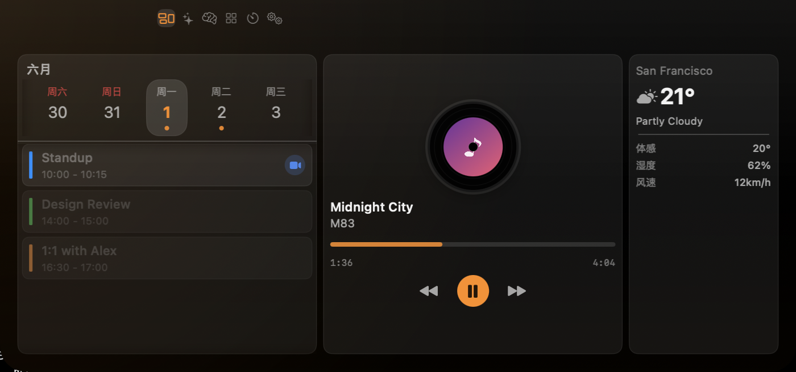
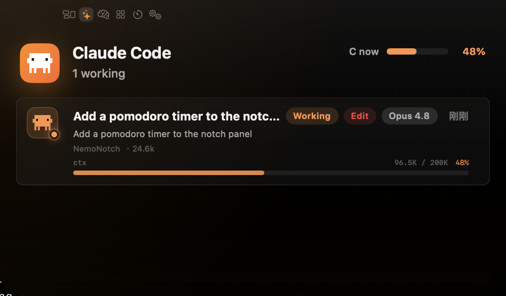
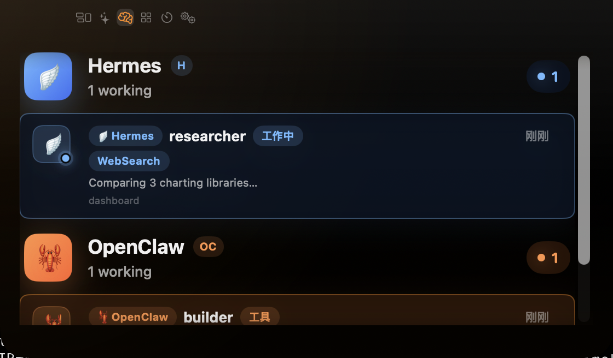
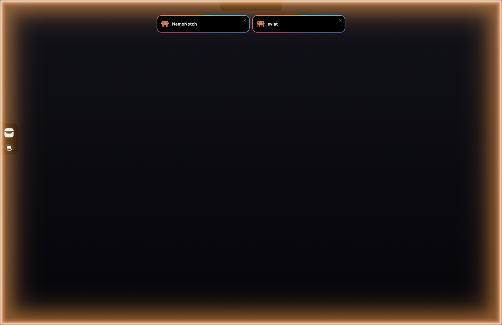

# NemoNotch

macOS 刘海区域的交互式浮动面板，将 MacBook 的 Notch 变成一块多功能信息中心。

<p align="center">
  
</p>

<p align="center"><em>实时展示 AI 会话与智能体状态。</em></p>

<p align="center">
  
</p>

<p align="center">
  
  
</p>

<p align="center">
  <a href="README.md">English</a>
</p>

## 功能

### 功能标签页

| 标签 | 功能 |
|------|------|
| **概览 (Overview)** | 一个标签页里三块速览信息 —— **媒体**：实时播放控制（播放/暂停/上下曲/拖动进度）、专辑封面、进度条 —— 通过 Perl 桥接系统媒体控制，支持任何上报 Now Playing 的播放器（Apple Music、Spotify、浏览器、Podcasts、网易云音乐……）；**日历**：15 天日期选择器、当日事件列表、日历颜色标识、可点击会议链接；**天气**：当前温度/体感温度、高低温、湿度风速、可滚动 7 日预报、昼夜天气图标（Open-Meteo 数据源，wttr.in 兜底） |
| **AI Chat** | 统一 Claude Code、Gemini CLI、opencode 与 zcode 监控 — 会话列表、子代理追踪、模型显示；对话详情、权限审批与 Context 用量进度条仅限 Claude Code 与 Gemini CLI。每个 CLI 在设置里有独立开关：关 = 卸载其 hook、停止发现轮询、静默清空会话 — 不弹卡、不显示徽章、彻底安静 |
| **智能体** | 多代理系统状态监控，支持 OpenClaw（WebSocket）和 Hermes-agent（HTTP API），实时代理工作状态追踪 |

### 核心特性

- **Notch 浮动面板** — 窗口悬浮在刘海区域，自动检测屏幕 Notch 尺寸
- **多 AI 提供商** — 统一界面支持 Claude Code、Gemini CLI、opencode 与 zcode，集成 Hook 事件监听和会话追踪；权限拦截仅限 Claude Code 与 Gemini CLI。opencode 通过 NemoNotch 编写的插件（`~/.config/opencode/plugin/nemonotch-notify.ts`）集成，将生命周期事件 POST 到 NemoNotch 的 Hook 服务器 —— 刘海 badge、完成闪光、Toast 与 AI 标签页状态卡片均自动生效。zcode（基于 GLM、与 Claude Code 兼容）直接复用 Claude 的 Hook 管线（无需插件）—— 仅提供通知与实时状态，不解析对话/Token，也不支持刘海内审批
- **AI 用量配额** —— 在 AI 标签页以卡片展示 Claude Code、Codex 与 Gemini 的用量配额（使用率 % + 重置倒计时），Claude 的用量读自 claude-hud 状态栏渲染器写的用量快照（`~/.claude/usage-snapshot.json`，仅在有 Claude 会话渲染 statusline 时刷新——不读取任何凭证）；Codex 与 Gemini 读各自 CLI 的 OAuth 凭证。检测到 Codex / Gemini CLI 已登录时自动显示对应段。zcode 用量来自 ZCode 官方使用的 BigModel 配额接口（5 小时 + 每周 token 窗口，使用率 % 与重置倒计时），凭据通过解密 CLI 本地凭据文件获得；不可用时回退为从 CLI 本地数据库（`~/.zcode/cli/db/db.sqlite`）统计的实际用量（今日 / 近 7 天）。
- **AI 状态悬浮胶囊** — 任意 AI 会话运行中或等待你操作时，屏幕右上角（默认）持续显示一个可拖动的悬浮胶囊，兼作 herdr 风格的状态灯：黄色脉冲 = 运行中，红色 = 等待权限选择，实心绿 = 等待输入，中空绿 = 全部完成（数秒后淡出）。胶囊**按状态分组**而不是只显示优先级最高的那一个：混合状态下每个非空状态各占一个点+计数（`●1 ●3 ●2`），胶囊宽度随之伸缩。点击展开为会话列表 + 详情面板（模型、Token、上下文进度、当前工具），底部新增用量/配额条，按供应商展示最短窗口的百分比进度 + 重置倒计时。详情页标题栏的按钮可一键跳回该会话所在的终端/IDE：hook 脚本上报 CLI 进程 pid，NemoNotch 在事件到达时沿进程树上溯到宿主 GUI 应用并缓存，pid 失效或被复用时回退为按 bundle id 激活。tmux/ssh 下或来自插件型 emitter（opencode）的会话没有宿主，不显示按钮。
- **锁屏 AI 面板** — Mac 锁屏时，锁屏时钟下方会浮现一块紧凑的深色卡片，列出仍在运行的 AI 会话（Claude Code / Gemini / opencode / zcode）：项目名、实时状态（运行中 / 整理上下文 / 等待批准）、已运行时长与上下文占比。等待批准的会话排在最前并高亮。纯展示、不拦截点击。可在设置中开关。
- **全局快捷键** — 切换面板开关：在设置 → 快捷键里自行配置（默认无）。切换标签页默认 `⌥⌘1`（总览）、`⌥⌘2`（AI）。所有快捷键均可自定义，基于 [KeyboardShortcuts](https://github.com/sindresorhus/KeyboardShortcuts)
- **自动切换** — 智能检测活跃服务（AI 工作中、音乐播放中）自动切到对应标签（AI 状态栏开启时，AI 运行中不再把刘海带到 AI 页）
- **AI 状态栏** — 每个运行中的 AI 会话一个圆环，可贴在屏幕左边或右边，也可以作为横向胶囊浮在任意位置：从边上拖出来就变成胶囊，拖到边上松手就吸附。悬停可查看所有会话的状态与上下文占比、用量额度（悬停某个 provider 可看各窗口的重置时间和消耗速度预测）和详情卡片（上下文用量与模型、审批、跳回会话所在终端）。会话开始等待审批的那一刻，状态栏会自己展开、直接弹出该会话的卡片——Allow/Deny 一步可达、零延迟，全部审批答完后自行收起（光标一进栏即交还给光标管理）。停在提示符等你输入的会话不会强开状态栏，只在栏已展开时顶出自己的卡片。多选问题（AskUserQuestion）直接在卡片上作答：单题单选点选项即答；多选/多题先勾选再点发送（草稿答齐才可发）。答案经权限应答的 `updatedInput.answers` 送回，仅限 Claude Code。可选的用量提醒（设置 → 提醒与动效，默认关）：某个 provider 的配额窗口用量超过阈值（50–100%，默认 80%）时，状态栏自动展开并弹出提醒卡，点「知道了」才消失；额度恢复后同样提醒。
- **活动光晕** — AI/Agent 忙碌时（运行中或等待审批），展开的刘海下半内边缘会泛起一层应用主题橘色的柔和模糊光晕，到中部渐隐消失（不遮挡正文）。AI 状态栏开启时，刘海把 AI 会话交给状态栏——所有屏幕的刘海都不再显示 AI 徽标和 AI 光晕（Agent 照常显示，AI 页仍列出全部会话）
- **通知 Toast** — 你选定的应用（默认邮件、Slack、微信）在通知中心的新消息，会以卡片出现在同一排 Toast 里，每个应用一张：单条显示发送人和正文，多条显示条数、发送人列表和最新一条。点击卡片打开该应用（未运行则启动）并关闭卡片；关掉、点过或到期的卡片里的消息不会再出现，即便它们还留在通知中心。NemoNotch 启动时通知中心里已有的旧消息不会补弹。系统没有读取其他应用通知的公开接口，NemoNotch 以只读方式读取通知中心的数据库，因此需要「完全磁盘访问权限」；绝不修改通知中心本身。默认关闭，在设置 → 通知中开启。
- **外部 Toast API** — 本机任意应用或脚本（任何语言，GUI 或命令行）都能用一个 HTTP POST（`POST /v1/toast`）在刘海下方同一排 Toast 里弹出卡片：应用名、标题、正文、SF Symbol 图标，以及可选的点击跳转 bundle id。带同一 `key` 的推送刷新同一张卡（计时重置）；不带 key 的推送各自成卡。NemoNotch 对你的数据零翻译——请求体就是完整卡面，缺字段即清空。凭共享本地令牌鉴权（见下方[外部 Toast API](#外部-toast-api)小节）。默认开启，设置 → 提醒与动效中可关；开关下方有一键复制的 agent 接入指南（端点发现+完整契约+验收清单，复制交给任意 agent 即可生成接入脚本）。
- **按接手原因分色的提醒** — 只有需要你接手的时刻才会在刘海下弹 Toast 卡 + 全屏边缘辉光，颜色告诉你接手干嘛：**绿色** = 一轮完成（回来看）、**琥珀色** = 有问题/方案等你决定（AskUserQuestion / 方案审批）、**蓝色** = 有权限等你点允许、**红色** = 出事了（agent 出错、额度/接口中断、会话中途死掉——不再伪装成"完成"卡）。卡片的旋转光环与全屏辉光说同一种颜色；琥珀/蓝卡挂到你回答为止（CLI 一解除阻塞即撤卡），迟到的"额度打满"红卡会顶掉刚弹的绿卡。排队规则照旧：每会话一卡、最多 4 张横排多出的等待递补、5 分钟到期（悬停暂停）、AI 卡标题是你这轮亲手打的提问、点击跳回会话所在应用。日历/通知/外部卡保留多彩光环。设置 → 提醒与动效里三个独立开关（完成 / 需要你决定 / 出事了）。
- **事件提醒** — 蓝牙音频设备（耳机/音箱）连接或断开时，收起的刘海会像灵动岛一样就地弹簧展开（耳机图标 + 设备名），停留片刻后收回；接入/断开电源同样触发刘海展开（充电中显示绿色闪电 + 精确电量百分比）；日历事件到点（提前量可选：到点 / 提前 5 / 10 / 15 分钟）触发全屏边缘闪光 + 带日历图标的 Toast，卡片显示时间和地点；事件带会议或其他链接时也一并显示，点击卡片即打开该链接。全天事件不提醒；各类提醒均可在设置中开关。

  <p align="center">
    
  </p>
- **合盖不休眠** — 菜单栏一键开关，合上盖子也不休眠（挂机跑构建、下载、长任务时用）。合盖休眠由内核处理、**无视 `caffeinate` 那一套防休眠接口**，唯一的口子是全局系统电源设置 `pmset -a disablesleep`，因此每次切换会弹一次管理员授权框。开启后合盖会自动熄屏（否则屏幕在盖子后面一直亮着持续耗电发热；接了外接显示器则不熄，那正是常见的合盖外接工作方式），并持有一个免 root 的 `PreventSystemSleep` 断言作第二道保险——在别的程序清掉 `SleepDisabled`（远程桌面/清理类软件常干）到我们发现之间的窗口期挡住空闲睡眠，但它挡不住合盖睡眠。因为这是**跨重启持久的全局设置**，NemoNotch 用落盘标记记住"这是自己开的"，退出时自动还原、异常退出后下次启动如实显示残留状态，且绝不动用户自己 `sudo pmset` 开启的那份。状态直读 IOPMrootDomain 注册表标志（不再起 `pmset -g` 子进程），因此 10 秒对账轮询 + `prefschange` 系统通知持续盯着外部改动——被其他程序改掉时 UI 自动纠正并记入事件日志。关闭防休眠（或退出还原）时若盖子已合着，会补一脚免 root 的 `pmset sleepnow`（以内核 `AppleClamshellCausesSleep` 判断为闸，接外接显示器的合盖工作状态绝不误睡），免得合盖的机器在包里持续发热。设置 → 防休眠可调整。合盖/开盖/开关切换/外部改动会记录到 `~/.NemoNotch/keep-awake.log`（独立于主日志，不轮转，可长期回溯）
- **崩溃自愈** — 进程级崩溃守卫：因致命信号（SIGSEGV / SIGBUS / SIGABRT 等）意外退出时，几秒内自动重启 NemoNotch，随后重发信号让系统照常生成标准崩溃报告（诊断信息不丢）。带循环保护：10 分钟窗口内最多自动重启 3 次（之后保持退出、等你手动打开，绝不无限打转），稳定运行 2 分钟后计数清零。每次决策记录在 `~/.NemoNotch/crash-restart.log`。强制退出（SIGKILL，不可捕获）永远不会触发重启。逃生开关：`defaults write com.nemo.BrightnessApp.NemoNotch crashGuardEnabled -bool false`
- **菜单栏入口** — 固定刘海图标（状态从刘海面板查看）；媒体播放时菜单显示正在播放控制区（上一曲 / 播放暂停 / 下一曲）
- **HUD 叠加层** — 音量、亮度、电池电量的分段条指示器
- **国际化** — 支持中文和英文，可在设置中切换
- **显式权限请求。** NemoNotch 启动时不会自动申请系统权限。每个需要权限的功能会在对应 Tab 中显示「授权」按钮(Overview 的日历、Weather 卡片的定位)— 点击触发系统弹窗。对于没有系统弹窗的权限（辅助功能等需要把 App 加进列表的隐私面板），按钮会打开系统设置的对应面板，并在旁边停一个小的悬浮引导窗：把引导窗里的 NemoNotch 图标拖进列表、打开开关，引导窗确认授权后自动收起（授权本身仍在系统设置里完成，没有绕过任何安全机制）。媒体控制完全不需要权限——走 Perl 桥实现。
- **ESC 关闭 Notch。** notch 打开时按 ESC 即可关闭。

## 外部 Toast API

本机任意应用——任何语言、GUI 或脚本——都能通过 HTTP 在刘海下方弹出 Toast 卡。这是 NemoNotch 插件化的第一步：wire schema 是公开的版本化契约。

- **端点**：`POST http://127.0.0.1:<port>/v1/toast`
- **鉴权**：`X-NemoNotch-Token` 请求头，内容为 `~/.NemoNotch/hook-token`（0600，首次启动生成）。令牌错误或缺失 → `401`，不弹卡。
- **端口发现**：读 `~/.NemoNotch/hook-port`——一行实际端口号（端口回落时自愈）。文件缺失 → 默认 `45831`。

请求体：

```json
{
  "schema": 1,
  "app": "MyDownloader",
  "key": "download-42",
  "title": "下载完成",
  "body": "nemo-1.2.3.dmg · 84 MB",
  "icon": "sf:arrow.down.circle",
  "jumpBundleId": "com.me.mydownloader",
  "jumpURL": "mydownloader://downloads/42",
  "tone": "done",
  "expiresAt": 1794470400
}
```

| 字段 | 类型 | 必填 | 说明 |
|---|---|---|---|
| `schema` | Int | ✓ | 契约版本，目前恒为 `1`；其他值 → `400` |
| `app` | String | ✓ | 应用显示名，1–48 字符 |
| `key` | String? | | 有 = keyed 持续卡（同 key 刷新同一张，重置计时）；无 = 一次性卡，每次推送各自成卡。1–128 字符；空串视为未提供。`app` 与 `key` 都禁含 `::` |
| `title` | String | ✓ | 1–120 字符（`action: "close"` 时不需要） |
| `body` | String? | | ≤ 280 字符 |
| `icon` | String? | | v1 仅 `sf:<SF Symbol 名>`；不存在的符号名回落通用卡片图标，不报错 |
| `jumpBundleId` | String? | | 点击卡片激活该应用；缺失 = 点击只关卡。≤ 255 字符 |
| `jumpURL` | String? | | 点击卡片打开该 URL（深链或网页）——优先于 `jumpBundleId`，URL 打不开时才回落到激活应用。必须是带 scheme 的绝对 URL，禁 `file:`；≤ 2048 字符；首尾空白会被剥掉，空串或纯空白视为未提供；其余原样透传（请自行百分号编码） |
| `tone` | String? | | 卡片边框颜色类别：`done`（绿，完成回来看）/ `decide`（琥珀，来做决定）/ `approve`（蓝，来点允许）/ `error`（红，来救火）；缺失 = 彩虹边框；其他值 → `400`。只改颜色，不改卡面文字 |
| `herdrTerminal` | String? | | [Herdr](#herdr-mod) 的 agent 地址（`t7`、`vps/t7`）：点卡片让 Herdr 聚焦到该 agent。优先于 `jumpURL`（并存时忽略 URL）；失败回落打开 Herdr。格式 `[机器名/]地址`，地址 1–32 位字母数字，不得以 `-` 开头，否则 → `400` |
| `action` | String? | | `show`（缺省）或 `close`。`close` 撤掉同 `app` + `key` 的卡（在屏上或排队中的都撤），**必须带 `key`**，不需要 `title`；卡不存在也返回 `200` |
| `expiresAt` | Number 或 String | | 卡片到期时刻：Unix 时间戳（秒，可带小数），到点消失，悬停不顺延；或 `"infinity"` = 永不自动消失，只能被 `close` / 点击 / × 撤下（**必须带 `key`**）。缺失 = 约 5 分钟。时间戳已过去或晚于 30 天后 → `400` |

契约规则：未知字段忽略（前向兼容）；keyed 重推是**完整卡面**——缺 `body` 即清空正文，无逐字段合并；卡片存活时长缺省与内部卡相同（约 5 分钟），需要别的时长用 `expiresAt`。响应：`200 {"status":"ok"}` / `400 {"status":"error","reason":…}` / `401`。

```bash
PORT=$(cat ~/.NemoNotch/hook-port)   # 文件缺失 → 45831
TOKEN=$(cat ~/.NemoNotch/hook-token)
curl -X POST "127.0.0.1:$PORT/v1/toast" \
  -H "X-NemoNotch-Token: $TOKEN" -H "Content-Type: application/json" \
  -d '{"schema":1,"app":"MyDownloader","key":"download-42","title":"下载完成","body":"84 MB","icon":"sf:arrow.down.circle"}'
```

### Herdr mod

在 Herdr 里跑 agent 时：agent 在你没看着的时候跑完，弹一张绿卡（约 5 分钟后消失）；卡住等你，弹一张蓝卡（一直挂到你处理）。点卡片，Herdr 聚焦到那个 agent；你在 Herdr 里看过或答完，卡片自动撤掉。Herdr 里唯一的变化是侧栏 Spaces 那一行多一个 `● NemoNotch`（圆点亮 = 连得上 NemoNotch）。

```bash
# 先打开 Herdr
sh scripts/install-herdr-mod.sh              # 安装 / 更新（可重复运行）
sh scripts/install-herdr-mod.sh --uninstall
```

mod 源码在 `integrations/herdr-mod/`，只用上面的外部 Toast API（`tone`、`herdrTerminal`、`action`、`expiresAt`）。如果在 Herdr 里同时装着 NemoNotch 自己的 Claude Code hook，每轮会收到两张卡——在设置 → AI 与 Agent 里关掉 Claude Code 开关即可（自动卸载 hook 并静默清空会话）。

## 技术栈

- **Swift 6** + **SwiftUI**，纯 macOS 原生应用
- **AppKit** — 自定义 NSWindow，点击穿透，多屏幕定位
- **MediaPlayer / MediaRemote** — 媒体播放控制
- **EventKit** — 日历事件读取
- **IOKit** — 电源状态（电池 / 充电检测）与睡眠断言
- **CocoaLumberjack** — 日志系统（`~/.NemoNotch/logs/`，保留 7 个文件、单文件上限 1MB —— 活跃使用时实际远不到一周，常常不足两天）
- **KeyboardShortcuts** — 用户可自定义全局快捷键（替代 Carbon `RegisterEventHotKey`）
- **WebSocket / Unix Socket** — AI CLI Hooks 和 OpenClaw 通信
- **HTTP API** — 通过 localhost:8787 监控 Hermes-agent

## 项目结构

```
NemoNotch/
├── NemoNotchApp.swift           # 入口，MenuBarExtra，全局快捷键
├── Models/                      # 数据模型（Tab, AppSettings, AIProvider, PlaybackState 等）
├── Notch/                       # 刘海 UI 核心（窗口、动画、事件监听、TabBar、HUD）
├── Tabs/                        # 各标签页内容视图（AIChatTab 统一 AI 会话）
├── Services/                    # 后台服务（媒体、日历、AI CLI 监控等）
├── Settings/                    # 偏好设置界面
└── Helpers/                     # 工具类（MarkdownRenderer, ClaudeCrabIcon, ToolStyles）
```

## 构建

1. 使用 Xcode 打开 `NemoNotch.xcodeproj`
2. 选择 `NemoNotch` target
3. Build & Run（需要 macOS 14+）

> **开发者环境：** 提交代码需要先装 lint 门禁工具 —— `brew install swiftlint swiftformat`，再执行 `sh .githooks/install.sh`（安装 worktree 工作流与 hooks；`git feat-done` 合并进 `develop` 前会先跑单元测试，合并后自动执行 `./build.sh` 构建并安装新版）。详见 `docs/git-worktree-workflow.md`。

> **注意：** 首次启动时如果 macOS 阻止打开应用，请执行以下命令移除隔离属性：
>
> ```bash
> sudo xattr -d com.apple.quarantine /Applications/NemoNotch.app
> ```

## 鸣谢

NemoNotch 的开发借鉴了以下优秀开源项目的设计与实现：

### 刘海窗口与交互

- [**NotchDrop**](https://github.com/Lakr233/NotchDrop) — Notch 窗口定位、多屏幕支持、点击穿透
- [**DynamicNotchKit**](https://github.com/MrKai77/DynamicNotchKit) — Spring 动画、自动收起、内容切换
- [**Peninsula**](https://github.com/celve/Peninsula) — 刘海区域多视图状态管理

### 媒体与播放控制

- [**mediaremote-adapter**](https://github.com/ejbills/mediaremote-adapter) — macOS 15.4+ 媒体控制的 Perl 桥（绕过私有 API 签名限制）

### 窗口管理与快捷键

- [**Loop**](https://github.com/MrKai77/Loop) — 全局快捷键注册、窗口操作引擎

### 显示器与系统监控

- [**MonitorControl**](https://github.com/MonitorControl/MonitorControl) — 通过 DisplayServices API 读取屏幕亮度

### 系统工具

- [**eul**](https://github.com/gao-sun/eul) — 菜单栏架构设计、Combine 响应式模式

### UI 组件

- [**Luminare**](https://github.com/MrKai77/Luminare) — SwiftUI 组件库与设计语言

### AI 与桌面集成

- [**Vibe Notch**](https://github.com/farouqaldori/vibe-notch) — Claude Code 刘海通知、会话监控、权限审批交互
- [**masko-code**](https://github.com/RousselPaul/masko-code) — Claude Code 状态监控与桌面覆盖层概念

### UI 与设计

- [**Notch Pilot**](https://notchpilot.app/) — 刘海面板布局、Tab 结构、控制台风格头部的视觉参考

## License

MIT
